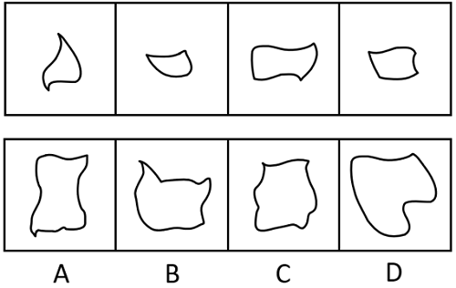
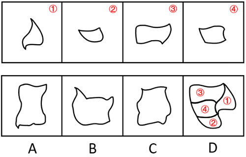

# 平面拼合-曲线图形消边拼合

考点：[[20-考点/判断推理/图形推理/平面拼合-曲线图形消边拼合|图形推理 / 平面拼合-曲线图形消边拼合]]

**问法模型**：四个小曲线图形只能平移拼合 → 用'等长同弯消边法'：将弯曲程度一致且等长的线条两两配对消去，剩余外轮廓对照选项

## 推理链
1. 第1步：题干四个图形均为纯曲线图形（弯叶形、小船形、波浪矩形、波浪梯形），拼合规则限定'只能上、下、左、右平移'，不能旋转或翻转
2. 第2步：确定方法——曲线类平面拼合中，两段能够互相拼合抵消的边，必须满足弯曲程度一致且等长，且因只能平移，两弧的凸凹方向须相对吻合
3. 第3步：逐一提取四个小图形的凸弧与凹弧，找出可两两配对的'等长同弯'线条，在脑中将这些公共边消去
4. 第4步：消去全部公共拼合边后，剩余未抵消的弧线按平移位置拼接，即为完整轮廓：上部一段长缓弧、右侧带外凸弧、下部为一大段外凸大弧
5. 第5步：逐项对照——A项轮廓上下收窄、B项轮廓宽扁带尖角、C项轮廓左侧内凹明显，其弧线的长度、弯曲度均与消边后应保留的轮廓弧线对不上
6. 第6步：D项的外轮廓弧线段与四个小图形消去公共边后剩余的各段弧线在弯曲程度、长度、凸凹方向上一一吻合，故为正确拼合结果

**最快解法**：⚡ 消边法（等长同弯消去）：先看四个小图形中最具辨识度的长弧（弯叶形的长外凸弧、波浪矩形的长波浪边），在选项中找能容纳这些特征弧且多出的凹凸处恰可由其余小图形等长同弯的边互相抵消的轮廓，D项吻合直接锁定

## 易错点
- ⚠ 忽略'只能平移、不能旋转/翻转'的限定，把方向不一致的弧线错误配对
- ⚠ 弯曲程度辨析缺位：凸弧与凹弧、大弧与小弧看似相近实则弧度不等，误消不该消的边
- ⚠ 只凭整体轮廓形状相似去'感觉'选项（如选A或C的近方形轮廓），不逐段核对弧线的长度与凸凹方向

## 母题抽象
> 🧩 当题干给出若干曲线小图形、要求'仅平移拼合'时，用'等长同弯消边法'：把弯曲程度一致且等长的边两两抵消，剩余轮廓与选项逐弧核对验证

**同类特征**：平面拼合、纯曲线图形、只能上下左右平移、消去等长同弯线条、剩余轮廓对照选项

## 相关题
- [[10-真题/判断推理/图形推理/16095271 图形推理-平面拼合（平行且等长相消）|16095271]]（江苏 2024，相关度2）
- [[10-真题/判断推理/图形推理/17900982 图形推理-平面拼合（平行且等长相消）|17900982]]（江苏 2024，相关度2）
- [[10-真题/判断推理/图形推理/2042722 平面拼合（方格面积守恒+仅平移拼合）|2042722]]（江苏 2017，相关度2）
- [[10-真题/判断推理/图形推理/2043624 图形推理-平面拼合（平移拼合·平行等长边对接）|2043624]]（江苏 2017，相关度2）
- [[10-真题/判断推理/图形推理/2367808 图形推理-平面拼合（平移拼合·平行且等长相消）|2367808]]（江苏 2019，相关度2）

---

### 题干

选项四个图形中，只有一个是由题干的四个图形拼合（只能通过上、下、左、右平移）而成的，请把它找出来。

### 选项
- A. A
- B. B
- C. C
- D. D　✅

### 官方解析

本题考查平面拼合。曲线类图形，消去弯曲程度一致且等长的线条后进行拼合可得到轮廓图，即为D项，拼合方式如下图所示。

故正确答案为D。

### 给定材料
（无）
