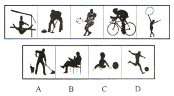

# 图形规律-内容属性归纳（人物剪影的生活语义归类：运动场景）

考点：[[20-考点/判断推理/图形推理/图形规律-内容属性归纳（人物剪影的生活语义归类：运动场景）|图形推理 / 图形规律-内容属性归纳（人物剪影的生活语义归类：运动场景）]]

**问法模型**：五个图找共同规律、选第六个图 → 几何特征无规律时，改从图形内容属性（人物在做什么）归纳共同点，再找唯一同属性选项

## 推理链
1. 第1步：逐图观察第一组五个剪影：图1单杠（体操）、图2俯身持长柄器械（冰壶刷冰等冰雪运动）、图3持球跑动（篮球类）、图4骑行（自行车运动）、图5持拍挥臂（网球/羽毛球类）
2. 第2步：线条、封闭区域、黑白分布等几何特征无明显数量规律，改按图形内容归纳：五图共同点是'人均在进行体育运动'
3. 第3步：逐项对照选项——A项拖地为家务劳动，B项坐在椅子上为静态行为，C项小孩玩球属玩耍而非运动项目，均不属于'体育运动'
4. 第4步：D项踢足球是典型运动项目，与五个图的共同属性一致，唯一符合规律，当选

**最快解法**：⚡ 属性归纳法：一眼确认五个图都是'人在做运动'的剪影，直接到选项中找唯一属于运动项目的D（踢足球），无需纠缠几何规律

## 易错点
- ⚠ 硬套几何规律（数线条、数封闭区、看对称），忽略剪影图应从'内容语义'找规律
- ⚠ A项拖地与图2刷冰动作形态相似而误选A（家务≠运动）
- ⚠ 误把C项'小孩玩球'当成运动（玩球属玩耍，非运动项目），或忽略B项坐姿明显静态

## 母题抽象
> 🧩 当题干是人物剪影/场景类图形且几何特征无规律时，改用'内容属性归纳法'：提炼五图人物行为的共同属性，在选项中找唯一同属性项

**同类特征**：人物剪影图形、五个图呈规律性、动作场景各不相同、几何数量规律不明显、均为体育运动场景、选项按生活常识属性归类

## 相关题
- [[10-真题/判断推理/图形推理/1789584 图形推理-实际意义（最大共同点：球类运动+黑色小球元素）|1789584]]（江苏 2016，相关度1）

---

### 题干

每道题在上边的题干中给出一套图形，其中有五个图，这五个图呈现一定的规律性。在下边给出一套图形，其中有四个图，从中选出唯一的一项作为保持上边五个图规律性的第六个图：

### 选项
- A. A
- B. B
- C. C
- D. D　✅

### 官方解析
观察发现图形中的人都在进行不同的运动，A项拖地、B项在椅子上坐着、C项小孩玩球，都不是运动，排除；只有D项踢足球是运动项目，当选。
故正确答案为D。

### 给定材料
（无）
