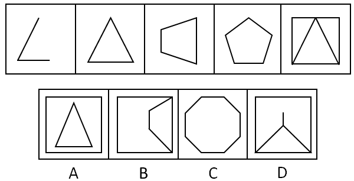

# 数量规律-线数量（直线数等差递增）+笔画数（一笔画二级筛选）

考点：[[20-考点/判断推理/图形推理/数量规律-线数量（直线数等差递增）+笔画数（一笔画二级筛选）|图形推理 / 数量规律-线数量（直线数等差递增）+笔画数（一笔画二级筛选）]]

**问法模型**：五个图呈现规律性，选第六个图 → 元素组成不同且无属性规律时，先数数量（直线数）定规律，数量无法唯一确定时再用一笔画做二级筛选

## 推理链
1. 第1步：观察题干五图，图1为两段相接折线（2条直线），图2三角形（3条），图3四边形（4条），图4五边形（5条），均为纯直线图形
2. 第2步：图5为外框四边形与内嵌三角形（三角形底边与外框共用一条线），共6条直线，故直线数呈2-3-4-5-6的等差递增规律，问号处应为7条直线
3. 第3步：数选项直线数——A项外框4条+内部三角形3条=7条，B项带缺口单一闭合轮廓共7条边，D项外框4条+内部3条线=7条；C项为八边形=8条，排除C
4. 第4步：发现题干五图全部可一笔画（连通且奇点数为0或2），将一笔画作为二级验证标准
5. 第5步：A项为外框与内部三角形两个分离部分，需两笔画；D项内部线条与外框构成两笔画结构，均排除
6. 第6步：B项为单一连续闭合轮廓，无奇点，可一笔画，且直线数为7，同时满足两个规律，故选B

**最快解法**：⚡ 数量递增法+一笔画排除法：先数直线数得2-3-4-5-6→?为7（快速排除C的8条），再对A、B、D三个7条直线的选项用奇点法验一笔画，A、D为两笔画排除，唯一一笔画的B即为答案

## 易错点
- ⚠ 数图5直线数时忽略三角形底边与外框共用一条线，误算成7条而认为规律是2-3-4-5-7
- ⚠ 数出A、B、D都是7条直线后未做一笔画二级验证，无从排除而乱选
- ⚠ 误把C项八边形当成'边数递增'的正确延续项（8条），未核对题干等差应为+1取7
- ⚠ 把B项带缺口的图形误看成'正方形加线'的两笔画结构，实际它是单一闭合七边形轮廓，一笔画即可完成

## 母题抽象
> 🧩 当题干图形元素组成不同、无对称性等属性规律，且图形均为直线构成时，先数直线（或交点、面）找等差数量规律；若多个选项满足数量，则升级用一笔画（连通+奇点数0或2）做二级筛选

**同类特征**：元素组成不同、无属性规律提示数数量、全部为直线图形、直线数2-3-4-5-6等差递增、题干均为一笔画图形、存在共用边需按实际线条数计数

## 相关题
- [[10-真题/判断推理/图形推理/10204454 数量规律-部分数（黑白球连通区域数做和）|10204454]]（甘肃 2024，相关度1）
- [[10-真题/判断推理/图形推理/10204604 数量规律-线数量（汉字横线数）|10204604]]（辽宁 2024，相关度1）
- [[10-真题/判断推理/图形推理/10297050 数量规律-特殊计数（线条穿过小白球的数量）|10297050]]（天津 2025，相关度1）
- [[10-真题/判断推理/图形推理/10297127 图形间关系-相交图形中不相交边数量（黑白图形相交）|10297127]]（天津 2025，相关度1）
- [[10-真题/判断推理/图形推理/10297148 数量规律-线的细化（端点连线穿过线条数；备选：平行线组数）|10297148]]（天津 2025，相关度1）

---

### 题干

每道题在上边的题干中给出一套图形，其中有五个图，这五个图呈现一定的规律性。在下边给出一套图形，其中有四个图，从中选出唯一的一项作为保持上边五个图规律性的第六个图。

### 选项
- A. A
- B. B　✅
- C. C
- D. D

### 官方解析
元素组成不同，无属性规律，考虑数数。观察发现题干都是直线图形，考虑数直线，题干图形的直线数量为2-3-4-5-6-？，？号处应为7条直线的图形，A、B、D项都为7条直线，C项为8条直线，排除C。
再次观察图形发现，题干图形均为一笔画图形，A、D项均为两笔画图形，B项为一笔画图形，排除A、D项。
故正确答案为B。

### 给定材料
（无）
