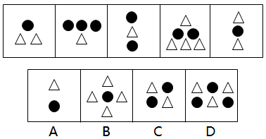

# 样式规律-元素排布特征（每行元素同种，不混排）

考点：[[20-考点/判断推理/图形推理/样式规律-元素排布特征（每行元素同种，不混排）|图形推理 / 样式规律-元素排布特征（每行元素同种，不混排）]]

**问法模型**：选出保持前五图规律性的第六图 → 元素组成相似时先查样式/数量，均无规律再观察元素的行列排布特征

## 推理链
1. 第1步：五图均由黑圆●与白三角△两种小元素组成，元素组成相似但无统一样式（图1'●/△△'、图2'●●●/△'、图3竖排'●/△/●'、图4'△/●●/△△△'、图5竖排'△/●/△'）
2. 第2步：数数验证——黑圆个数为1、3、2、2、1，三角个数为2、1、1、4、2，无递变或循环规律，按比例换算也不成立，排除数量规律
3. 第3步：转向观察排布位置——五图共同点为'每一横行只含一种元素'：图1上行纯●下行纯△，图2上行纯●●●下行纯△，图3、图5竖排每行仅一个元素自然同种，图4三行依次纯△、纯●●、纯△△△
4. 第4步：逐项对照——A项'上行△/下行●'每行单一种类，符合；B项第二行'△●△'两种元素混排，违反规律
5. 第5步：C项两行均为'△●''●△'混排、D项两行'△●△''●△●'混排，均违反'每行同种'规律，排除B、C、D，锁定A

**最快解法**：⚡ 排除法+排布口诀'行内不混种'：扫一眼四个选项，B、C、D均存在同一行内●与△混排的画面，唯A每行只含一种元素，直接选A

## 易错点
- ⚠ 死磕数量规律：反复数●和△的个数、尝试元素等价换算，因个数1/3/2/2/1与2/1/1/4/2均无规律而卡壳
- ⚠ 把规律误判为'黑白上下交替'或'轴对称'，忽略图1、图2、图4等横排图与图3、图5竖排图真正的共性在'行内元素纯净'
- ⚠ 误选B：被'△-●-△'竖向交替的对称外观吸引，忽视其中间行已混排两种元素

## 母题抽象
> 🧩 当题干图形由两种小元素混排组成且个数、换算均无规律时，转向'排布纯净度'规律——验证每行（或每列）是否只含一种元素，混排的选项排除

**同类特征**：两种小元素（黑圆+白三角）、元素个数不成规律、元素呈行/列排布、每行仅一种元素、横排与竖排结构并存、元素组成相似

## 相关题
- [[10-真题/判断推理/图形推理/10204610 样式规律-加减同异（去同存异），九宫格列规律|10204610]]（辽宁 2024，相关度1）
- [[10-真题/判断推理/图形推理/10297349 样式规律-黑白运算|10297349]]（浙江 2025，相关度1）
- [[10-真题/判断推理/图形推理/10297407 样式规律-黑白运算（定义叠加）|10297407]]（四川 2025，相关度1）
- [[10-真题/判断推理/图形推理/11226895 图形推理-样式规律（叠加求同-保留相同部分）|11226895]]（上海 2025，相关度1）
- [[10-真题/判断推理/图形推理/11226896 样式规律-加减同异（分区域：上圆内部求异+下椭圆内部求同）|11226896]]（上海 2025，相关度1）

---

### 题干

每道题在上边的题干中给出一套图形，其中有五个图，这五个图呈现一定的规律性。在下边给出一套图形，其中有四个图，从中选出唯一的一项作为保持上边五个图规律性的第六个图： 

### 选项
- A. A　✅
- B. B
- C. C
- D. D

### 官方解析
题干元素组成相似，但无明显的样式规律。考虑数数，发现元素换算以及单个元素数目均不呈现规律。观察发现，每幅图形中的元素排布特点均为每一行的元素都是同一种。只有A选项满足此规律。
故正确答案为A。

### 给定材料
（无）
