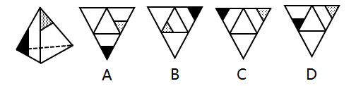
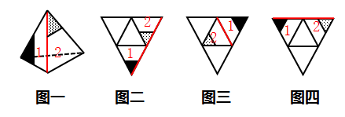

# 空间重构-四面体折叠（相邻面公共边法）

考点：[[20-考点/判断推理/图形推理/空间重构-四面体折叠（相邻面公共边法）|图形推理 / 空间重构-四面体折叠（相邻面公共边法）]]

**问法模型**：给出立体图与四个三角形展开网，问哪一个折叠后能与之重合 → 采用公共边特征法：锁定两个带图案面折叠后相邻的公共棱，核对图案'贴边/不贴边'关系逐一排除

## 推理链
1. 第1步：从立体图提取信息——黑色小三角形所在面（1面）与灰色（点状）小三角形所在面（2面）为相邻面，两面的公共边即标红的棱
2. 第2步：确立规律——折叠前后相邻两面图案与公共边的相对位置不变；题干特征为：2面灰色三角形有一条边贴着公共边，1面黑色三角形没有任何边贴着公共边
3. 第3步：A项——公共边上灰色、黑色三角形都有边贴着，'灰贴+黑贴'与题干'黑不贴'矛盾，排除
4. 第4步：B项——公共边上灰色、黑色三角形都没边贴着，'灰不贴'与题干'灰贴边'矛盾，排除
5. 第5步：C项——公共边上又是灰色、黑色都有边贴着，与A同类错误，排除
6. 第6步：D项——公共边上仅灰色三角形贴边、黑色三角形不贴边，'灰贴+黑不贴'与立体图完全一致，当选

**最快解法**：⚡ 公共边法（画边排除）：在展开图中找到黑色三角形面与灰色三角形面相邻的公共棱，口诀'一贴一不贴'——题干是灰贴边、黑不贴，逐项排查：A/C两项两图案均贴边、B项两图案均不贴，只有D满足一贴一不贴，直接锁定D

## 易错点
- ⚠ 四面体四个面两两相邻，找错两条图案面真正的公共棱（标错红线位置），导致贴边关系判断全错
- ⚠ 只看'面上有没有黑/灰图案'而忽略图案与公共边的相对位置，误把A、C当成正确项
- ⚠ 忽视折叠后面的旋转：小三角形顶点朝向随折叠改变，需以公共边为基准核对贴边关系而非死记位置

## 母题抽象
> 🧩 当四面体（大三角四分展开图）折叠题中出现'小图案相对位置'特征时，用公共边法：先在立体图确定两图案面公共棱上图案的贴边情况，再到展开图中逐项核对同一公共棱，不符即排除

**同类特征**：四面体折叠、空间重构、大三角分成四个小三角的展开图、黑色与灰色小三角形图案、相邻面公共边、贴边特征逐一排除

## 相关题
- [[10-真题/判断推理/图形推理/1791644 图形推理-空间重构（四面体折叠-公共边特征线）|1791644]]（江苏 2016，相关度2）
- [[10-真题/判断推理/图形推理/11367779 空间重构-六面体折叠（相对面排除＋公共边特征验证）|11367779]]（江苏 2025，相关度1）
- [[10-真题/判断推理/图形推理/16069767 空间重构-组合体表面展开图（公共边法·黑白颜色匹配）|16069767]]（河南 2026，相关度1）
- [[10-真题/判断推理/图形推理/16095261 空间重构-六面体折叠（特征面字母朝向定位）|16095261]]（江苏 2024，相关度1）
- [[10-真题/判断推理/图形推理/16593173 空间重构-展开图折叠（相邻面公共边特征）|16593173]]（海南 2024，相关度1）

---

### 题干

左边这个图形是由右边四个图形中的某一个作为外表面折叠而成，请指出它是哪一个？

### 选项
- A. A
- B. B
- C. C
- D. D　✅

### 官方解析

本题属于空间重构类，逐一分析选项，将题干如图一标号。

由题干图形可知，1面和2面为相邻面，标红的线即为两个面的公共边，可以观察到，2面上的灰色三角形有条边挨着这条标红的公共边，而1面上的黑色三角形没有边与标红的公共边挨着。

A项：如图二所示，选项中，1面和2面的公共边即为标红的线条，可以发现在公共边上灰色三角形和黑色三角形都有边与公共边挨着，和题干已知图形不一致，排除；

B项：如图三所示，选项中，1面和2面的公共边即为标红的线条，可以发现在公共边上灰色三角形和黑色三角形都没有边与公共边挨着，和题干已知图形不一致，排除；

C项：如图四所示，C选项中，1面和2面的公共边即为标红的线条，可以发现在公共边上灰色三角形和黑色三角形都有边与公共边挨着，和题干已知图形不一致，排除。

故正确答案为D。

### 给定材料
（无）
