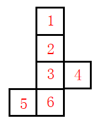

# 空间重构-六面体折叠（公共点法+相对面排除）

考点：[[20-考点/判断推理/图形推理/空间重构-六面体折叠（公共点法+相对面排除）|图形推理 / 空间重构-六面体折叠（公共点法+相对面排除）]]

**问法模型**：给出折叠成型的立体图，问由四个展开图中的哪一个折叠而成 → 采用'公共点法'比对三面公共顶点处的线条与图案特征，辅以相对面排除

## 推理链
1. 第1步：提取立体图三个相邻面特征——顶面为带平行斜线的条纹面、正面为含灰色小方块（点状面）的面、右侧面为含黑色三角形的面，三面共用一个公共顶点
2. 第2步：放大立体图公共点细节——该公共点同时连接条纹面与三角面的两条对角线（对角线交点处），且落在灰色三角形图案的锐角一侧
3. 第3步：先用相对面规律排除D项——D中面4与面5呈'Z字'两端，为相对面不能同时出现，而立体图中对应两图案面同时可见
4. 第4步：验证A项公共点——其三面公共点仅连接面4的一条对角线，与立体图'连接面3、面4两条对角线'不符，排除
5. 第5步：验证B项公共点——其公共点落在灰色三角形直角处，与立体图'锐角处'不符，排除
6. 第6步：验证C项公共点——其公共点恰为面3与面4的对角线交点，与立体图公共点特征完全一致，且无相对面冲突，确定当选

**最快解法**：⚡ 公共点法+相对面排除：先用'Z字两端为相对面'秒杀D项，再逐一比对剩余选项三面公共点引出的对角线数量（一条还是两条相交）及灰三角形直角/锐角部位，唯一与立体图吻合者为C

## 易错点
- ⚠ 忽略'Z字型两端为相对面'规律，误以为D项可行
- ⚠ 只看公共点连不连对角线、不数对角线条数，A项仅一条对角线的细节被漏看
- ⚠ 灰色三角形直角与锐角部位混淆，B项与立体图的部位差异被忽略

## 母题抽象
> 🧩 当立体图三个相邻面上带有对角线、三角形等细节图案时，用公共点法：锁定三面公共顶点，比对公共点引出的对角线数量及所落图案部位（直角/锐角/交点），并先用Z字两端相对面排除明显错误项

**同类特征**：六面体展开图、三相邻面公共点、对角线交点、灰色三角形直角/锐角、Z字型相对面、逐项排除验证

## 相关题
- [[10-真题/判断推理/图形推理/1791826 空间重构-六面体折叠（公共点法+相对面排除）|1791826]]（江苏 2016，相关度2）
- [[10-真题/资料分析/综合/16593087 信息交叉比对（两份榜单求交集）|16593087]]（新疆 2024，相关度1）
- [[10-真题/资料分析/综合/2578893 综合判断题（人均产值比较＋工资增长率与产值增长率比较）|2578893]]（湖南 2020，相关度1）
- [[10-真题/判断推理/定义判断/1789612 单定义-选非题（要件对照排除）|1789612]]（江苏 2016，相关度1）
- [[10-真题/判断推理/图形推理/19181439 空间重构-六面体折叠（相邻面公共边-公共点特征验证）|19181439]]（吉林 2024，相关度1）

---

### 题干

左边这个图形是由右边四个图形中的某一个作为外表面折叠而成，请指出它是哪一个？

### 选项
- A. A
- B. B
- C. C　✅
- D. D

### 官方解析

对选项的面进行标号，如下图所示。

A项：选项中面2、3、4为左边所展示的面，选项中三个面的公共点仅连接了面4的对角线，但在原图中连接了面3和面4的两条对角线，排除；

B项：选项中面3、4、6为左边所展示的面，选项中三个面的公共点为面3灰色三角形的直角处，但在原图中三个面的公共点为灰色三角形的锐角处，排除；

C项：选项中面2、3、4为左边所展示的面，选项中三个面的公共点为面3和面4的对角线交点处，原图中三个面的公共点也是面3和面4的对角线交点处，公共点相同，排除不了，先保留；

D项：选项中面3、4、5为左边所展示的面，选项中面4和面5是z字型两端，为相对面，不可能同时出现，排除。

故正确答案为C。

### 给定材料
（无）
