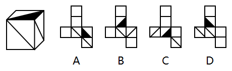

# 空间重构-折纸盒-相邻面公共点法（公共点发散对角线验证）

考点：[[20-考点/判断推理/图形推理/空间重构-折纸盒-相邻面公共点法（公共点发散对角线验证）|图形推理 / 空间重构-折纸盒-相邻面公共点法（公共点发散对角线验证）]]

**问法模型**：立体图由展开图中某一个折叠而成 → 锁定立体图可见的三个相邻特征面，用公共点法逐一验证排除

## 推理链
1. 第1步：观察左图立方体，可见三个特征面：顶面为被对角线分割、其中一半涂黑的三角形面，正面与右面均为带单条对角线的面
2. 第2步：对四个展开图各面标号，找出与左图对应的三个相邻面（含黑三角面与对角线面），以三面公共顶点为判定基准
3. 第3步：A项中面4、5、6对应左图三面，其公共点发散出两条对角线，而原图公共点处仅发散一条对角线，矛盾，排除
4. 第4步：B项中面2、4、5对应左图三面，其公共点未发散任何对角线，而原图公共点发散一条对角线，矛盾，排除
5. 第5步：C项中面3、4、6对应左图三面，其公共点落在面4直角三角形左下锐角处，而原图中三面公共点位于直角三角形的直角处，位置不符，排除
6. 第6步：D项三个相邻面的公共点位置、直角/锐角属性及对角线发散情况均与原图一致，当选

**最快解法**：⚡ 公共点排除法：先定位黑三角面，再看与它相邻的两个对角线面，检查三面公共顶点处『发散几条对角线、公共点落在直角还是锐角』，与原图不符即排除

## 易错点
- ⚠ 只核对面的图案形状，忽略对角线是否从公共点发散（数量差异）
- ⚠ 黑三角所在直角三角形面与相邻面的公共点在直角处还是锐角处分不清
- ⚠ 展开图中相邻面位置转换后未还原空间方位，误判相邻关系

## 母题抽象
> 🧩 当折纸盒题干多个面含对角线或三角形图案时，用公共点法：锁定立体图中三个相邻特征面，验证其公共顶点处对角线发散数量与三角形顶点类型（直角/锐角）是否与原图一致

**同类特征**：立方体外表面折叠、展开图含对角线面、展开图含黑色三角形面、三个相邻面公共顶点、公共点发散对角线数量、逐项排除选答案

## 相关题
（暂无）

---

### 题干

左边这个图形是由右边四个图形中的某一个作为外表面折叠而成，请指出它是哪一个？

### 选项
- A. A
- B. B
- C. C
- D. D　✅

### 官方解析

对选项的面进行标号，如下图所示。

A项：选项中面4、5、6为左边所展示的面，选项中三个面的公共点发散出两条对角线，但在原图中仅发散出一条对角线，排除；

B项：选项中面2、4、5为左边所展示的面，选项中三个面的公共点没有发散出对角线，但在原图中发散出一条对角线，排除；

C项：选项中面3、4、6为左边所展示的面，选项中三个面的公共点为面4直角三角形左下的锐角处，而在原图中三个面的公共点为直角三角形的直角处，排除。

故正确答案为D。

### 给定材料
（无）
