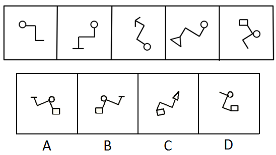

# 数量规律-直线数等差递增（3、4、5、6、7→8）+ 折线形状特征排除

考点：[[20-考点/判断推理/图形推理/数量规律-直线数等差递增（3、4、5、6、7→8）+ 折线形状特征排除|图形推理 / 数量规律-直线数等差递增（3、4、5、6、7→8）+ 折线形状特征排除]]

**问法模型**：“五个图呈现规律，选第六个图保持规律” → 先归纳全组共性（必含圆、折线结构），再数直线数找等差递增规律，最后用排除法逐项验证细节特征

## 推理链
1. 第1步：观察五幅图的共性——每幅图都由一条折线和端点处的封闭小图形（圆、三角形、正方形）构成，且每幅图都有一个圆
2. 第2步：数每幅图的直线段数量：图1为3条、图2为4条、图3为5条、图4为6条（三角形3边+3段折线）、图5为7条（正方形4边+3段折线），呈现3、4、5、6、7的等差递增规律，第六图应为8条直线
3. 第3步：观察折线形状特征——每幅图中由三条直角折线组成的路径，均可以通过旋转拼成一个“Z”字形
4. 第4步：逐项排除：C项端点是箭头没有圆，与“每图必有一圆”矛盾，排除
5. 第5步：D项直线数不是8条，与数量规律矛盾，排除
6. 第6步：A项的折线带T形端头，三条直角折线无法旋转成“Z”字形，排除；B项有圆、直线数为8条（正方形4边+4段折线）、折线可旋转成“Z”字形，全部符合，选B

**最快解法**：⚡ 排除法：第一步数直线数得3、4、5、6、7→锁定8条，排除D；第二步用“每图必有一个圆”排除C；第三步用“三条直角折线可旋转成Z字形”排除A，快速锁定B

## 易错点
- ⚠ 数直线时只数折线段、漏数端点封闭图形（三角形3边、正方形4边）的边数，导致数量规律看错
- ⚠ 忽略“折线可旋转成Z字形”这一形状特征，导致A、B两个高相似选项无法区分
- ⚠ 把C项的箭头误当作可用图形，忽略“每幅图都必须有一个圆”这一基础共性

## 母题抽象
> 🧩 当一组图形整体结构相似（折线+端点小元素）且无明显交点/面规律时，优先数直线段数量是否等差递增，再用全组共有元素（如必含圆）和局部形状特征（如折线可拼成特定字形）做二级排除

**同类特征**：每幅图均含一个圆、直线数3、4、5、6、7等差递增、三条直角折线可旋转成Z字形、折线端点附封闭小图形（圆/三角形/正方形）、数量类-线计数、排除法逐项验证

## 相关题
- [[10-真题/判断推理/定义判断/1758890 单定义-目的要件核对（选非题）|1758890]]（上海 2016，相关度1）
- [[10-真题/判断推理/类比推理/2187426 语义关系-因果对应（含顺序与必然性二级辨析）|2187426]]（选调 2018，相关度1）
- [[10-真题/判断推理/类比推理/2188617 三词类比-种属关系+语法关系（动宾结构）|2188617]]（四川 2018，相关度1）
- [[10-真题/判断推理/图形推理/2133614 数量规律-交点（按圆内外分区数交点）|2133614]]（国考 2018，相关度1）

---

### 题干

每道题在上边的题干中给出一套图形，其中有五个图，这五个图呈现一定的规律性。在下边给出一套图形，其中有四个图，从中选出唯一的一项作为保持上边五个图规律性的第六个图。

### 选项
- A. A
- B. B　✅
- C. C
- D. D

### 官方解析
观察发现，题干中每幅图形都有一个圆，排除C项；再次观察发现，题干图形中的直线数分别为3、4、5、6、7，那么下一幅图应该为8条直线，排除D项；题干中三条直角折线均可以通过旋转形成一个“Z”字形，排除A项。
故正确答案为B。

### 给定材料
（无）
