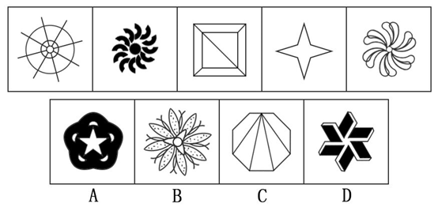

# 属性规律-对称性（中心对称）

考点：[[20-考点/判断推理/图形推理/属性规律-对称性（中心对称）|图形推理 / 属性规律-对称性（中心对称）]]

**问法模型**：两组图形选第六图保持规律 → 元素组成不相同不相似时优先考虑属性规律，归纳题干五图共性并逐项验证选项

## 推理链
1. 第1步：题干五图（米字轮辐同心圆、旋叶风车、嵌套正方形加对角线、四角星、花瓣旋涡）元素组成不相同不相似，排除位置、数量规律，优先考虑属性规律
2. 第2步：逐一检验对称属性——图一既是轴对称又是中心对称，图二仅中心对称，图三既轴对称又中心对称，图四既轴对称又中心对称，图五仅中心对称
3. 第3步：归纳共同规律——五个图形全部是中心对称图形（旋转180°后与原图重合），轴对称并非五图共有属性
4. 第4步：对照选项——A项为黑白花朵嵌五角星，仅是轴对称图形，旋转180°不与自身重合，排除
5. 第5步：C项为八边形自顶点引线，仅是轴对称图形，排除；B项内部三角形不是中心对称图形，且外侧黑点分布不规则，整体不满足中心对称，排除
6. 第6步：D项六向立体风车旋转180°后与原图完全重合，是中心对称图形，符合题干规律，当选

**最快解法**：⚡ 旋转180°检验法——将图形绕中心旋转180°看能否与自身重合；题干五图均能重合（共性为中心对称），A、C仅轴对称不重合，B内部三角形不重合，只有D重合，直接锁定D

## 易错点
- ⚠ 混淆轴对称与中心对称，误把A、C这类仅轴对称的规整图形当作正确答案
- ⚠ B项花朵外轮廓看似规则对称，忽略内部三角形不是中心对称及外侧黑点分布不规则的细节陷阱
- ⚠ 图二、图五仅中心对称而非轴对称，若错误归纳为'既是轴对称又是中心对称'将导致规律不成立而无解

## 母题抽象
> 🧩 当题干多个图形元素组成不相同不相似、且出现旋涡状/星形/嵌套多边形等对称样态时，优先检验对称属性，用'旋转180°能否与自身重合'验证中心对称规律并逐项排除

**同类特征**：元素组成不相同不相似、属性规律优先、旋涡状/风车状图形、四角星与嵌套方形、中心对称、旋转180°重合

## 相关题
- [[10-真题/判断推理/图形推理/11367775 属性规律-对称性（对称轴数量等差递减）|11367775]]（江苏 2025，相关度1）
- [[10-真题/判断推理/图形推理/18899567 属性规律-中心对称（四格拼合整体对称）|18899567]]（上海 2021，相关度1）
- [[10-真题/判断推理/图形推理/19452426 属性规律-对称性（仅中心对称与轴+中心对称的区分）|19452426]]（上海 2026，相关度1）
- [[10-真题/判断推理/图形推理/2037766 属性规律-对称性（中心对称判定）|2037766]]（浙江 2016，相关度1）
- [[10-真题/判断推理/图形推理/2137206 属性规律-轴对称（对称轴数量递增）|2137206]]（上海 2018，相关度1）

---

### 题干

在上边的题干中给出一套图形，其中有五个图，这五个图呈现一定的规律性。在下边给出一套图形，其中有四个图，从中选出唯一的一项作为保持上边五个图规律性的第六个图。

### 选项
- A. A
- B. B
- C. C
- D. D　✅

### 官方解析
元素组成不相同不相似，优先考虑属性规律。观察发现，图一既是轴对称图形又是中心对称图形，图二中心对称图形，图三既是轴对称图形又是中心对称图形，图四既是轴对称图形又是中心对称图形，图五中心对称图形，发现题干所有图形都是中心对称图形。A、C两项均是轴对称图形，排除；B项中内部的三角形不是中心对称图形，且外侧黑点位置也分布不规则，排除；只有D项符合，当选。
故正确答案为D。

### 给定材料
（无）
