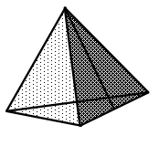
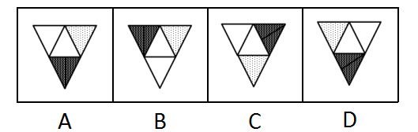
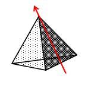
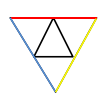
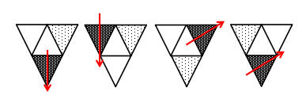

# 空间重构-四面体展开图折叠（箭头法-公共边方位判定）

考点：[[20-考点/判断推理/图形推理/空间重构-四面体展开图折叠（箭头法-公共边方位判定）|图形推理 / 空间重构-四面体展开图折叠（箭头法/公共边方位判定）]]

**问法模型**：题干立体图由四个展开图之一折叠而成 → 四面体空间重构题，用箭头法固定一个面的方向，判定相邻面的左/右/下方位后逐项排除

## 推理链
1. 第1步：题干立体图为四面体，四个面图案相同（点状阴影面），仅深色面具有方向性，可作为'箭头面'，其余为'非箭头（点状）面'
2. 第2步：采用四面体专用箭头法——在深色面上画箭头，以箭头指向为参照，展开图需整体按同一方式定向后比较相邻面方位
3. 第3步：由题干立体图读出关键方位关系：非箭头（点状）面位于箭头（深色）面的左侧
4. 第4步：对照A项：定向后点状面恰在深色面左侧，与题干相对关系一致
5. 第5步：对照B项：定向后点状面在深色面下方，与题干'左'不符，排除
6. 第6步：对照C项：定向后点状面在深色面右侧，与题干'左'不符，排除
7. 第7步：对照D项：点状面在深色面下方，且D仅是B整体旋转后的图形，方位关系仍未改变，排除
8. 第8步：只有A与题干立体图中两面相对关系吻合，故选A

**最快解法**：⚡ 箭头法：在深色面画箭头定方向，记住'点状面在箭头面左侧'这一条方位关系，一次排除B（下）、C（右）、D（下），直接锁定A

## 易错点
- ⚠ 不先在面上画箭头定向，直接按展开图原始上下左右看位置，误把旋转后的B、D当作正确
- ⚠ B与D仅是整体旋转关系，图案几乎相同，不画箭头极易误判为两个不同选项或漏排除
- ⚠ 四面体展开图可以旋转拼接，忽略'展开图整体旋转后相对方位不变'这一性质会导致重复验证浪费时间

## 母题抽象
> 🧩 当四面体展开图各面图案相同仅方位不同时，在具方向性的一面画箭头，用立体图中相邻面的方位关系（左/右/下）逐一排除，仅旋转差异的选项一并排除

**同类特征**：四面体折叠、四个小三角形组成的展开图、各面图案相同仅方位不同、存在一个方向性（深色/箭头）面、非箭头面在箭头面左侧、存在仅旋转方向不同的干扰项

## 相关题
- [[10-真题/判断推理/图形推理/1791642 空间重构-四面体折叠（相邻面公共边法）|1791642]]（江苏 2016，相关度1）
- [[10-真题/判断推理/图形推理/1791644 图形推理-空间重构（四面体折叠-公共边特征线）|1791644]]（江苏 2016，相关度1）

---

### 题干

上边这个图形是由下边四个图形中的某一个作为外表面折叠而成，请指出它是哪一个？

### 选项
- A. A　✅
- B. B
- C. C
- D. D

### 官方解析

本题考查四面体结构。四面体可用箭头法，公共边和公共点等方法来进行解题。

如上图所示，相同边用相同颜色进行标示。

A项：题干中所给图形箭头标示面与非箭头标示面二者相对关系正确，为正确选项，当选；

B项：题干中非箭头标示面在箭头标示面的左，而选项中非箭头标示面在箭头标示面的下，选项与题干不对应，排除；

C项：题干中非箭头标示面在箭头标示面的左，而选项中非箭头标示面在箭头标示面的右，选项与题干不对应，排除；

D项：题干中非箭头标示面在箭头标示面的左，而选项中非箭头标示面在箭头标示面的下，选项与题干不对应（D选项只是B选项旋转了方向），排除。

故正确答案为A。

### 给定材料
（无）
