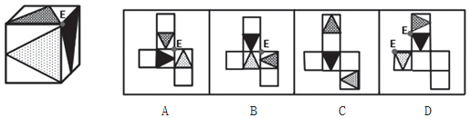

# 空间重构-六面体折叠（公共点法+相对面排除）

考点：[[20-考点/判断推理/图形推理/空间重构-六面体折叠（公共点法+相对面排除）|图形推理 / 空间重构-六面体折叠（公共点法+相对面排除）]]

**问法模型**：给出立体图和四个展开图，问哪一个折叠而成 → 用公共点法锁定三面交点的图案归属，辅以相对面排除

## 推理链
1. 第1步：立体图展示三个相邻面，每个面上各有一个阴影三角形，且三种阴影填充各不相同（网格、点状、实黑）
2. 第2步：三面存在公共点E，题干中E点与三个阴影三角形的顶点重合，即公共点处三个三角形的角全部汇聚
3. 第3步：运用规则——折叠不改变相邻面之间的位置关系，公共点对应的图案特征（是否为三角形顶点）必须与立体图一致；同时相对面不能在立体图中相邻出现
4. 第4步：A项，展开图中三面公共点未与三角形顶点重合，与立体图E点特征不符，排除
5. 第5步：B项，公共点同样未与三角形顶点重合，排除
6. 第6步：C项，两个三角形面中间隔了一个空白面，构成相对面，折叠后不可能相邻同时出现，与立体图矛盾，排除
7. 第7步：D项，三面公共点E与三个不同阴影三角形的顶点重合，与立体图完全一致，当选

**最快解法**：⚡ 公共点法：先在立体图标记三面交点E（三个阴影三角形顶点交汇处），再在展开图中定位同组三个相邻面的公共点，逐一验证其是否与三个三角形的顶点重合；若图案位置对不上立即排除，遇'隔一面'的两三角形面直接按相对面排除（如C项）

## 易错点
- ⚠ 只核对图案种类（三种阴影都有）而不核对图案与公共点的相对位置关系，误选A或B
- ⚠ 忽略相对面判定规则：C项两个三角形面'隔一个面'即为相对面，未察觉会误选C
- ⚠ 展开图中图案方向与立体图不一致时凭感觉比对，未以公共点/公共边为锚点统一旋转方向

## 母题抽象
> 🧩 当立体图出现'三个面共点且各面图案带明显角/顶点特征'时，用公共点法：在立体图和展开图分别标记三面公共点，验证公共点是否与图案特征点重合，并先用相对面排除不能同时出现的面

**同类特征**：六面体折叠、三面共点、阴影三角形、公共点与顶点重合、相对面不能同时出现、四个展开图选项

## 相关题
- [[10-真题/判断推理/图形推理/1791646 空间重构-六面体折叠（公共点法+相对面排除）|1791646]]（江苏 2016，相关度2）
- [[10-真题/判断推理/图形推理/2367800 空间重构-六面体折叠（折纸盒：相对面排除+相邻面公共边特征）|2367800]]（江苏 2019，相关度2）
- [[10-真题/判断推理/图形推理/12019707 空间折叠（六面体折纸盒）——相对面排除＋公共边画边法-公共点引线法|12019707]]（广东 2026，相关度1）
- [[10-真题/判断推理/图形推理/12561915 空间重构-六面体折叠（相对面排除+公共点法）|12561915]]（浙江 2024，相关度1）
- [[10-真题/判断推理/图形推理/16070182 空间重构-六面体展开图折叠（相对面排除＋相邻面数字方向验证）|16070182]]（湖北 2026，相关度1）

---

### 题干

上边这个图形是由下边四个图形中的某一个作为外表面折叠而成，请指出它是哪一个？

### 选项
- A. A
- B. B
- C. C
- D. D　✅

### 官方解析

本题考查六面体的空间重构。

题干立体图形中给出三个面，三个面存在公共点，分别在题干和选项中标记出三面的公共点，如下图E点所示：

题干中点E为三面交点，且与三个不同阴影三角形的顶点重合。

A项：公共点E未与三角形顶点重合，与题干不一致，排除；

B项：公共点E未与三角形顶点重合，与题干不一致，排除；

C项：其中两个三角形面中间隔了一个空白面，为相对面，不能同时出现，与题干不一致，排除；

D项：三面的公共点E与三个不同阴影三角形的顶点重合，与题干一致，当选。

故正确答案为D。

### 给定材料
（无）
