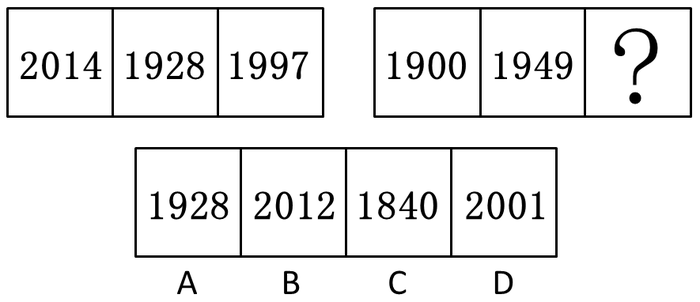

# 属性类-开闭性（全开放图形个数计数）

考点：[[20-考点/判断推理/图形推理/属性类-开闭性（全开放图形个数计数）|图形推理 / 属性类-开闭性（全开放图形个数计数）]]

**问法模型**：两组各三幅图求问号处图形 → 分别统计每组每幅图的同一属性数量，找组内恒定规律（组成元素不同优先考虑属性类）

## 推理链
1. 第一步：题干为两组图，第一组为2014、1928、1997，第二组为1900、1949、？，选项A/B/C/D依次为1928、2012、1840、2001；图形组成元素不同，优先考虑属性类
2. 第二步：把每个数字视为图形，区分两类字符——含封闭区域的数字（0、4、8、9，本题4为封口写法含1个封闭圈）与完全不含封闭区域的全开放数字（1、2）
3. 第三步：数第一组每幅图的全开放图形个数：2014含'2''1'共2个（4含封闭圈不计），1928含'1''2'共2个，1997含'1''7'共2个——第一组组内恒定为2个
4. 第四步：数第二组：1900中仅'1'全开放共1个，1949中仅'1'全开放共1个，故问号处图形应恰好包含1个全开放图形
5. 第五步：逐项对照：A(1928)含'1''2'共2个，B(2012)含'2''1''2'共3个，C(1840)仅'1'共1个，D(2001)含'2''1'共2个
6. 第六步：只有C满足'含1个全开放图形'的组内恒定规律，且官方认定按'面数求和'推出的B不严谨（两组图求和可为5/6/7/8/9等多种规律），故选C

**最快解法**：⚡ 开闭性计数法+排除法：快速数每个四位数中'无封闭圈数字'（1、2）的个数——第一组均为2个，第二组前两图均为1个（只有数字1开放），对照选项：A有2个、B有3个、C只有1个、D有2个，直接锁定C(1840)

## 易错点
- ⚠ 跨组'求和恒定'陷阱：按第一组面数2+3+2=7推出第二组缺1个面而误选B(2012)；两组式（3+3）图形用'和恒定'不严谨，和取5/6/7/8/9均可自圆其说，应优先取组内一致的规律
- ⚠ 字体辨析错误：本题数字'4'为封口写法、含1个封闭区域，不能计入全开放图形；若把4当开放数字，第一组'每幅2个全开放图形'的规律即被破坏
- ⚠ 混淆两个计数对象：'封闭区域数'是数圈（0、6、8、9及封口4），'全开放图形数'是数完全开放的字符（1、2），两套规律指向不同选项（B与C），须按更严谨的一套作答

## 母题抽象
> 🧩 当两组图形组成元素不同（尤其由数字/字符构成）时，优先统计组内每幅图的同一属性数量（全开放图形个数、封闭区域数等）是否恒定；组内恒定规律的严谨性高于跨组求和规律，两组求和恒定仅在九宫格题型中可靠

**同类特征**：两组式图形（每组3幅）、图形由四位数年份数字构成、组成元素不同、数字含0、4、8、9等带封闭圈的字符、考查开闭性/全开放图形计数、存在面数求和恒定的干扰规律（九宫格规律误用于两组式）

## 相关题
（暂无）

---

### 题干

从所给四个选项中，选择最合适的一个填入问号处，使之呈现一定的规律性：

### 选项
- A. A
- B. B
- C. C　✅
- D. D

### 官方解析
解析一：本题图形组成元素不同，优先考虑属性类，前一组图形每幅图中都包含2个全开放图形，后一组图形每幅图中都包含1个全开放图形，A选项全开放图形个数为2，B选项为3，C选项为1，D选项为2，故正确答案为C。
解析二：第一组图中每幅图中包含面个数依次为2、3、2，总数相加为7。第二组图中每幅图包含面个数依次是3、3，因此问号处应填入面个数为1的图形。A选项为3个面，B选项为1个面，C选项为4个面，D选项为2个面，故正确答案为B。
数量相加为恒定数值，这种规律在2007年国考、2012年联考以及其他省考中都有考过，但是都是出现在九宫格题目当中。因为当前两个数字相同的时候我们能确定第三个数字应该也是相同的，但是两组图如果用这样的思维是不严谨的，如第一组图面之和为7，第二组图面之和为5（奇数递减）、6（递减）、7（恒定）、8（递增）、9（奇数递增）都是有规律的，因此解析二没有解析一严谨，故粉笔公考更倾向于选C。

### 给定材料
（无）

<!-- CODEX-ANSWER-REVIEW:BEGIN -->
### 本次独立复核

**复核状态：** `resolved`（答案与解析已核定）

**计分答案：** C（可计分）

**复核解析：**

固定题图为第一行2014、1928、1997；第二行1900、1949、问号。全开放数字个数：2014、1928、1997各为2；1900、1949各为1。选项A=1928有2个，B=2012有3个，C=1840有1个，D=2001有2个，故按修订题干明确的全开放数字规律唯一选C。需说明：原题没有声明优先使用哪项属性，另一种“各行数字封闭面总数均为7”的规律会得到B（第一行2+3+2=7；第二行3+3+B的1=7），所以原题单选存在歧义；本复核通过明确题干规则修成可唯一计分版本，并不声称原题本身能排除B。

**修订题干：**

按每个数中“全开放数字”（没有封闭区域的数字）个数这一规律补全图形：第一行每个数均含2个全开放数字，第二行已给出的数均含1个全开放数字，问号处应填入哪个数？

**相关信息：**

图形推理—数字图形的开放性与封闭面计数。多个属性规律都能拟合题面时，应明确题目要考查的属性，避免仅凭“更常见”排除另一有效规律。

**题源依据：** [固定版本原题](https://github.com/Mentat-Uran/kaogongzhentizhengliu/blob/84ab93d4b64b61d897bece8a1c0a5bab06b4feb2/10-%E7%9C%9F%E9%A2%98/%E5%88%A4%E6%96%AD%E6%8E%A8%E7%90%86/%E5%9B%BE%E5%BD%A2%E6%8E%A8%E7%90%86/1796428%20%E5%B1%9E%E6%80%A7%E7%B1%BB-%E5%BC%80%E9%97%AD%E6%80%A7%EF%BC%88%E5%85%A8%E5%BC%80%E6%94%BE%E5%9B%BE%E5%BD%A2%E4%B8%AA%E6%95%B0%E8%AE%A1%E6%95%B0%EF%BC%89.md)；固定内容 commit `84ab93d4b64b61d897bece8a1c0a5bab06b4feb2`，Markdown blob `1fe008187b1077df872e6be70aa4612d900f954a`。
<!-- CODEX-ANSWER-REVIEW:END -->
