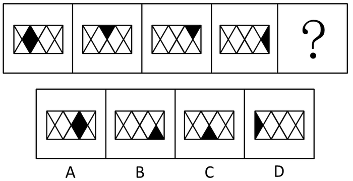

# 位置规律-平移（小黑块沿网格移动，步数呈1、2、1、2交替周期）

考点：[[20-考点/判断推理/图形推理/位置规律-平移（小黑块沿网格移动，步数呈1、2、1、2交替周期）|图形推理 / 位置规律-平移（小黑块沿网格移动，步数呈1、2、1、2交替周期）]]

**问法模型**：四个图形组成相同、仅一个黑色部分位置不同，问填入问号处使之呈现规律 → 小黑块位置移动规律：标记黑块逐图位置，数出移动步数找周期，再外推定位

## 推理链
1. 第1步：题干四图组成元素完全相同，均只有一个黑色部分，位置依次为：左侧菱形（图1）、中上部倒三角（图2）、右上倒三角（图3）、最右侧三角（图4）
2. 第2步：组成相同且仅黑块位置变化 → 考虑位置类平移，黑块沿网格中三角形/菱形位置逐格移动
3. 第3步：数相邻两图黑块移动步数：图1→图2移动1步，图2→图3移动2步，图3→图4移动1步，步数呈'1、2'交替周期
4. 第4步：按周期规律，图4到问号处应移动2步
5. 第5步：从最右侧三角位置再移动2步，黑块落在右侧菱形位置
6. 第6步：对照选项，A为右侧菱形，B为右下三角，C为中下三角，D为最左三角，故选A

**最快解法**：⚡ 数步找周期法：先给四图黑块位置编号，快速数出移动步数为1、2、1，识别'1、2'交替周期后直接'+2步'，定位右侧菱形，秒选A

## 易错点
- ⚠ 把黑色菱形误拆为'两个三角形'，误以为黑块大小/形状在变化，从而否定平移规律
- ⚠ 步数规律误判为等差（1、2、3）或恒定步数，导致外推位置错误
- ⚠ 移动路径方向（沿网格从左向右逐格）看错，错选B、C或D

## 母题抽象
> 🧩 当题干各图组成元素完全相同、仅一个小黑块（小元素）位置不同时，用位置平移模型：逐图数移动步数，找到步数周期（如1、2交替），按周期外推确定问号处黑块位置

**同类特征**：图形组成相同、仅一个黑色部分、黑块位置逐图变化、网格三角形/菱形排布、移动步数1、2、1周期、外推定问号

## 相关题
- [[10-真题/判断推理/图形推理/10297399 位置规律—平移（多黑块分组循环平移）|10297399]]（四川 2025，相关度1）
- [[10-真题/判断推理/图形推理/2673987 数量规律+位置规律（黑色扇形个数对称+顺时针平移一格）|2673987]]（选调 2018，相关度1）
- [[10-真题/判断推理/图形推理/5430358 位置规律-平移（宫格内外圈分层平移）|5430358]]（浙江 2023，相关度1）

---

### 题干

从所给四个选项中，选择最合适的一个填入问号处，使之呈现一定的规律性。

### 选项
- A. A　✅
- B. B
- C. C
- D. D

### 官方解析

图形组成相同，每个图形仅有一个黑色部分，且位置不同，考虑小黑块的位置。

观察题干可发现，小黑块移动规律如下图所示：

每次移动的步数分别为1、2、1，则接下来小黑块移动两步，在右边黑色菱形上。

故正确答案为A。

### 给定材料
（无）
