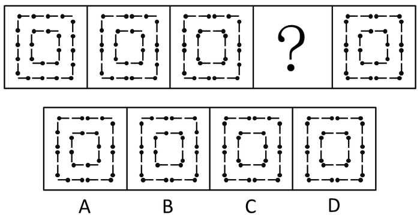

# 位置规律-火柴棍方向交替改变（外圈-内圈轮流转头）

考点：[[20-考点/判断推理/图形推理/位置规律-火柴棍方向交替改变（外圈-内圈轮流转头）|图形推理 / 位置规律-火柴棍方向交替改变（外圈/内圈轮流转头）]]

**问法模型**：“五图序列填问号使之呈现规律性” → 对相邻两图做差分，锁定‘谁变了、变几根’，发现交替周期后外推到问号处

## 推理链
1. 第1步：五个图形均由24根火柴棍拼成双重正方形（外圈+内圈），每根火柴一端带黑点（火柴头）作方向标记，组成完全相同，排除数量/样式类规律，锁定位置类
2. 第2步：差分比较图1与图2：外圈恰好有4根火柴棍的火柴头方向改变，内圈火柴棍方向全部不变
3. 第3步：差分比较图2与图3：内圈恰好有4根火柴棍方向改变，外圈火柴棍方向全部不变——变化主体按'外圈→内圈→外圈’交替
4. 第4步：按交替规律外推，图3→问号图应满足：外圈4根火柴方向改变、内圈保持不变
5. 第5步：以图3为基准逐项比对：A、B、C项或内外圈同时变动、或变动部位与根数不符，不满足'仅外圈4根变、内圈零变化'
6. 第6步：D项外圈恰好4根火柴头转向，内圈与图3完全一致，符合规律，故选D

**最快解法**：⚡ 差分比对法：先对图1→图2、图2→图3各做一次'找不同'，发现规律为'外圈变4根/内圈不动'与'内圈变4根/外圈不动’交替；再以图3为基准，只盯外圈找'恰好4根火柴头转向、内圈一模一样'的选项，直接锁定D

## 易错点
- ⚠ 只数火柴根数不看火柴头（黑点）朝向，误以为各图'长得一样'而无从下手
- ⚠ 把规律误判为整体旋转或翻转，漏看'变化主体是外圈、内圈交替'这一周期特征
- ⚠ 比对基准选错：应以前一图（图3）为基准对比选项，而不是回头与图1对比

## 母题抽象
> 🧩 当题干出现'组成相同的火柴棍/带方向标记图形'时，用相邻图差分法找出'变化部位+变化数量'，若主体呈内外/上下交替，则按交替周期外推选答案

**同类特征**：24根火柴棍组成相同、双重同心正方形（外圈+内圈）、火柴一端带黑点作方向标记、五图连续序列含问号、相邻图仅部分火柴方向改变、变化主体外圈与内圈交替

## 相关题
（暂无）

---

### 题干

从所给四个选项中，选择最合适的一个填入问号处，使之呈现一定的规律性。

### 选项
- A. A
- B. B
- C. C
- D. D　✅

### 官方解析
图形组成相同，都是由24根火柴棍组成，考虑位置规律。
从图1到图2，外圈有4根火柴棍方向发生了改变，且内圈的火柴棍方向均没有发生变化。从图2到图3，内圈有4根火柴棍方向发生了改变，且外圈的火柴棍方向均没有发生变化，依此规律，图3到图4外圈应有4根火柴方向发生改变，内圈应保持不变，D项符合规律。
故正确答案为D。

### 给定材料
（无）
