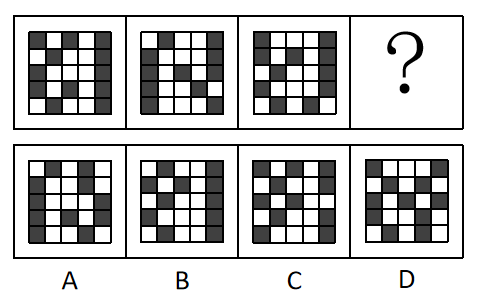

# 图形推理-位置规律（相邻图形黑块位置重合数递减）

考点：[[20-考点/判断推理/图形推理/图形推理-位置规律（相邻图形黑块位置重合数递减）|图形推理 / 图形推理-位置规律（相邻图形黑块位置重合数递减）]]

**问法模型**：黑白格组成不同且黑块总数无规律 → 转为比较相邻图形黑块位置重合数，找递变规律并按下一项筛选选项

## 推理链
1. 第1步：观察题干三个黑白格图，数出黑块个数分别为12、11、11，数量上不构成规律，排除纯数量规律
2. 第2步：转换思路，逐格比较相邻两图黑块的位置：图1与图2有6个黑块位置相同，图2与图3有5个黑块位置相同，重合数构成6、5的递减数列
3. 第3步：按递减规律，问号处图形应与图3恰有4个黑块位置相同
4. 第4步：以图3为基准逐项对照选项：A项与图3有5个位置相同，B项有9个，C项有4个，D项有6个
5. 第5步：只有C项满足与图3重合黑块数为4，故选C

**最快解法**：⚡ 重合位置计数法：数量无规律后，以第三幅图为基准逐项对比四个选项黑块位置，数出重合黑块个数，锁定等于4的C项

## 易错点
- ⚠ 只盯着黑块总数12、11、11找规律，数量无规律后误转向对称、平移等其他规律而偏离正确方向
- ⚠ 数重合位置时漏数或错位对比（网格行列未对齐），导致重合数数错，尤其B项与图3重合达9个，若误把规律当成'重合数最多'会错选B
- ⚠ 未意识到规律是'相邻图形间'的重合数递减（6→5→4），而是逐个图形孤立找静态规律，导致无从下手

## 母题抽象
> 🧩 当黑白格（小方块）图形组成不同、元素总数不构成规律时，应比较相邻图形中相同元素的重合位置数；若重合数呈等差递变，则按数列下一项去选项中验证对应重合数的图形

**同类特征**：黑白格矩阵、组成不同、黑块总数12、11、11无数量规律、相邻图形存在部分黑块位置重合、重合数构成6、5、4递减数列、问号处需与前图满足既定重合数

## 相关题
（暂无）

---

### 题干

从所给四个选项中，选择最合适的一个填入问号处，使之呈现一定的规律性。

### 选项
- A. A
- B. B
- C. C　✅
- D. D

### 官方解析
图形组成不同，即黑块的数量不同，考虑数数。题干三个图中，黑方块的个数分别为：12、11、11，没有任何规律，数量上不存在规律，只能考虑其他规律。仔细观察发现，第一个图和第二个图有6个黑块的位置是相同的，第二个图和第三个图有5个黑块的位置是相同的，我们尝试在选项当中寻找跟第三个图有4个黑块位置相同的选项，发现：A选项有5个位置相同；B选项有9个位置相同；C选项有4个位置相同；D选项有6个位置相同。
故正确答案为C。

### 给定材料
（无）
