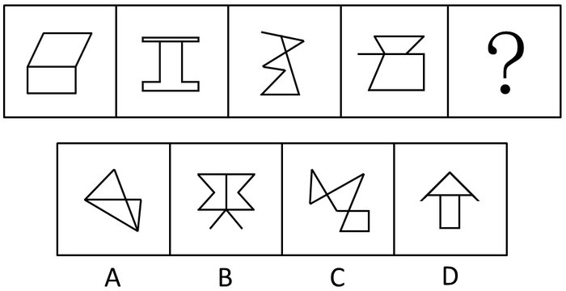

# 数量规律-面的个数＋面的二级辨析（形状相同-不同、上下-左右位置关系）

考点：[[20-考点/判断推理/图形推理/数量规律-面的个数＋面的二级辨析（形状相同-不同、上下-左右位置关系）|图形推理 / 数量规律-面的个数＋面的二级辨析（形状相同/不同、上下/左右位置关系）]]

**问法模型**：'选择最合适的一个填入问号处，使之呈现一定的规律性'且图形组成凌乱 → 先数面（封闭区域个数），面数相同时再做面的形状与位置关系二级辨析

## 推理链
1. 第1步：题干四幅图形组成凌乱，对称、曲直等属性规律不统一，但每幅图都含封闭区域，优先考虑数量规律中的'数面'
2. 第2步：数封闭区域：图1为上、下两个面，图2为一上一下两个面，图3为两个三角形面，图4为一上一下两个面，题干面数恒为2
3. 第3步：二级辨析：题干每幅图的两个面形状均不相同（无一为同形面），且两面的相对位置均为'一上一下'
4. 第4步：逐项对照：A、C的面数量不是2，先排除；B、D均有两个面，进入二级辨析
5. 第5步：B项两个面形状相同且呈'一左一右'，与题干'两面异形、一上一下'均不符，排除；D项两个面（三角形与四边形）形状不同且一上一下，与题干一致，选D

**最快解法**：⚡ 数面法＋二级辨析排除：先数封闭区域个数，题干均为2个面，排除A、C；再比较B、D——B两面同形且一左一右，D两面异形且一上一下，题干两面均异形且一上一下，故选D

## 易错点
- ⚠ 只数到'面数为2'就停止，未对面的形状（同形/异形）和位置（上下/左右）做二级辨析，在B、D之间纠结误选B
- ⚠ 忽略B项两面'一左一右'与题干'一上一下'的位置差异，只看面数
- ⚠ 图形凌乱时执着于找对称、曲直等属性规律，未及时切换到数量规律浪费时间

## 母题抽象
> 🧩 当题干图形组成凌乱但每幅图都含封闭区域时，先数面的个数；若剩余选项面数相同，则对两面做二级辨析——比较'形状是否相同'与'上下/左右位置关系'，与题干一致者即为答案

**同类特征**：图形组成凌乱无属性规律、每幅图均恰好2个面、两个面形状互不相同、两面呈一上一下排布、数量规律明显（数数型）、选项按面数→面形→面位三层筛选

## 相关题
（暂无）

---

### 题干

从所给的四个选项中，选择最合适的一个填入问号处，使之呈现一定的规律性：

### 选项
- A. A
- B. B
- C. C
- D. D　✅

### 官方解析
图形组成凌乱，且数量规律明显，考虑数数。
题干中每个图形都有两个面，排除A、C两项，B、D两项均有两个面，区别在于B项是两个形状相同的面，D项是不同的面，题干中的面都不相同，排除B项。（也可以用下面的规律：题干中两个面的关系都是一上一下，而B项是一左一右，D项是一上一下，故排除B项。）
故正确答案为D。

### 给定材料
（无）
