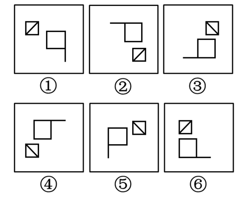
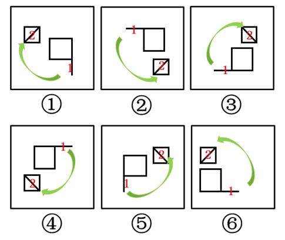

# 位置规律-旋转与翻转（时针法判定顺逆时针）

考点：[[20-考点/判断推理/图形推理/位置规律-旋转与翻转（时针法判定顺逆时针）|图形推理 / 位置规律-旋转与翻转（时针法判定顺逆时针）]]

**问法模型**："六个图形分为两类使每类有各自共同特征"的分类问法 → 元素组成相同，优先考虑位置规律，用时针法画箭头按顺/逆时针分组

## 推理链
1. 第1步：六个图形元素组成完全相同，均由一个带对角线的小正方形和一个带单边延伸线的"旗形"大正方形构成，仅两元素的相对方位不同，优先考虑旋转与翻转
2. 第2步：直接比较绝对位置会受整体旋转干扰，故用时针法：按统一顺序取点1（小对角线正方形）、点2（旗形延伸线末端），在每幅图中画箭头
3. 第3步：图①（小方块在左上、旗形延伸线在右下）、图③（小方块在右上、旗形延伸线在左下）、图④（小方块在左下、旗形延伸线在右上）按1→2画出的箭头均为顺时针方向
4. 第4步：图②（小方块在右下）、图⑤（小方块在右上）、图⑥（小方块在左上）按同一顺序画出的箭头均为逆时针方向，说明其旗形相对①③④发生了翻转（镜像）
5. 第5步：据顺/逆时针分为两组：①③④为顺时针一组（仅靠旋转可互化），②⑤⑥为逆时针一组（需翻转才可互化）
6. 第6步：与选项对照，①③④、②⑤⑥对应C项，与官方答案一致

**最快解法**：⚡ 时针法（描箭头）：从小对角线正方形向旗形延伸线末端按固定顺序画箭头，箭头呈顺时针的①③④一组、呈逆时针的②⑤⑥一组；亦可直接看旗形延伸线绕正方形的绕向，①③④绕向一致（旋转关系），②⑤⑥绕向相反（翻转关系）

## 易错点
- ⚠ 只用小方块与旗形的上下左右相对位置（如"小方块在左上/右上"）分组，忽略图形整体旋转后相对位置会互换
- ⚠ 只观察单一元素（六个小方块的对角线方向看似相同），未将两元素的方向连成带顺序的箭头，导致无规律可循
- ⚠ 顺时针/逆时针方向判断看反，或把翻转（镜像）误当成旋转，错选A/B/D

## 母题抽象
> 🧩 当六图分类题中各图元素组成完全相同、仅两元素间相对方位不同时，用时针法按统一顺序在两元素间画箭头，按顺时针/逆时针分为两类，本质是区分"旋转关系"与"翻转（镜像）关系"

**同类特征**：元素组成相同的六图分组题、每图由两个元素构成、带对角线的小正方形+带延伸线的旗形、仅相对方位/朝向不同、旋转与翻转的辨析、时针法定顺逆时针

## 相关题
（暂无）

---

### 题干

把下面的六个图形分为两类，使每一类图形都有各自的共同特征和规律，分类正确的一项是：

### 选项
- A. ①②⑥，③④⑤
- B. ①③⑤，②④⑥
- C. ①③④，②⑤⑥　✅
- D. ①④⑥，②③⑤

### 官方解析

元素组成相同，优先考虑位置规律。此题主要考查图形的旋转和翻转，如下图所示，使用时针法，按照1-2的顺序画时针。图①③④三个图形为顺时针，图②⑤⑥三个图形为逆时针。

故正确答案为C。

### 给定材料
（无）
