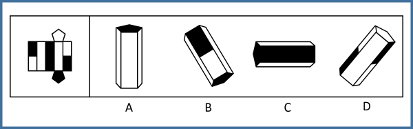

# 空间重构-立体折叠（五棱柱展开图，相邻面黑白关系排除）

考点：[[20-考点/判断推理/图形推理/空间重构-立体折叠（五棱柱展开图，相邻面黑白关系排除）|图形推理 / 空间重构-立体折叠（五棱柱展开图，相邻面黑白关系排除）]]

**问法模型**：给出外表面展开图，问'哪一项能由它折叠而成' → 以各类面的数量与相邻/间隔关系为不变量，逐项用排除法筛选立体图。

## 推理链
1. 第1步：展开图为五棱柱结构：5个长方形侧面共包含2个空白长方形白色面、1个长方形全黑面、2个半黑半白面，上下两个五边形为底面
2. 第2步：从展开图排布归纳相邻关系：两个空白白色面不相邻，每个白色面都与全黑面相邻，两个半黑半白面彼此相邻（环绕顺序约为'白—黑—白—半—半'）
3. 第3步：A项立体图中出现三个相邻的空白长方形白色面，而展开图中只有两个白色面，数量与位置均不对应，排除
4. 第4步：B项立体图中两个白色面不相邻、中间夹的是半黑半白面，而展开图中两个白面之间应为长方形全黑面，不对应，排除
5. 第5步：D项立体图中一个长方形白色面与两个半黑半白面相邻，而展开图中任意一个白色面都必须与全黑面相邻（且两个半黑半白面相邻），不对应，排除
6. 第6步：C项立体图各可见面的黑白相邻配置与展开图逐一对应，为正确答案

**最快解法**：⚡ 相邻关系排除法：先在展开图上标出不变量——'两白面中间隔全黑面''每个白面必邻全黑面''两个半黑半白面彼此相邻'，再核对各选项立体图可见面的颜色搭配，对不上即一票排除，剩下C。

## 易错点
- ⚠ 只看颜色不看数量：A项三个白面相邻看似普通，但展开图白面总共只有2个，数量矛盾是最快的排除点
- ⚠ 忽略两白面之间夹的面：B项把'白—半黑半白—白'误当成展开图的'白—全黑—白'
- ⚠ 忽略半黑半白面的相邻限制：D项白面同时邻接两个半黑半白面，与'白面必邻全黑面'矛盾，仅凭颜色大致相似容易放过

## 母题抽象
> 🧩 当题干给出带黑白图案的棱柱展开图并问折叠结果时，先数清每类面的数量并锁定'某面必与某面相邻/两某面间隔某面'的关系，再以这些不变量逐项排除立体图。

**同类特征**：纸盒外表面展开图、五棱柱（长方形侧面+五边形底面）、面着色分全白/全黑/半黑半白三类、问'哪一项能由它折叠而成'、用相邻面关系排除、无图案只有黑白配色

## 相关题
- [[10-真题/判断推理/图形推理/12536419 空间折叠（六面体）-相对面排除与相邻面位置关系（画边法-公共点法）|12536419]]（四川 2024，相关度1）
- [[10-真题/判断推理/图形推理/16593173 空间重构-展开图折叠（相邻面公共边特征）|16593173]]（海南 2024，相关度1）
- [[10-真题/判断推理/图形推理/18643899 空间重构-纸盒折叠（相邻面公共边定位法）|18643899]]（四川 2026，相关度1）
- [[10-真题/判断推理/图形推理/18650003 空间重构-六面体折叠（相对面关系判定）|18650003]]（选调 2025，相关度1）
- [[10-真题/判断推理/图形推理/2015354 空间重构-六面体折叠（相对面排除+相邻面指向关系）|2015354]]（重庆 2016，相关度1）

---

### 题干

下列选项中，左边给定的是纸盒的外表面展开图，右边哪一项能由它折叠而成？

### 选项
- A. A
- B. B
- C. C　✅
- D. D

### 官方解析
本题属于空间重构类，逐一分析选项。
A项：立体图中存在三个空白长方形白色面相邻，观察平面图，存在两个空白长方形白色面且不相邻，立体图与平面图二者不对应，排除；
B项：立体图中存在两个空白长方形白色面不相邻，中间为一个半黑半白面，观察平面图，两个空白长方形白色面中间应为一个长方形全黑面，而非半黑半白面，立体图与平面图二者不对应，排除；
C项：在B项的分析之上，此选项的立体图与平面图二者互相对应，为正确选项；
D项：立体图中存在一个长方形白色面与两个半黑半白面相邻，观察平面图，任意一个长方形白色面都要与一个长方形全黑面相邻，立体图与平面图二者不对应，排除。（或者说两个半黑半白面二者是相邻关系）
故正确答案为C。

### 给定材料
（无）
