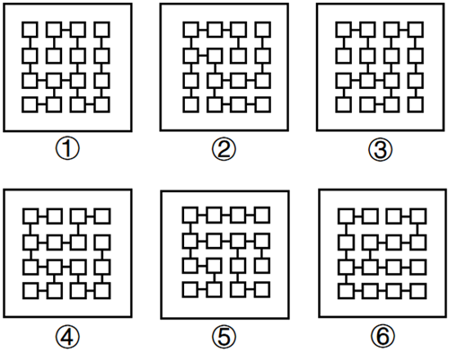
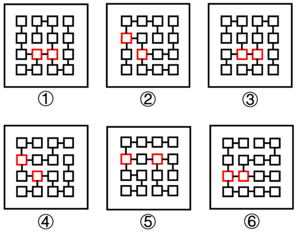

# 图形推理-特殊规律（小方块连线条数-节点度数及相对位置）

考点：[[20-考点/判断推理/图形推理/图形推理-特殊规律（小方块连线条数-节点度数及相对位置）|图形推理 / 图形推理-特殊规律（小方块连线条数/节点度数及相对位置）]]

**问法模型**：'把六个图形分成两类，使每一类都有各自共同特征'→分类分组题，先数元素细节量（每个方块连出的线条数），再按特殊元素相对位置分组

## 推理链
1. 第1步：六幅图均由同样规格的小方块和方块之间的短连线组成，元素组成相同，但整体排布无平移、旋转等明显位置规律
2. 第2步：改用特殊规律，逐个数每个小方块引出的短线条数（节点度数），发现每幅图中都恰好有且只有两个小方块连接三条短线，其余方块只连一条或两条
3. 第3步：锁定这两个'连三条线'的方块，考察它们的相对位置：图①③⑥中这两个方块直接相连（相邻且共用一条短线）
4. 第4步：图②④⑤中这两个方块不相邻，中间隔着一个小方块
5. 第5步：按'两个三条线方块直接相连/间隔一方块'分为①③⑥一组、②④⑤一组，与选项C吻合

**最快解法**：⚡ 数线法（节点度数法）：快速找出每幅图中唯一连着三条短线的两个方块，再看这两个方块是'紧挨着直接相连'还是'中间隔一个方块'，一步即可分成①③⑥与②④⑤两组

## 易错点
- ⚠ 只数方块总数或看外框形状，忽略'方块连线条数'这一细节数量规律
- ⚠ 数线条时粗心，把连接两条线的方块误当成连接三条线的目标方块，导致找不到稳定的两个特殊元素
- ⚠ 找到两个三条线方块后误判相对位置：图②④⑤中二者并非直接相连而是隔一个方块，若只看'在同一行/列'易分错组

## 母题抽象
> 🧩 当图形由相同小元素加连线构成且无明显位置规律时，数每个元素连出的线条数（度数），以'特殊度数元素的数量+其相对位置关系（相邻相连或间隔）'作为分类标准

**同类特征**：

## 相关题
（暂无）

---

### 题干

把下面的六个图形分成两类，使每一类图形都有各自的共同特征或规律，分类正确的一项是：

### 选项
- A. ①②⑤，③④⑥
- B. ①②⑥，③④⑤
- C. ①③⑥，②④⑤　✅
- D. ①④⑤，②③⑥

### 官方解析

元素组成相同，但无明显位置规律，考虑特殊规律。观察发现，题干中每幅图形都只有两个小方块连接三条短线，且图①③⑥中两个小方块直接相连，图②④⑤中两个小方块中间隔着一个小方块，如下图所示，故图①③⑥为一组，图②④⑤为一组。

故正确答案为C。

### 给定材料
（无）
