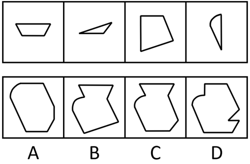

# 平面拼合-平行且等长相消（仅平移拼轮廓）

考点：[[20-考点/判断推理/图形推理/平面拼合-平行且等长相消（仅平移拼轮廓）|图形推理 / 平面拼合-平行且等长相消（仅平移拼轮廓）]]

**问法模型**：“四个小图形只可上下左右平移拼合成哪个轮廓”→ 平面拼合模型：只平移不旋转，相邻边平行且等长即内部相消，剩余边构成外轮廓，再用特征边（弧线/缺口/斜边方向）排除选项

## 推理链
1. 第1步：题干四图为①梯形、②细长针状三角形、③不规则四边形、④一边直一边弧的小月牙形；规则限定“只可上下左右平移”，即每条边的方向、长度在拼合后保持不变，不能旋转或翻转。
2. 第2步：采用“平行且等长相消法”：拼合时相邻图形的接触边必然平行且等长，在图形内部重合而消失，未被相消的边即最终外轮廓。
3. 第3步：将②细长三角形的长斜边与③四边形的平行等长斜边相消，①梯形的腰/底与相邻边相消，得到无重叠、无缝隙的组合轮廓骨架。
4. 第4步：定位特征边：④小月牙形的弧线无法被直线相消，必须保留在外轮廓上，且只是一段小弧；A项外轮廓上部为一大段圆弧、整体近似圆形，与“一小段弧+多段直线”不符，排除A。
5. 第5步：核对轮廓走向：四个小图形均为凸形块，平移相消只会在外侧形成斜边或直角，不会产生向内折返的缺口；D项右侧有向内凹陷的切角缺口，排除D。
6. 第6步：B、C轮廓高度相近，需逐边细辨：按第3步相消结果核验各斜边的方向与长度，B项右下斜边的走向（及下底长度）与题干斜边相消后的延伸方向不一致，C项每一段边均能对应题干剩余边。
7. 第7步：与选项对照，弧线位置、缺口有无、斜边方向三项校验均指向C，故正确答案为C。

**最快解法**：⚡ 平行且等长相消法＋特征边排除法：牢记“只平移不旋转”→先在心里消去平行等长的内部接触边→用“必有一段小弧”排除A、“不能出现内凹缺口”排除D→B/C高度相似时逐边比对斜边方向定C

## 易错点
- ⚠ 误以为小图形可以旋转或翻转拼合，导致斜边方向比对出错（题干明示只可上下左右平移）
- ⚠ 忽略弧线这一特征边的位置与长度，把整体近似圆形的A当正确项
- ⚠ B、C轮廓高度相近，辨析不细，漏看右下斜边走向/长度的差异；或误以为拼合会产生D那样的内凹缺口

## 母题抽象
> 🧩 当题干给出若干小图形并限定“只可上下左右平移”求拼合轮廓时，用“平行且等长相消法”消去内部重合边，再以特殊边（弧线、内凹、特征斜边方向）快速排除，重点比对相近选项的斜边方向与长度

**同类特征**：只可上下左右平移、四个小图形拼合、含一小段弧线的小图形、平行且等长相消、两个选项轮廓高度相近（B/C）、干扰项含内凹缺口或过大弧线

## 相关题
- [[10-真题/判断推理/图形推理/1791636 平面拼合（平行且等长相消）|1791636]]（江苏 2016，相关度2）
- [[10-真题/判断推理/图形推理/2172477 图形推理-平面拼合（平行且等长相消法）|2172477]]（江苏 2018，相关度2）
- [[10-真题/判断推理/图形推理/2742145 图形推理-平面拼合（平行且等长相消）|2742145]]（江苏 2021，相关度2）
- [[10-真题/判断推理/图形推理/2742146 平面拼合-平行且等长相消法（仅平移拼轮廓）|2742146]]（江苏 2021，相关度2）
- [[10-真题/判断推理/图形推理/4651584 图形推理-平面拼合（平行且等长相消法）|4651584]]（江苏 2022，相关度2）

---

### 题干

下面四个图形，可以拼合（只可上下左右平移）成选项中的哪一个图形？

### 选项
- A. A
- B. B
- C. C　✅
- D. D

### 官方解析

本题考查平面拼合，可采用平行且等长相消的方式解题。消去平行且等长的线段后进行组合即可得到轮廓图，即为C项。平行且等长相消的方式如下图所示：

故正确答案为C。

### 给定材料
（无）
