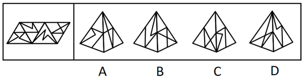
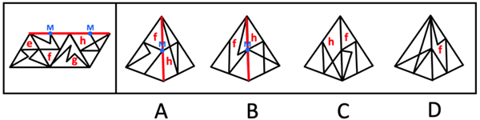

# 空间重构-纸盒折叠（相邻面公共边定位法）

考点：[[20-考点/判断推理/图形推理/空间重构-纸盒折叠（相邻面公共边定位法）|图形推理 / 空间重构-纸盒折叠（相邻面公共边定位法）]]

**问法模型**：给出纸盒外表面展开图，问哪一项能由它折叠而成 → 用公共边定位法逐项比对相邻面上特征线段与公共边的相对位置

## 推理链
1. 第1步：题干展开图由多个带内部特征线段的三角形面组成，各面的区别在于内部线段的走向及与边的交点位置
2. 第2步：四个立体选项均只露出两个相邻面（官方标注为面f与面h），故解题关键是两面的公共边
3. 第3步：在公共边上取中点标记为M点，以'M点引出的线'作为面f、面h内部线段的定位基准
4. 第4步：A项比对——面f上M点引出的线与展开图中面f的线不一致，排除
5. 第5步：B项比对——面h上M点引出的线与展开图中面h的线不一致，排除
6. 第6步：C项比对——面f与面h上特征线与公共边（M点）的相对位置均与展开图一致，当选
7. 第7步：D项比对——选项左侧面在题干展开图中根本未出现，直接排除，故正确答案为C

**最快解法**：⚡ 公共边法+排除法：先扫D项发现其左侧面是展开图中不存在的面，秒杀排除；再对A/B/C统一取面f、面h的公共边并标中点M，只看'M点引出线的方向与交点位置'这一个特征，与展开图一致的仅C

## 易错点
- ⚠ 只检查面内线段'有没有'而忽略线段与公共边的相对位置（从M点引出还是从其他点引出、夹角方向），误选A或B
- ⚠ 忽视D项'出现展开图中不存在的面'这一可秒杀排除的特征，浪费比对时间
- ⚠ 立体图存在透视压缩，线段角度在视觉上发生变形，若凭直观视觉比对而非以公共边为基准定位，易判断失误

## 母题抽象
> 🧩 当展开图各面带有不同走向的内部特征线时，折叠验证题用公共边定位法：锁定选项中相邻两面的公共边，比对特征线与公共边的交点位置及夹角方向；若选项出现展开图中不存在的面，直接排除

**同类特征**：纸盒外表面展开图、各面含内部特征线段、立体图仅露两个相邻面、公共边中点作定位点、面f与面h相邻组合、选项含不存在的面可秒杀

## 相关题
- [[10-真题/判断推理/图形推理/12536419 空间折叠（六面体）-相对面排除与相邻面位置关系（画边法-公共点法）|12536419]]（四川 2024，相关度1）
- [[10-真题/判断推理/图形推理/16593173 空间重构-展开图折叠（相邻面公共边特征）|16593173]]（海南 2024，相关度1）
- [[10-真题/判断推理/图形推理/1805286 空间重构-立体折叠（五棱柱展开图，相邻面黑白关系排除）|1805286]]（上海 2016，相关度1）
- [[10-真题/判断推理/图形推理/18650003 空间重构-六面体折叠（相对面关系判定）|18650003]]（选调 2025，相关度1）
- [[10-真题/判断推理/图形推理/2015354 空间重构-六面体折叠（相对面排除+相邻面指向关系）|2015354]]（重庆 2016，相关度1）

---

### 题干

左图给定的是纸盒的外表面，下列哪一项能由它所折叠而成？

### 选项
- A. A
- B. B
- C. C　✅
- D. D

### 官方解析

将题干展开图标上序号，如下图所示，逐一进行分析。

A项：选项由面f和面h组成，将两个面公共边的中点标记为M点，选项中面f的M点引出的线与题干展开图不一致，排除；

B项：选项由面f和面h组成，将两个面公共边的中点标记为M点，选项中面h的M点引出的线与题干展开图不一致，排除；

C项：选项由面f和面h组成，选项与题干展开图一致，当选；

D项：选项左侧面在题干展开图中未出现，选项与题干展开图不一致，排除。

故正确答案为C。

### 给定材料
（无）
