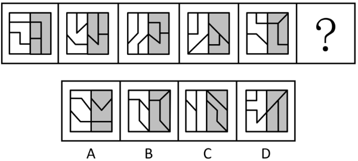

# 图形推理-图形间关系（面与面的相离-相交于边，分区观察）

考点：[[20-考点/判断推理/图形推理/图形推理-图形间关系（面与面的相离-相交于边，分区观察）|图形推理 / 图形推理-图形间关系（面与面的相离/相交于边，分区观察）]]

**问法模型**：问号处填入最合适图形使之呈现规律性 → 面数量无区分度时，转看图形间关系，且按'左白右灰'分区分别验证面与面的位置关系

## 推理链
1. 第1步：题干五幅图元素组成不同、无对称封闭等属性规律，且每幅图分割明显，均由多个小面拼接而成，可考虑数量规律
2. 第2步：先数面数量——题干及所有选项均为3个白色面和3个灰色面，面数量无法排除任何选项，规律须下沉一层
3. 第3步：转看图形间关系，发现题干图形均可划分为左侧白色区域与右侧灰色区域，应分区观察
4. 第4步：左侧白色区域规律——每幅图中均存在一个面将另外两个面完全分隔开，即白色区域内有两个面相离，其余面两两相交于边
5. 第5步：对照选项白色区域，B、C不符合'存在相离面'的特征，予以排除，剩A、D
6. 第6步：右侧灰色区域规律——题干所有图形的灰色区域内所有面均两两相交于边（无相离面），A的灰色区域不满足，只有D项灰色区域所有面两两相交于边，故选D

**最快解法**：⚡ 分区排除法：将每图拆成'左白右灰'两半，先按'白色区域必有两面相离（一个面隔开另外两面）'排除B、C，再用'灰色区域所有面两两相交于边'在A、D中锁定D

## 易错点
- ⚠ 只数总面数或按颜色数面（均为3白3灰），发现选项无差异后误判'无数量规律'而放弃，漏掉图形间关系这一深层规律
- ⚠ 忽略'左白右灰'的分区结构，把白面灰面混在一起看相交/相离，导致关系混乱无法归纳
- ⚠ '相交于边'与'相离'辨析不准：两个面有公共边才算相交，仅被分隔线隔开而无公共边属于相离，判定时须逐面确认公共边

## 母题抽象
> 🧩 当题干图形分割明显、面数量在各图及选项间无差异时，先分区（如按颜色/左右拆分），再分别验证'某区域恒存在相离面、另一区域恒两两相交'的组合式图形间关系规律，双条件全符合者当选

**同类特征**：图形分割明显、多面拼接、左白右灰双色分区结构、面数量相同（3白3灰）无区分度、面与面存在公共边（相交）、存在一个面完全隔开另两个面（相离）、元素组成不同且无属性规律

## 相关题
- [[10-真题/判断推理/图形推理/10204622 图形推理-数量规律-笔画数（一笔画判定）|10204622]]（辽宁 2024，相关度1）
- [[10-真题/判断推理/图形推理/11367773 数量规律-一笔画（奇点数）+面的形状（三角形面个数）双规律|11367773]]（江苏 2025，相关度1）
- [[10-真题/判断推理/图形推理/12019817 数量规律-面的细化（面的形状：所有面均为四边形）|12019817]]（浙江 2026，相关度1）
- [[10-真题/判断推理/图形推理/13504266 数量规律-交点数（曲直交点数量+交点形态交替规律）|13504266]]（云南 2025，相关度1）
- [[10-真题/判断推理/图形推理/13504600 数量规律-多边形元素边数递减（等差数列）|13504600]]（辽宁 2025，相关度1）

---

### 题干

从所给的四个选项中，选择最合适的一个填入问号处，使之呈现一定的规律性：

### 选项
- A. A
- B. B
- C. C
- D. D　✅

### 官方解析
元素组成不同，且无明显属性规律，考虑数量规律。观察发现，题干图形分割明显，可考虑面数量，但题干及所有选项均为3个白色面和3个灰色面，无法排除。继续观察发现，题干图形均由多个面拼接而成，可考虑图形间关系。题干图形均可划分为左侧白色区域与右侧灰色区域，分别观察，左侧白色区域内均存在一个面将另外两个面完全分隔开，即有两个面相离，其余面两两相交于边，排除B、C两项；右侧灰色区域内所有面均两两相交于边，只有D项符合。
故正确答案为D。

### 给定材料
（无）
