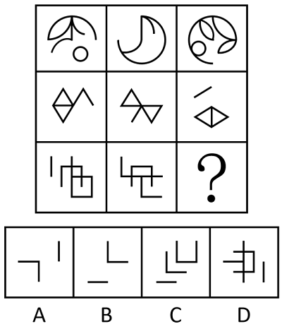

# 样式规律-去同存异（求异）与位置旋转的复合规律

考点：[[20-考点/判断推理/图形推理/样式规律-去同存异（求异）与位置旋转的复合规律|图形推理 / 样式规律-去同存异（求异）与位置旋转的复合规律]]

**问法模型**：九宫格'？'处填最合适图形呈现规律性 → 元素相似且相同线条重复出现时，按横行用'图1与图2去同存异＋整体旋转'复合模型验证

## 推理链
1. 第1步：九宫格元素组成相似，各行图1、图2与图3之间存在大量相同与不同线条，排除位置类和属性类，锁定样式规律中的加减同异（去同存异）。
2. 第2步：九宫格优先看横行；第一行将图1（含叶片弧线、小圆的圆形组合）与图2（月牙形及弧线）对比，去掉两图共有的线条，仅保留各自独有线条，得到求异中间图形。
3. 第3步：将求异所得图形整体顺时针旋转90°，其圆弧、叶片轮廓与小圆位置恰好与图3（圆内叶片+小圆）完全重合，初步确认'求异＋顺时针旋转'规律。
4. 第4步：用第二行验证：图1（双三角/菱形与折线组合）与图2（三角形与折线组合）去同存异后仅剩一条斜线与菱形轮廓，再顺时针旋转90°，得到图3（一撇斜线+菱形），规律成立。
5. 第5步：第三行应用规律：对比图1（左侧短竖线+嵌套方框交叉线）与图2（左上L形折线+方框交叉线），找出公共线条予以去除，保留两图独有线条。
6. 第6步：将第三行求异结果整体顺时针旋转90°，得到一个'L形折角+下方短横线'的图形。
7. 第7步：逐项比对：B项'折角+短横线'与旋转结果一致；A、C、D项的线条数量、夹角方向或组合方式均与求异加旋转的结果不符，排除。

**最快解法**：⚡ 复合规律口诀法：九宫格横行套用'图1⊕图2（去同存异）→整体顺时针转90°=图3'；第三行直接对图1、图2描线去同，脑内把剩余线条顺时针转90°，与选项比对即可秒选B。

## 易错点
- ⚠ 只做去同存异忘记再旋转90°，误选与求异原始方向一致的干扰项
- ⚠ 把规律误做成'求同'（保留公共线条）或将旋转方向搞成逆时针
- ⚠ 九宫格先看列或对角线导致规律不成，或求异时漏掉重合的短线条（如第三行左侧短竖线）

## 母题抽象
> 🧩 当九宫格图形元素相似、图3形似图1与图2的'拼合变形'且存在重复线条时，按横行用'去同存异＋旋转（或翻转）'复合规律：图1与图2求异后旋转90°应与图3重合，末行据此筛选选项。

**同类特征**：九宫格、元素组成相似、相同线条重复出现、加减同异/去同存异、求异后旋转90°、横行规律优先

## 相关题
- [[10-真题/判断推理/图形推理/2264343 样式规律-加减同异（求异）+位置旋转复合|2264343]]（国考 2019，相关度4）
- [[10-真题/判断推理/图形推理/12019768 样式规律-加减同异（求同）与位置旋转的复合规律|12019768]]（浙江 2026，相关度3）
- [[10-真题/判断推理/图形推理/16070178 样式规律-加减同异（翻转+去同存异）|16070178]]（重庆 2026，相关度3）
- [[10-真题/判断推理/图形推理/17056529 样式规律-求同求异（分元素：直线求同、小圆圈求异）|17056529]]（上海 2026，相关度3）
- [[10-真题/判断推理/图形推理/18649984 样式规律-加减同异（求异-去同存异）|18649984]]（选调 2025，相关度3）

---

### 题干

从所给的四个选项中，选择最合适的一个填入问号处，使之呈现一定的规律性： 

### 选项
- A. A
- B. B　✅
- C. C
- D. D

### 官方解析

元素组成相似，优先考虑样式规律。图形中有相同线条重复出现，考虑加减同异。九宫格优先看横行，第一行中，图1和图2求异后再顺时针旋转得到图3；经验证，第二行满足此规律；第三行应用此规律，故“？”处应选择一个图1和图2先求异再顺时针旋转得到的图形，只有B项符合。

故正确答案为B。

### 给定材料
（无）
