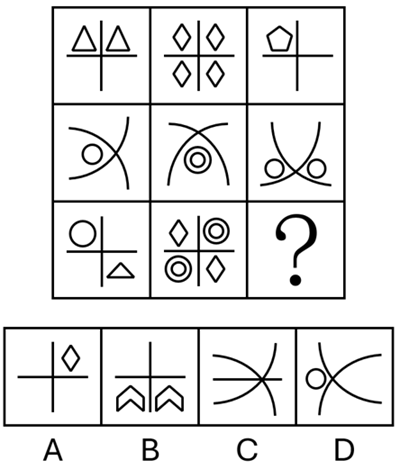

# 属性规律-曲直性（九宫格按横行统一）

考点：[[20-考点/判断推理/图形推理/属性规律-曲直性（九宫格按横行统一）|图形推理 / 属性规律-曲直性（九宫格按横行统一）]]

**问法模型**：'最符合所给图形规律'的九宫格题 → 元素组成不同时优先看属性规律，按横行扫描曲直性找行规律

## 推理链
1. 第1步：提取图形要素——第一行为三角形/菱形/五边形配十字交叉线，第二行为圆弧与圆的组合，第三行前两图为'圆+三角形+十字线'和'菱形+双圆+十字线'，末格为'？'
2. 第2步：元素组成不同，排除位置与叠加规律，优先考虑属性规律；题干同时出现全直线与全曲线图形，锁定'曲直性'考点
3. 第3步：九宫格优先看横行——第一行三图均由直线段构成（全直线），第二行三图均由圆弧和圆构成（全曲线），第三行前两图均既有圆/圆弧又有直线（有曲有直）
4. 第4步：归纳行规律为'全直→全曲→曲直混合'，问号处应补一个有曲有直的图形
5. 第5步：逐项对照——A项十字线+菱形全直线，排除；B项竖线+两个箭头形全直线，排除；D项圆弧+小圆全曲线，排除；C项两条圆弧加一条水平直线，有曲有直，符合
6. 第6步：只有C项满足第三行'有曲有直'的属性要求，故选C

**最快解法**：⚡ 曲直性行扫法：九宫格先横行扫属性，'一行全直、一行全曲、一行曲直混'，问号处补'有曲有直'；直接看选项——A、B全直，D全曲，只有C的圆弧+横线曲直兼备，秒选C

## 易错点
- ⚠ 误入数量类误区：元素组成不同时去数小元素个数、交点数，忽略属性规律优先原则
- ⚠ 看错规律方向：按列或按整体九宫格找曲直规律，导致'有曲有直'的位置判断错乱
- ⚠ 曲直辨析不彻底：D项圆弧有曲易误判为'有曲'就够，漏查其缺直线元素，误选D

## 母题抽象
> 🧩 当九宫格图形元素组成不同、且整体出现'全直线图与全曲线图混排'时，按横行扫描曲直性属性，若某行前两图曲直混合，问号处必补'有曲有直'图形

**同类特征**：九宫格、元素组成不同、全直线与全曲线图形混排、第三行前两图有曲有直、问号处求属性一致、属性规律-曲直性

## 相关题
- [[10-真题/判断推理/图形推理/11367791 属性类-对称性（对称轴方向与条数、轴对称+中心对称）＋数量类-面数量（九宫格横行复合规律）|11367791]]（江苏 2025，相关度2）
- [[10-真题/判断推理/图形推理/11881082 属性规律-对称性（对称轴方向）|11881082]]（黑龙江 2024，相关度2）
- [[10-真题/判断推理/图形推理/12881896 属性规律-曲直性（九宫格横行遍历）|12881896]]（新疆 2025，相关度2）
- [[10-真题/判断推理/图形推理/14993416 数量规律-点数量（黑点个数按行求和恒值）|14993416]]（选调 2024，相关度2）
- [[10-真题/判断推理/图形推理/17097275 图形间关系-点相交（点接触 vs 线接触）|17097275]]（山西 2024，相关度2）

---

### 题干

下列选项中最符合所给图形规律的是（    ）。

### 选项
- A. A
- B. B
- C. C　✅
- D. D

### 官方解析
元素组成不同，优先考虑属性规律。观察发现，题干出现全直线、全曲线图形，考虑曲直性。九宫格优先看横行，第一行图形均为全直线图形，第二行图形均为全曲线图形，第三行前两幅图形均为有曲有直图形，故“？”处图形应是有曲有直图形，只有C项符合。
故正确答案为C。

### 给定材料
（无）
