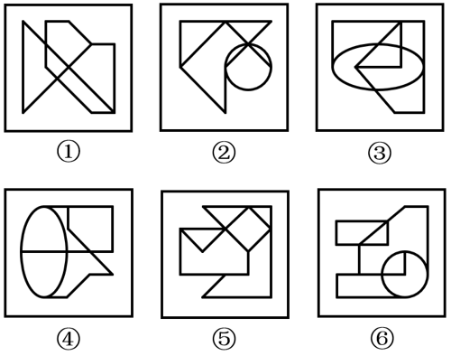

# 数量规律-笔画数（一笔画与两笔画分组）

考点：[[20-考点/判断推理/图形推理/数量规律-笔画数（一笔画与两笔画分组）|图形推理 / 数量规律-笔画数（一笔画与两笔画分组）]]

**问法模型**：“把六个图形分成两类，使每一类都有各自共同特征/规律”的分组分类问法 → 逐图提取统一量化规律（笔画数/奇点数），按数值相同者归组

## 推理链
1. 第1步：六图元素组成不同，且对称、曲直、封闭、开闭等属性规律均不统一，故转入数量规律考点
2. 第2步：题干图形均出现圆/椭圆与直线图形相切、相交的“变形图”特征，按命题套路优先考虑笔画数（一笔画）
3. 第3步：用奇点法验证——数每个图形中度数为奇数的交点及端点（端点度数为1也是奇点），一笔画条件为奇点数为0或2
4. 第4步：逐项对照：图①②③的奇点数为0或2，均可一笔画成；图④⑤⑥的奇点数为4，最少笔画数=4÷2=2，均为两笔画图形
5. 第5步：①②③归为一组、④⑤⑥归为一组，与选项A的分组完全吻合

**最快解法**：⚡ 奇点计数法+分组口诀：“含圆相切相交的变形图，先数奇点定笔画”；奇点0或2个→一笔画，奇点4个→两笔画。快速扫描六图交点，发现①②③可一笔画、④⑤⑥需两笔，直接锁定A

## 易错点
- ⚠ 见到圆/椭圆与直线相切相交，只去数交点数、封闭区域数或考虑对称性，漏掉“变形图优先想一笔画”这一高频套路
- ⚠ 数奇点时漏数度数为1的端点（如伸出的线头），或漏数T字形交点，导致笔画数判断错误
- ⚠ 误以为图形看起来“线条交叉复杂”就一定多笔画，实际奇点数才是唯一判据（奇点必为偶数个）

## 母题抽象
> 🧩 当分组分类题的图形出现圆/椭圆与直线图形相切、相交的变形图且属性规律（对称、曲直、封闭）不一致时，用奇点计数法定笔画数：奇点0或2个为一笔画一组，奇点4个为两笔画一组，据此选分组项

**同类特征**：分组分类问法、六图元素组成不同、无统一属性规律、圆/椭圆与直线图形相切或相交的变形图、笔画数/一笔画、奇点计数（含端点与T字交点）、①②③与④⑤⑥数量规律分组

## 相关题
- [[10-真题/判断推理/图形推理/10297098 功能元素-黑点标记交点的发射线数|10297098]]（天津 2025，相关度1）
- [[10-真题/判断推理/图形推理/10297262 数量规律-面的形状种类（封闭面种类数分组）|10297262]]（浙江 2025，相关度1）
- [[10-真题/判断推理/图形推理/12019737 数量规律-相同元素的位置关系（相对-相邻）分组|12019737]]（浙江 2026，相关度1）
- [[10-真题/判断推理/图形推理/12536392 数量规律-黑色区域面积（宫格面积折算）|12536392]]（四川 2024，相关度1）
- [[10-真题/判断推理/图形推理/12882156 图形推理-对称性（仅轴对称 vs 既轴对称又中心对称）|12882156]]（黑龙江 2025，相关度1）

---

### 题干

把下面的六个图形分成两类，使每一类图形都有各自的共同特征或规律，分类正确的一项是（    ）。

### 选项
- A. ①②③，④⑤⑥　✅
- B. ①②④，③⑤⑥
- C. ①③⑤，②④⑥
- D. ①④⑥，②③⑤

### 官方解析
本题为分组分类题目。元素组成不同，且无明显属性规律，考虑数量规律。题干图形出现明显多圆相切或相交的变形图，优先考虑笔画数。观察发现，图①②③均为一笔画图形，图④⑤⑥均为两笔画图形，即图①②③为一组，图④⑤⑥为一组。
故正确答案为A。

### 给定材料
（无）
