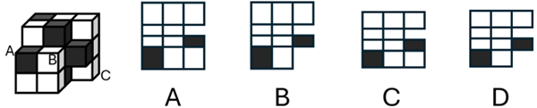
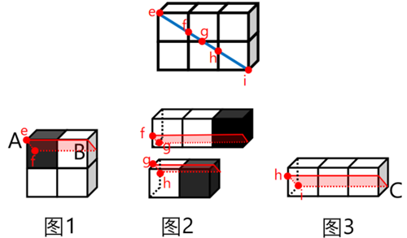

# 截面图（立体切割-三点定面）

考点：[[20-考点/判断推理/图形推理/截面图（立体切割-三点定面）|图形推理 / 截面图（立体切割-三点定面）]]

**问法模型**：题干问'经过A、B、C三个顶点切开的截面是'→用'三点定唯一平面+逐个小立方体分析截面形状与颜色'的模型排除选项

## 推理链
1. 第1步：提取题干条件——多面体由15个白色和5个灰色正方体组合而成，截面必须经过顶点A、B、C
2. 第2步：应用平面公理'过不在一条直线上的三点，有且只有一个平面'，A、B、C确定唯一截面，且该截面为斜切
3. 第3步：分析A点所在小立方体——斜切经过该立方体时截面为长方形，因ef的长度大于小立方体的棱长，故该长方形横边长度应小于竖边长度，排除C、D两项
4. 第4步：分析颜色与位置——点A所在的小立方体为灰色，点B所在的白色小立方体右边不存在其他小立方体，故最后一行截面图中只应有一个灰色长方形和一个白色长方形，排除A项
5. 第5步：逐项对照后仅剩B项，故正确答案为B（官方同时注明题目本身不严谨）

**最快解法**：⚡ 排除法+局部特征验证：先抓A点所在小立方体的截面形状（斜切成长方形且横边<竖边）秒杀排除C、D，再看最后一行颜色排布（一灰一白）排除A，锁定B

## 易错点
- ⚠ 忽略斜切经过小立方体时长方形的长宽比例（ef大于棱长→横边小于竖边），误选C或D
- ⚠ 忽略颜色对应关系：A点所在立方体为灰色、B点白色立方体右侧无立方体，误选含多余色块的A项
- ⚠ 题干本身不严谨（B项截面图亦有瑕疵），纠结于找'完全正确'的选项而浪费时间

## 母题抽象
> 🧩 当题干出现'经过三个顶点(不共线三点)切开的截面'特征时，用'三点定面+逐个被切小立方体验证截面形状与颜色'的方法，验证横竖边比例和色块分布即可排除定答案

**同类特征**：15白5灰正方体组合多面体、经A、B、C三顶点切开、三点确定唯一截面、斜切、小立方体截面为长方形、色块位置对应

## 相关题
- [[10-真题/判断推理/图形推理/2374751 截面图-空心立体（空心圆柱）的截面可能性判断|2374751]]（广东 2019，相关度1）

---

### 题干

下图为15个白色和5个灰色正方体组合而成的多面体，将其经A、B、C三个顶点切开后，正确的截面是（    ）。

### 选项
- A. A
- B. B　✅
- C. C
- D. D

### 官方解析

本题选项不严谨，没有正确选项。

本题考查截面图。根据平面公理“过不在一条直线上的三点，有且只有一个平面”可以得出，A、B、C三个顶点可以确定一个唯一的截面，将图形拆分后，如下图所示：

 

由于图中是斜切，因此在经过点A所在的小立方体时，该小立方体所在的截面应为长方形，此时由于ef的长度大于小立方体的棱长，因此在长方形截面中横边长度应小于竖边长度，排除C、D两项；又由于点A所在的小立方体为灰色，点B所在的白色小立方体的右边不存在其他小立方体，因此在选项中最后一行的截面图中应只存在一个灰色长方形和一个白色长方形，排除A项。

故正确答案为B。

注：本题出题不严谨，由上面拆分后的图形可知，本题B项中的截面图也存在问题，正确的截面应如下图所示，因此考生可以侧重学习解题思路。

### 给定材料
（无）

> [!warning] 疑点（官方解析可能有误，待人工复核）
> 官方解析自注'本题出题不严谨，B项中的截面图也存在问题'，即严格意义上四个选项均非精确截面，B仅为排除法下最接近的答案；考生应侧重掌握解题思路而非答案本身
