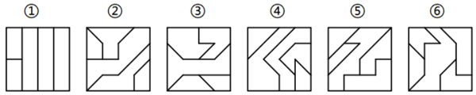
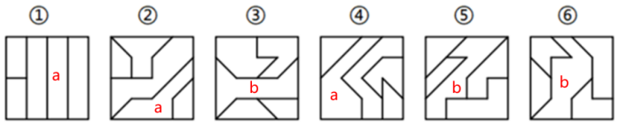

# 图形推理-图形间关系（面的分隔与相交）；辅助考点：数内部线条与外框交点

考点：[[20-考点/判断推理/图形推理/图形推理-图形间关系（面的分隔与相交）；辅助考点：数内部线条与外框交点|图形推理 / 图形推理-图形间关系（面的分隔与相交）；辅助考点：数内部线条与外框交点]]

**问法模型**：'六个图形分为两类，使每一类都有各自的共同特征或规律'→分组分类模型：先属性后数量（面数无规律时）再升级到图形间关系或数框上交点

## 推理链
1. 第1步：六图均为正方形外框、内部由多条线条分割成多个封闭面，元素组成不同且无明显对称、曲直、开闭等属性规律
2. 第2步：图形分割明显，先数面数量，无规律，排除单纯面数量考点
3. 第3步：转向图形间关系——图①②④中存在一个面（面a）将其中1个面与另外3个面完全分隔开，同侧的3个面彼此相交
4. 第4步：图③⑤⑥中存在一个面（面b）将与之相交的4个面两两分隔开，同侧的2个面彼此相交，与第3步形成对照分组
5. 第5步：用官方另两条解析双重验证——只考虑内部线条，①②④内部线条为三部分、③⑤⑥为两部分；数内部线与外框的交点，①②④框上交点均为7、③⑤⑥均为6，三条路径指向同一分组
6. 第6步：与选项对照，B项为'①②④，③⑤⑥'，与解析一、二、三均吻合，故选B

**最快解法**：⚡ 数交点法（最快、最机械）：数每图内部线条与外框的交点数，①②④均为7个、③⑤⑥均为6个，直接得B；备选验证：数内部线条部分数，①②④三部分、③⑤⑥两部分

## 易错点
- ⚠ 只盯面数量，发现无规律后卡题，漏掉'图形间关系——面的分隔方式'这一层
- ⚠ 数内部线条部分数时误把外框计入，导致部分数判断错误
- ⚠ 数框上交点时漏数或重数（尤其内部线交在框角顶点处），得出错误分组

## 母题抽象
> 🧩 当题干出现'外框+内部多条分割线'且面数量无规律的分组分类题时，用图形间关系（是否存在一个面将其余面完全分隔及分隔对象数量）或数内部线条与外框的交点数来验证分组

**同类特征**：分组分类：六图分两类、正方形外框内被直线分割、多面拼接、分割明显、面数量无规律、面与面存在分隔与相交关系、内部线条与外框有明显交点

## 相关题
- [[10-真题/判断推理/图形推理/12019817 数量规律-面的细化（面的形状：所有面均为四边形）|12019817]]（浙江 2026，相关度1）
- [[10-真题/判断推理/图形推理/13504389 图形推理-笔画数（奇点数定一笔画-多笔画）|13504389]]（云南 2025，相关度1）
- [[10-真题/判断推理/图形推理/16070143 图形间关系（面的分隔与相交）＋内部线条部分数-笔画数|16070143]]（贵州 2026，相关度1）
- [[10-真题/判断推理/图形推理/2029962 数量规律-数直角（角数量）|2029962]]（四川 2016，相关度1）
- [[10-真题/判断推理/图形推理/5510129 数量规律-面的细化（最小面形状与外框形状一致）|5510129]]（广西 2023，相关度1）

---

### 题干

把下面的六个图形分为两类，使每一类图形都有各自的共同特征或规律，分类正确的一项是（    ）。

### 选项
- A. ①②③，④⑤⑥
- B. ①②④，③⑤⑥　✅
- C. ①③⑤，②④⑥
- D. ①⑤⑥，②③④

### 官方解析

解析一：本题为分组分类题目。元素组成不同，且无明显属性规律，考虑数量规律。观察发现，题干图形分割明显，考虑面数量，但没规律；继续观察发现，题干图形均由多个面拼接而成，考虑图形间关系。图①②④中，面a将其中1个面与另外3个面完全分隔开，且同侧的3个面相交；图③⑤⑥中，面b将与之相交的4个面两两分隔开，且同侧的2个面相交。即图①②④为一组，图③⑤⑥为一组。

解析二：本题为分组分类题目。元素组成不同，且无明显属性规律，考虑数量规律。观察发现，题干图形分割明显，考虑面数量，但没规律；继续观察发现，只考虑内部线条的情况下，图①②④的内部线条为三部分，图③⑤⑥的内部线条为两部分。即图①②④为一组，图③⑤⑥为一组。

解析三：本题为分组分类题目。元素组成不同，且无明显属性规律，考虑数量规律。观察发现，题干每幅图形都有外框，且内部线条与外框有明显相交，考虑数内部直线和外框的交点，图①②④框上交点数均为7，图③⑤⑥框上交点数均为6，即图①②④为一组，图③⑤⑥为一组。

故正确答案为B。

### 给定材料
（无）
