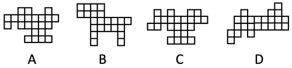
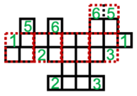
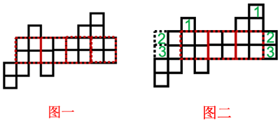

# 空间重构-立体图形外表面展开图（小正方形总数+大面完整性拼合）

考点：[[20-考点/判断推理/图形推理/空间重构-立体图形外表面展开图（小正方形总数+大面完整性拼合）|图形推理 / 空间重构-立体图形外表面展开图（小正方形总数+大面完整性拼合）]]

**问法模型**：问'哪一个是由2×2×2小正方体拼成的大正方体的外表面展开图'→空间重构模型：先按小正方形总数守恒排除，再按'每个大面须由完整2×2四格构成'验证拼合有无重叠

## 推理链
1. 第1步：由题干'2×2×2的白色小正方体拼成的大正方体'知大正方体由8个小正方体组成，每个外表面由4个小正方形组成，6个外表面共24个小正方形
2. 第2步：应用数量守恒规则——合法展开图必须恰好含24个小正方形，据此先排除格数不足的选项
3. 第3步：A、B两项均只有23个小正方形，排除A、B
4. 第4步：对C、D应用面完整性规则——折叠时每个大面必须由完整的2×2四个小正方形拼成，逐项验证能否无重叠分割
5. 第5步：C项中标序号的小正方形可拼合在对应相同序号的位置，各面均能凑成完整2×2，可以拼成，当选
6. 第6步：D项左下角存在构成L型的三个小正方形：若将中间部分分割出完整4个2×2面，最左边下方2个小正方形将与其他小正方形重叠；若只分割出3个完整2×2面，两个1号小正方形所在的大正方形面重叠，不可拼成，排除

**最快解法**：⚡ 数格子排除法：先数小正方形总数是否等于6×4=24，直接排除只有23格的A、B；再对C、D按'每个大面须切成完整2×2'验证，C项序号格可对应拼合无重叠，D项两种切法均产生重叠，故选C

## 易错点
- ⚠ 套用普通正方体展开图'6个正方形'的旧经验，忽略本题每个大面由4个小正方形构成、总数应为24，错把格数相近的A、B当候选
- ⚠ 验证C、D时不按'完整2×2大面'切割，仅凭外形接近正方体展开图形状凭直觉判断
- ⚠ 分析D项时只试一种分割方案，忽略'完整切4个面会重叠小格'与'只切3个面会重叠整面'两种方案都不可行

## 母题抽象
> 🧩 当题干出现'由n×n×n小正方体拼成的大正方体的外表面展开图'特征时，先用总数=6×n²个小正方形作数量排除，再对剩余项按'每个大面必须是完整n×n方块、拼合不得重叠'验证

**同类特征**：2×2×2小正方体、大正方体外表面展开图、8个小正方体、每个外表面4个小正方形、总数24个小正方形、面完整性拼合验证

## 相关题
（暂无）

---

### 题干

以下4个图形中，哪一个是由2×2×2的白色小正方体拼成的大正方体的外表面展开图？（    ）

### 选项
- A. A
- B. B
- C. C　✅
- D. D

### 官方解析

本题考查空间重构。由题干可知，该大正方体由8个小正方体组成，因此，大正方体每个外表面由4个小正方形组成，其6个外表面一共应包括24个小正方形，A、B两项均只有23个小正方形，排除。继续分析C、D两项。

C项：如下图所示，标有序号的小正方形可拼合在对应相同序号的位置，该项可以拼成，当选；

D项：如图一所示，左下角存在构成L型的三个小正方形，如果将展开图中间部分分割出完整的4个2×2的面（红色虚线框所示），最左边下方2个小正方形将和其他小正方形重叠，只能如图二所示，将展开图中间部分分割出完整的3个2×2的面（红色虚线框所示），2号和3号小正方形拼合在对应相同序号的位置，此时两个1号小正方形所在的大正方形面重叠，该项不可以拼成，排除。

故正确答案为C。

### 给定材料
（无）
