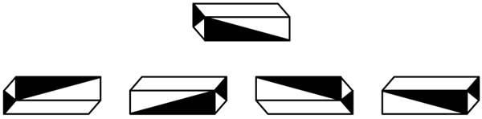
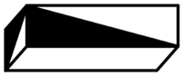
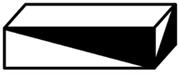

# 三视图-长方体多视角视图判断（俯视-仰视+整体旋转）

考点：[[20-考点/判断推理/图形推理/三视图-长方体多视角视图判断（俯视-仰视+整体旋转）|图形推理 / 三视图-长方体多视角视图判断（俯视/仰视+整体旋转）]]

**问法模型**：给出长方体某角度视图，问第二行几个图形是同一长方体的不同视图 → 先锁定2个非白特征面，再按可见顶/底面定俯仰视角，逐项整体旋转验证图案朝向

## 推理链
1. 第1步：从第一行视图提取特征：该长方体仅有2个面不为纯白色——一个窄端面为全黑，一个长侧面被对角线分割成黑白三角形，其余面（顶面、底面、另一端面）均为纯白
2. 第2步：确定方法：对每个候选项，先由'能看到顶面还是底面'判断视角（见顶面=俯视、见底面=仰视），再整体旋转长方体，验证两个非白面的相邻位置及黑白三角形朝向是否与真实视图一致
3. 第3步：图1——正面和左侧面非白且能看到底面（左前方仰视），推演该视角下的真实视图，黑白三角形朝向与推演结果不符，排除
4. 第4步：图2——正面和右侧面非白且能看到顶面（整体旋转后的右前方俯视），推演该视角下的真实视图，黑白三角形朝向不符，排除
5. 第5步：图3——正面和右侧面非白且能看到底面（整体旋转后的右前方仰视），推演结果与图3完全一致，保留
6. 第6步：图4——正面和右侧面非白且能看到顶面（整体旋转后的右前方俯视），推演该视角下的真实视图，黑白三角形朝向不符，排除
7. 第7步：综上仅图3通过验证，第二行4个图形中只有1个是同一长方体的不同视图，故选A

**最快解法**：⚡ 视角定位+朝向验证法：口诀'见底面=仰视、见顶面=俯视'；先确认每个图的非白面组合是否为'1个全黑端面+1个半黑长侧面'的相邻关系，再核对整体旋转后黑白三角形的开口方向——两关全过的只有图3，直接锁定答案A

## 易错点
- ⚠ 忽略'仅有2个面不为纯白色'这一约束，把纯白面误认为带图案面或数错非白面个数
- ⚠ 俯视/仰视判断颠倒：看到底面应为仰视、看到顶面应为俯视，判断错则后续旋转方向全错
- ⚠ 只比对'也有一个黑端面+一个黑三角形面'的表面相似，未验证整体旋转后黑白三角形朝向（镜像/翻转变化），误选图2或图4

## 母题抽象
> 🧩 当题干给出立体图形的一个视图并要求判断哪些是同一立体的不同视图时，先锁定特征面（非白/图案面）的数量与图案方向，再由可见顶面/底面确定俯仰视角，最后逐项整体旋转验证图案朝向是否吻合

**同类特征**：长方体视图、仅有2个面不为纯白色、全黑端面、黑白各半三角形长侧面、俯视/仰视视角判断、整体旋转后图案朝向验证

## 相关题
（暂无）

---

### 题干

下图中第一行的图形为给定的长方体某个角度的视图。问第二行的4个图形中，有几个是同一长方体的不同视图（该长方体仅有2个面不为纯白色）？（    ）

### 选项
- A. 1　✅
- B. 2
- C. 3
- D. 4

### 官方解析

逐一分析第二行的4个图形是否与第一行图形为同一长方体的不同视图：

图1：由该图形的正面和左侧面不是纯白色，且能看到底面可知，该图形可能为第一行图形的左前方仰视视角的视图，但该视角的视图应如下图所示；

图2：由该图形的正面和右侧面不是纯白色，且能看到顶面可知，该图形可能为第一行图形整体旋转后的右前方俯视视角的视图，但该视角的视图应如下图所示；

图3：由该图形的正面和右侧面不是纯白色，且能看到底面可知，该图形与第一行图形整体旋转后的右前方仰视视角的视图一致；

图4：由该图形的正面和右侧面不是纯白色，且能看到顶面可知，该图形可能为第一行图形整体旋转后的右前方俯视视角的视图，但该视角的视图应如下图所示。

综上，第二行的4个图形中只有图3与第一行图形为同一长方体的不同视图，即只有1个。

故正确答案为A。

### 给定材料
（无）
