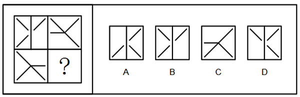

# 属性规律-中心对称（四格拼合整体对称）

考点：[[20-考点/判断推理/图形推理/属性规律-中心对称（四格拼合整体对称）|图形推理 / 属性规律-中心对称（四格拼合整体对称）]]

**问法模型**：题干为带'？'的四格拼合图、问'符合变化规律'→ 找整体属性规律（中心对称），将已知格绕大图中心旋转180°与选项比对

## 推理链
1. 第1步：题干为2×2四格拼合图，四个小方格元素组成不同，按'元素组成不同优先看属性'的思路切入
2. 第2步：观察已知三格，右上角（X形加左横线）与左下角（X形加右横线）形状相同，绕大图中心旋转180°后完全重合，即二者互为中心对称
3. 第3步：由一半图形已呈现的中心对称关系，归纳整张图应为中心对称图形，故左上角（双折线加中竖线）与右下角'？'处也应互为中心对称
4. 第4步：将左上角图案整体旋转180°（中竖线仍为竖线、折线开口方向左右翻转），得到'？'处应有的图形
5. 第5步：逐项对照——A项与左上角旋转180°后完全重合；C项与右上角形状相同（X加左横线）而非与左上角成中心对称，为干扰项；B、D的线条结构与左上角旋转结果不符
6. 第6步：仅A项使整体构成中心对称图形，故选A

**最快解法**：⚡ 整体中心对称法——把左上角小图绕大图中心旋转180°，与四个选项逐一比对，能完全重合的即为答案（A）

## 易错点
- ⚠ 误把规律当成'每个小方格自身对称'，忽略对称对象是四个格之间以大图中心为对称中心的整体关系
- ⚠ 误选C：C与右上角形状相同，但'？'处应与左上角互为旋转180°，二者形状并不相同
- ⚠ 只做局部线条的轴对称判断，漏掉'旋转180°'这一中心对称的方向验证

## 母题抽象
> 🧩 当题干是多格拼合图形且元素组成不同时，先在已知格之间找对称关系（互为旋转180°的格形状相同），再推出'？'处格与对角格互为中心对称，用旋转180°比对选项

**同类特征**：2×2四格拼合、元素组成不同、缺一格问规律、对角格图案形状相同、线条构成的小图形、中心对称

## 相关题
- [[10-真题/判断推理/图形推理/10204454 数量规律-部分数（黑白球连通区域数做和）|10204454]]（甘肃 2024，相关度1）
- [[10-真题/判断推理/图形推理/10204604 数量规律-线数量（汉字横线数）|10204604]]（辽宁 2024，相关度1）
- [[10-真题/判断推理/图形推理/10297050 数量规律-特殊计数（线条穿过小白球的数量）|10297050]]（天津 2025，相关度1）
- [[10-真题/判断推理/图形推理/10297127 图形间关系-相交图形中不相交边数量（黑白图形相交）|10297127]]（天津 2025，相关度1）
- [[10-真题/判断推理/图形推理/10297148 数量规律-线的细化（端点连线穿过线条数；备选：平行线组数）|10297148]]（天津 2025，相关度1）

---

### 题干

下列选项中，符合所给图形的变化规律的是<u>        </u>。

### 选项
- A. A　✅
- B. B
- C. C
- D. D

### 官方解析
元素组成不同，优先考虑属性规律。观察发现，右上角的图案和左下角的图案形状相同，二者为中心对称，故左上角和右下角的图案也应是形状相同，且为中心对称，当放入该图案后，题干图形整体为中心对称图形，故？处应填入A项。
故正确答案为A。

### 给定材料
（无）
