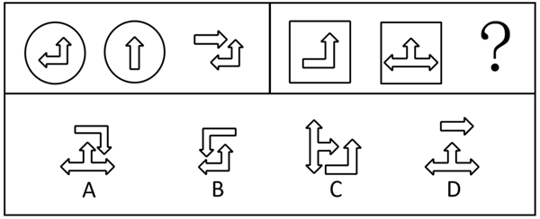

# 样式规律-加减同异（去相同外框+内部图案叠加，结合图形旋转）

考点：[[20-考点/判断推理/图形推理/样式规律-加减同异（去相同外框+内部图案叠加，结合图形旋转）|图形推理 / 样式规律-加减同异（去相同外框+内部图案叠加，结合图形旋转）]]

**问法模型**：'符合所给图形的变化规律'的两组图类比问法 → 在第一组找完整规则（先旋转、再去相同外框、内部图案保留叠加），原样套用到第二组

## 推理链
1. 第1步：两组图形元素组成相似，外框（第一组为圆、第二组为矩形）与内部箭头图案重复出现，优先考虑样式规律中的加减同异
2. 第2步：第一组中图2为圆内竖直向上箭头，将其顺时针旋转90°得到向右箭头
3. 第3步：旋转后的图2与图1（圆内折线箭头）对比，外框圆为相同元素，去掉外框，内部图案'折线箭头+向右箭头'全部保留叠加，即得图3
4. 第4步：第二组遵循同一规律：图2为矩形内三叉箭头（上、左、右三个箭头），顺时针旋转90°后三个箭头指向变为右、上、下
5. 第5步：旋转后的图2与图1（矩形内折线箭头）对比，相同外框矩形去掉，内部图案全部保留叠加得到？处图形
6. 第6步：逐项对照，C项呈现'折线箭头+旋转后的三叉箭头'组合且无外框，符合规律；A、B、D项箭头方向或组合方式不符，排除

**最快解法**：⚡ 图形规律口诀'方向不齐先旋转，外框相同先去框，剩余图案做叠加'：将第二组图2顺时针旋转90°→去矩形外框→与图1内部箭头叠加，直接锁定C

## 易错点
- ⚠ 忽略'先旋转再叠加'这一前置步骤，直接用未旋转的图2与图1叠加，会误选其他干扰项
- ⚠ 误以为外框应保留，未执行'去掉相同外框'这一步，导致组合图案多出一个矩形
- ⚠ 三叉箭头旋转90°后的指向判断错误（应变为右、上、下），方向看反会把正确项C排除

## 母题抽象
> 🧩 当两组图形呈现'相同外框+方向不同的内部图案'特征时，用'先旋转→去相同外框→内部图案保留叠加'三步法，再对照选项验证

**同类特征**：两组图对比求规律、相同外框（圆/矩形）、内部箭头图案方向不一致、元素相似、相似线条重复出现、问号处求第二组第三图、样式规律加减同异

## 相关题
- [[10-真题/判断推理/图形推理/12019768 样式规律-加减同异（求同）与位置旋转的复合规律|12019768]]（浙江 2026，相关度1）
- [[10-真题/判断推理/图形推理/5690245 图形推理-样式规律（叠加求异-去同存异）|5690245]]（上海 2017，相关度1）

---

### 题干

下列选项中，符合所给图形的变化规律的是<u>        </u>。

### 选项
- A. A
- B. B
- C. C　✅
- D. D

### 官方解析

元素组成相似，且有相似线条重复出现，优先考虑样式规律中的加减同异。第一组图形中，将图2顺时针旋转后，与图1之间，把相同的外框圆去掉，剩下的内部图案均保留从而得到图3；第二组图形也应满足此规律，将图2顺时针旋转后，与图1之间，把相同的外框矩形去掉，剩下的内部图案均保留从而得到？处图形，只有C项符合。

故正确答案为C。

### 给定材料
（无）
