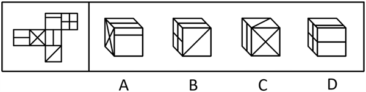
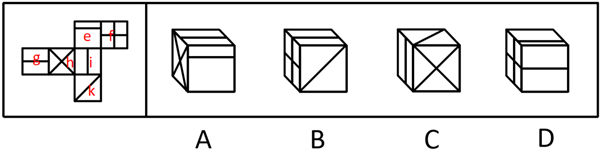
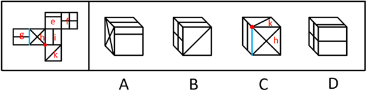

# 空间重构-六面体折叠（相邻面公共边-公共点特征验证）

考点：[[20-考点/判断推理/图形推理/空间重构-六面体折叠（相邻面公共边-公共点特征验证）|图形推理 / 空间重构-六面体折叠（相邻面公共边/公共点特征验证）]]

**问法模型**：问'不能由展开图折叠而成'（选非题）→ 给展开图各面标号，用公共边平行/垂直关系与公共点引线数逐一验证各选项，三对组合一致、一对矛盾者即为答案

## 推理链
1. 第1步：题干为六面体展开图，问法为'不能折叠而成'，属选非题；展开图含特征面：X形双对角线面、单对角线面g、横线/竖线面、田字格面k等，官方对面标号为e、f、g、h、i、k
2. 第2步：方法——相邻面定位＋公共边法＋公共点法：先确定选项各面对应展开图中的面，再核对线条与公共边的方向关系、公共点引出线条数
3. 第3步：A项由面e、g、h构成，图案与相邻位置关系均与展开图一致，排除；B项由面f、g、k构成，与展开图一致，排除；D项由面e、f、g构成，与展开图一致，排除
4. 第4步：C项正面为面h、顶面为面k，左侧面存在两种可能（面g或面i），需逐一验证
5. 第5步：若左侧面为面g——选项中面g内的线条与面g、面h的公共边平行，而展开图中面g内的线与该公共边垂直，方向矛盾
6. 第6步：若左侧面为面i——选项中三个面（h、k、i）的公共点引出两条线，而展开图中对应公共点仅引出一条线，数量矛盾
7. 第7步：C项在两种可能下均与展开图不一致，本题为选非题，故当选C

**最快解法**：⚡ 公共边法＋公共点法组合排除：先锁定C项特征面（正面h、顶面k），再看左侧面两种可能——若为g，一眼看线条与g-h公共边'平行vs垂直'即矛盾，直接选C，无需再验i的情况

## 易错点
- ⚠ 选非题审题失误：把'不能折叠'当成'能折叠'，误选A、B、D等一致项
- ⚠ 只核对图案形状、忽略线条与公共边的方向关系（平行/垂直），漏掉面g的矛盾
- ⚠ 左侧面有g、i两种可能时只验证其一便下结论，需两证皆伪才能锁定C

## 母题抽象
> 🧩 当六面体展开图中存在带方向线条的特征面、且某选项可对应多组相邻面时，用'定面→查公共边方向→查公共点引线数'双口径验证，任一口径矛盾即不能折叠；选非题中两口径皆矛盾者为答案

**同类特征**：不能由展开图折叠而成（选非）、六面体展开图、带单对角线等方向性线条的面、公共边平行/垂直关系、公共点引出线条数、同一位置对应多种面组合

## 相关题
- [[10-真题/判断推理/图形推理/1791646 空间重构-六面体折叠（公共点法+相对面排除）|1791646]]（江苏 2016，相关度1）
- [[10-真题/判断推理/图形推理/2042730 空间重构-六面体折叠（画边法-相邻面公共边）|2042730]]（江苏 2017，相关度1）
- [[10-真题/判断推理/图形推理/2049948 空间重构-六面体折叠（切角纸盒展开图-公共边重合与缺角顶点验证）|2049948]]（新疆 2017，相关度1）
- [[10-真题/判断推理/图形推理/2097180 空间重构-六面体折叠（相对面排除+画边法验证相邻面）|2097180]]（四川 2017，相关度1）
- [[10-真题/判断推理/图形推理/2188065 空间重构-六面体折叠（相对面排除+相邻面公共边特征验证）|2188065]]（选调 2018，相关度1）

---

### 题干

右边哪项不能由左侧展开图折叠而成？

### 选项
- A. A
- B. B
- C. C　✅
- D. D

### 官方解析

将题干展开图标上序号，如下图所示，逐一分析选项。

A项：选项由面e、面g和面h构成，选项与题干展开图一致，排除；

B项：选项由面f、面g和面k构成，选项与题干展开图一致，排除；

C项：选项正面为面h，顶面为面k，左侧面为面g或面i。如果选项左侧面为面g，选项中面g中的线与面g和面h的公共边平行，而题干展开图中面g中的线与二者的公共边垂直；如果选项左侧面为面i，选项中三个面的公共点引出两条线，而题干展开图中三个面的公共点仅引出一条线。两种情况下，选项与题干展开图均不一致，当选；

D项：选项由面e、面f和面g构成，选项与题干展开图一致，排除。

本题为选非题，故正确答案为C。

### 给定材料
（无）
