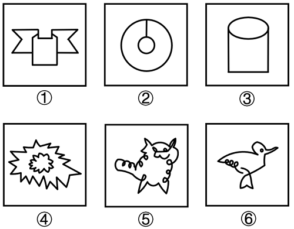

# 数量规律-笔画数（一笔画与多笔画分组）

考点：[[20-考点/判断推理/图形推理/数量规律-笔画数（一笔画与多笔画分组）|图形推理 / 数量规律-笔画数（一笔画与多笔画分组）]]

**问法模型**：'把六个图形分为两类，使每一类都有各自共同特征'的分组分类问法 → 元素组成不同且无属性规律时，转向数量规律，用笔画数（奇点数）分组

## 推理链
1. 第1步：题干六个图形各异（①丝带方框组合、②大圆内含小圆并由一线相连、③圆柱、④外围星形包内部云朵、⑤单线勾成的小猫、⑥小鸟），元素组成不同且无明显对称、曲直等属性规律
2. 第2步：题干出现'日'字变形及'封闭图形+连线'结构，启用笔画数规则：连通图奇点（引出奇数条线的点）为0或2个时可一笔画，否则笔画数=奇点数÷2，互不相连的部分分别计算再相加
3. 第3步：图②连线与两圆相接处各形成1个三叉奇点共2个、图③圆柱仅顶部椭圆与两侧竖线相接处有2个奇点、图⑤由一根连续线条画成，均为一笔画图形
4. 第4步：图①丝带与方框组合处奇点数超过2个为两笔画、图④星形与云朵两个部分互不相连各需一笔共两笔、图⑥小鸟图形奇点数超过2个为两笔画
5. 第5步：①④⑥均为两笔画一组，②③⑤均为一笔画一组，对照选项只有C（①④⑥，②③⑤）符合

**最快解法**：⚡ 奇点数法＋排除法：一眼定图④为互不相连的两个部分＝两笔，图②（圆＋连线，2个奇点）＝一笔，图⑤单线条猫＝一笔，据此排除把④⑤同组的B和把②④同组的D；再验图③圆柱奇点仅2个为一笔画，应与②⑤同组，锁定C

## 易错点
- ⚠ 把图③圆柱误判为'椭圆＋柱身'两笔画，实际线条相接处只有2个奇点，仍是一笔画
- ⚠ 只按部分数或封闭区域数分组，漏掉本题真正的笔画数（奇点数）考点
- ⚠ 图①⑥线条交叉较多，把度数为偶数的点误计为奇点，错判两笔画图为一笔画

## 母题抽象
> 🧩 当分组分类题'元素组成不同、无属性规律'且出现'日'字变形、圆线相连、多部分线条组合等特征时，用一笔画奇点法验证：奇点0或2个的归一笔画一组，其余按笔画数=奇点数÷2（不相连部分相加）归入另一组

**同类特征**：六个图形分为两类、元素组成不同、无明显属性规律、'日'字变形/圆线相连图形、多个封闭图形组合、笔画数（奇点数）规律

## 相关题
- [[10-真题/判断推理/图形推理/10204454 数量规律-部分数（黑白球连通区域数做和）|10204454]]（甘肃 2024，相关度2）
- [[10-真题/判断推理/图形推理/10297050 数量规律-特殊计数（线条穿过小白球的数量）|10297050]]（天津 2025，相关度2）
- [[10-真题/判断推理/图形推理/10297262 数量规律-面的形状种类（封闭面种类数分组）|10297262]]（浙江 2025，相关度2）
- [[10-真题/判断推理/图形推理/10297314 数量规律-交点数（曲直交点）|10297314]]（浙江 2025，相关度2）
- [[10-真题/判断推理/图形推理/11454020 数量规律-小元素按行排布（每行个数自上而下递增1）|11454020]]（选调 2024，相关度2）

---

### 题干

把下面的六个图形分为两类，使每一类图形都有各自的共同特征或规律，分类正确的一项是：

### 选项
- A. ①③④，②⑤⑥
- B. ①②③，④⑤⑥
- C. ①④⑥，②③⑤　✅
- D. ①③⑤，②④⑥

### 官方解析
本题为分组分类题目。元素组成不同，且无明显属性规律，考虑数量规律。观察发现，题干出现多个“日”字变形图，考虑笔画数。图①④⑥为两笔画图形，图②③⑤为一笔画图形，即图①④⑥为一组，图②③⑤为一组。
故正确答案为C。

### 给定材料
（无）
