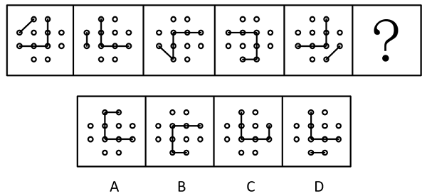

# 位置规律（多元素复合：平移+旋转）

考点：[[20-考点/判断推理/图形推理/位置规律（多元素复合：平移+旋转）|图形推理 / 位置规律（多元素复合：平移+旋转）]]

**问法模型**：题干问'填入问号处使之呈现一定的规律性'且各图元素组成相同 → 拆分图形中的独立元素，分别追踪每个元素的位置变化（平移的方向与步数＋旋转的方向与角度），用多条件交集锁定答案

## 推理链
1. 第1步：每幅图均由3×3圆点阵、1条两端落在圆点上的小短线、1条带拐点的折线构成，五幅图元素组成完全相同，优先考虑位置规律而非样式规律
2. 第2步：将图形拆分为三个独立运动的要素分别追踪：小短线、折线的拐点、折线整体（官方解析思路）
3. 第3步：小短线规律——沿外圈依次逆时针平移1格（图1位于左上，逐图逆时针走，到图5已移至右下），问号处应在图5基础上再逆时针平移1格
4. 第4步：折线拐点规律——拐点在内圈依次顺时针平移1格，问号处拐点应再顺时针移1格
5. 第5步：折线整体规律——折线逐图顺时针旋转（90°），问号处折线开口方向应在图5基础上再顺时针转90°
6. 第6步：逐项对照——A、B、D三项在小短线外圈位置、拐点内圈位置、折线旋转后方向三个条件中至少一项不吻合
7. 第7步：只有C项同时满足'短线逆时针移1格＋拐点顺时针移1格＋折线顺时针旋转'三重规律，故选C

**最快解法**：⚡ 拆分追踪法（'元素相同看位置'口诀）：把小短线、拐点、折线开口当作三个独立'指针'——小短线沿外圈逆时针每图走1格、拐点沿内圈顺时针每图走1格、折线整体每图顺时针转90°，三个条件同时满足的选项即为C，可用排除法快速砍掉只符合一两条规律的A、B、D

## 易错点
- ⚠ 三个要素运动方向不一致（小短线逆时针、拐点顺时针、折线整体顺时针旋转），只盯单一要素找规律极易误选
- ⚠ 忽略'折线拐点在内圈平移'这一隐藏规律，只按折线整体旋转去排除，会在B/D与C之间纠结出错
- ⚠ 外圈按1格逐图平移，数错步数或把平移误看成旋转，导致小短线位置对不上

## 母题抽象
> 🧩 当各图元素组成相同、且图形由多条可分离的线段/小元素分布在点阵或框架上时，拆分每个元素分别追踪其平移（方向＋步长）与旋转（方向＋角度），再用多条件交集锁定唯一答案

**同类特征**：元素组成相同、九宫圆点阵＋小短线＋折线、多个元素各自独立运动、平移与旋转复合规律、问号处延续前图规律

## 相关题
- [[10-真题/判断推理/图形推理/2172768 位置规律（旋转-翻转）|2172768]]（海南 2021，相关度1）
- [[10-真题/判断推理/图形推理/10204458 位置规律-平移（特征交点沿内圈循环平移）|10204458]]（甘肃 2024，相关度1）
- [[10-真题/判断推理/图形推理/10204614 图形推理-位置规律（旋转+翻转交替循环）|10204614]]（黑龙江 2024，相关度1）
- [[10-真题/判断推理/图形推理/10297399 位置规律—平移（多黑块分组循环平移）|10297399]]（四川 2025，相关度1）
- [[10-真题/判断推理/图形推理/11226892 位置规律-九宫格小元素沿固定循环链移动|11226892]]（上海 2025，相关度1）

---

### 题干

从所给的四个选项中，选择最合适的一个填入问号处，使之呈现一定的规律性：

### 选项
- A. A
- B. B
- C. C　✅
- D. D

### 官方解析

元素组成相同，优先考虑位置规律。观察发现，小短线在外圈依次逆时针平移1格，折线的拐点在内圈依次顺时针平移1格，折线整体依次顺时针旋转了，只有C项符合。

故正确答案为C。

### 给定材料
（无）

> [!warning] 疑点（官方解析可能有误，待人工复核）
> 官方解析'折线整体依次顺时针旋转了'一句缺失旋转角度（按图形规律应为每次顺时针旋转90°），属表述不完整，但不影响答案C的判定
