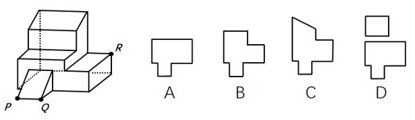
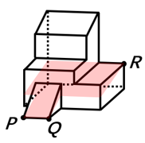

# 截面图（立体切割——三点定面）

考点：[[20-考点/判断推理/图形推理/截面图（立体切割——三点定面）|图形推理 / 截面图（立体切割——三点定面）]]

**问法模型**：“经P、Q、R三点的平面切割多面体求切面”→先用平面公理确定唯一切割平面，再沿多面体表面追踪截线还原截面轮廓，与选项比对

## 推理链
1. 第1步：从题干和图形提取信息：多面体为阶梯状组合体（上部大块＋下部台阶＋右侧凸块），P、Q位于前下方棱上，R位于右侧凸块上棱端点，三点不在同一直线上
2. 第2步：应用官方解析所依据的平面公理“过不在一条直线上的三点，有且只有一个平面”，故P、Q、R唯一确定切割平面，截面形状唯一
3. 第3步：确定平面行进路径：P、Q同在前下部，连线PQ构成截面在前部的下沿；平面由PQ朝R（右上方）方向延伸切入立体
4. 第4步：追踪截线：平面先穿过P、Q所在的下部小块（形成截面左下方的小凸块），再穿过台阶面与上部大块形成主体大矩形轮廓，最后经R所在的右侧棱切出，各截线均落在相互垂直的表面上，轮廓由直角折线构成、无斜边
5. 第5步：逐项对照：A项为带左下小凸块的多边形，与“P、Q下部小平台＋上部大切面”吻合；B项凸块与主体朝向不符（旋转/镜像干扰）；C项顶部出现斜边，而该平面与各垂直表面的交线不应产生此斜线；D项为两个分离图形，与三点确定的同一平面截得的连通截面不符
6. 第6步：结论：唯一切面为A，与官方答案一致

**最快解法**：⚡ 三点定面＋截线追踪法：先连P、Q确定平面在前部的入刀下沿，再把平面朝R方向“压”入立体想象切割路径，勾出“主体大矩形＋左下小凸块”的轮廓直接锁定A；D两块分离、C含斜边、B方向不符均可快速排除

## 易错点
- ⚠ 忽视平面公理的唯一性，凭感觉平移或转动切割平面，导致截面走向判断错误
- ⚠ A与B互为旋转/镜像干扰，把P、Q所在小凸块（下部平台）在截面中的朝向看反
- ⚠ 误选D：误以为凹形立体被平面切割会得到两块分离截面，实际该三点确定的平面截得的是连通的一个多边形

## 母题抽象
> 🧩 当题干出现“过三点的平面切割多面体求截面”特征时，用“平面公理三点定面＋沿表面追踪截线”方法，画出截面轮廓并比对凸块位置、边角形状与连通性

**同类特征**：经P、Q、R三点的平面切割、求切面/截面图问法、阶梯状（凹）多面体、其中两点（P、Q）同在一条棱附近、选项含旋转镜像干扰项、选项含分离双图形干扰项

## 相关题
- [[10-真题/判断推理/图形推理/19526333 截面图（立体切割—三点定面）|19526333]]（国考 2026，相关度1）

---

### 题干

左边为给定的多面体，现用经P、Q、R三点的平面对其进行切割，问哪个选项是其切面？

### 选项
- A. A　✅
- B. B
- C. C
- D. D

### 官方解析

本题考查截面图。根据平面公理“过不在一条直线上的三点，有且只有一个平面”可以得出，经过P、Q、R三点可以确定的唯一切面（即截面），即为A项，如下图所示：

故正确答案为A。

### 给定材料
（无）
