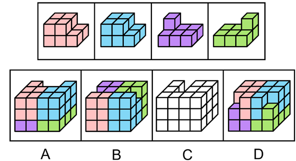

# 立体拼合（多组件拼合·选非题）

考点：[[20-考点/判断推理/图形推理/立体拼合（多组件拼合·选非题）|图形推理 / 立体拼合（多组件拼合·选非题）]]

**问法模型**：给出4个已知多面体，问在3×3×4空间内'不可能'拼成哪个选项 → 选非型立体拼合：逐项按'先大后小、凹凸互补'试拼，能拼成的全部排除，剩余项即答案

## 推理链
1. 第1步：清点题干4个组件的特征——前两个是带一级台阶的块状体（形似2×2×2缺角/带阶梯的大块），后两个是'底部3连+顶部1凸'的小块，且第3块凸起在左端、第4块凸起在右端，凸起方向互为镜像
2. 第2步：明确拼合规则——组件可三维旋转摆放，在3×3×4空间内必须凹凸互补、不重叠、不悬空；由于四选项均为近似完整方块带缺口、单位正方体总数与组件总量一致，数数法无法排除，必须做凹凸形状匹配
3. 第3步：采用'先大后小'试拼——先用两个带台阶的大块占满目标立体的主体与底层，再看剩余缺口能否被两个'3连+1凸'小块以合适朝向嵌入
4. 第4步：对A项试拼，其顶部/侧面缺口的位置与走向恰好容纳'一左凸一右凸'两小块及大块台阶，四块可无缝嵌入，排除
5. 第5步：对B、D项同样试拼，缺口均能与两小块的凸起及大块台阶形成凹凸互补，官方验证均可拼成，排除
6. 第6步：对C项试拼，其顶部凹陷的形状与位置使两个'3连+1凸'小块无论怎样旋转都无法同时凹凸互补，填入后必有组件重叠或残留空洞，故C不可能拼成
7. 第7步：本题为选非题，'不可能拼成'的C即为正确答案

**最快解法**：⚡ 凹凸互补排除法：先数四组件与各选项的单位正方体数做初筛（本题数量一致，数数失效），再按'先摆两个大块、后塞两个小块'逐项试拼，凡能无缝拼满的划掉，划掉A、B、D后剩下的C即为'不可能'项

## 易错点
- ⚠ 忽略选非问法，把'能拼成'的A/B/D误当答案
- ⚠ 只数方块总数不验证凹凸形状，数量一致时数量法失效应转凹凸匹配
- ⚠ 立体图观察时把缺口的前后/左右位置看反（镜像混淆），误判'3连+1凸'小块的凸起朝向能否嵌入缺口

## 母题抽象
> 🧩 当题干出现'若干小多面体拼成目标立体（或问不可能拼成哪个）'时，先数单位正方体个数排除数量不符项，再按'先大后小、凹凸互补'逐项旋转试拼，选非题最后取反

**同类特征**：立体拼合、3×3×4限定空间、四个组件（两个带台阶大块+两个'3连+1凸'小块）、棱长为1的单位正方体、选非问法（不可能拼成）、凹凸互补/可旋转摆放

## 相关题
- [[10-真题/判断推理/图形推理/2776149 图形推理-立体拼合（小方块计数守恒+分层形状咬合）|2776149]]（浙江 2021，相关度1）
- [[10-真题/判断推理/图形推理/10204640 立体拼合（多面体组合：数量守恒+凹凸互补+旋转）|10204640]]（河南 2024，相关度1）
- [[10-真题/判断推理/图形推理/12019797 立体拼合-由两视图及全等小块反推小立体（数小立方体+旋转试装）|12019797]]（浙江 2026，相关度1）
- [[10-真题/判断推理/图形推理/12536475 图形推理-立体拼合（正方体堆叠多面体组合）|12536475]]（四川 2024，相关度1）
- [[10-真题/判断推理/图形推理/12881949 立体拼合-多块拼合正方体（凹凸互补+旋转）|12881949]]（广东 2025，相关度1）

---

### 题干

以下为4个由若干棱长为1的正方体拼成的多面体，将它们在3×3×4空间内进行拼接，不可能拼成以下四个选项中的哪一个多面体？

### 选项
- A. A
- B. B
- C. C　✅
- D. D

### 官方解析

本题考查立体拼合。如下图所示，A、B、D三项均能由题干多面体拼接而成。

本题为选非题，故正确答案为C。

### 给定材料
（无）
