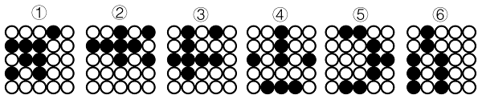
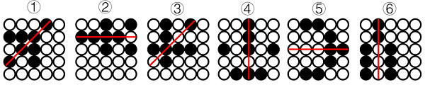

# 属性规律-对称性（黑球整体轴对称+对称轴经过黑球个数的二级辨析）

考点：[[20-考点/判断推理/图形推理/属性规律-对称性（黑球整体轴对称+对称轴经过黑球个数的二级辨析）|图形推理 / 属性规律-对称性（黑球整体轴对称+对称轴经过黑球个数的二级辨析）]]

**问法模型**：“六个图形分为两类，使每类有各自共同特征”→分组分类题：元素组成相同且位置规律失效时，转属性规律（对称性），再对对称轴细节做二级分类

## 推理链
1. 第1步：题干六图均由黑球和白球构成的点阵图形，元素组成相同，且无明显平移、旋转等位置规律
2. 第2步：黑球分布较为规整，转属性规律——将每幅图中所有黑球视为一个整体图形，考虑其对称性
3. 第3步：逐图验证：①②④③⑤⑥的黑球部分均为轴对称图形，仅凭“轴对称”无法分成两类
4. 第4步：进行二级辨析——观察对称轴与黑球的位置关系：图①②④的对称轴均经过四个黑球
5. 第5步：图③⑤⑥的对称轴均经过两个黑球
6. 第6步：故①②④为一组、③⑤⑥为一组，对照选项，B项“①②④，③⑤⑥”符合

**最快解法**：⚡ 黑球整体描形+数轴法：把每图黑球连成整体画对称轴，数对称轴穿过的黑球个数——①②④穿4个黑球、③⑤⑥穿2个黑球，直接锁定B

## 易错点
- ⚠ 只验证“都是轴对称”就停止，缺少二级辨析（对称轴经过黑球个数不同），导致无法分组而乱选
- ⚠ 把黑球逐个单独看对称，未将所有黑球视为一个整体图形来找对称轴
- ⚠ 对称轴方向找错或漏找（斜轴/竖轴），数出的“穿过黑球个数”出错

## 母题抽象
> 🧩 当题干出现黑白小球点阵、元素组成相同且位置规律失效、黑球分布规整的特征时，将黑球视为整体看轴对称性，再用“对称轴经过的黑球（元素）个数”做二级分类验证

**同类特征**：黑白球点阵图、元素组成相同、无明显位置规律、黑球分布规整、分组分类题型、对称轴经过元素个数二级辨析

## 相关题
- [[10-真题/判断推理/图形推理/13504530 属性规律-对称性（黑白球分开看＋对称轴方向顺时针旋转）|13504530]]（河南 2025，相关度2）
- [[10-真题/判断推理/图形推理/16069886 数量规律-黑块部分数（连通分堆数）|16069886]]（贵州 2026，相关度2）
- [[10-真题/判断推理/图形推理/2719404 图形推理-一笔画（黑球连线的奇点数与笔画数）|2719404]]（国考 2021，相关度2）
- [[10-真题/判断推理/图形推理/4637321 数量规律-部分数（黑白球连通部分数，两级辨析）|4637321]]（国考 2022，相关度2）
- [[10-真题/判断推理/图形推理/2172768 位置规律（旋转-翻转）|2172768]]（海南 2021，相关度1）

---

### 题干

把下面的六个图形分为两类，使每一类图形都有各自的共同特征或规律，分类正确的一项是：

### 选项
- A. ①②⑥，③④⑤
- B. ①②④，③⑤⑥　✅
- C. ①③⑥，②④⑤
- D. ①④⑤，②③⑥

### 官方解析

本题为分组分类题目。元素组成相同，且无明显位置规律，考虑属性规律。观察发现，题干图形均由黑球和白球构成，且黑球分布较为规整，考虑对称性。题干图形的黑球部分均为轴对称图形，且图①②④的对称轴均经过四个黑球，图③⑤⑥的对称轴均经过两个黑球，即图①②④为一组，图③⑤⑥为一组。

故正确答案为B。

### 给定材料
（无）
