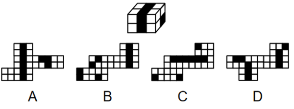
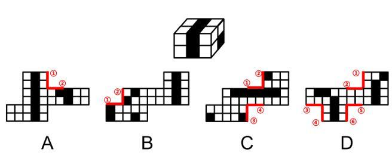

# 空间重构-外表面展开图（公共边法）

考点：[[20-考点/判断推理/图形推理/空间重构-外表面展开图（公共边法）|图形推理 / 空间重构-外表面展开图（公共边法）]]

**问法模型**：“哪一项可能是其正确的外表面展开图”→ 对展开图用公共边法：找出折叠后粘合成直角公共边的成对边，逐对验证两侧小方块颜色是否一致，不符即排除。

## 推理链
1. 第1步：题干给出“4个黑色、8个白色正方体粘接成的长方体”，原立体中黑色方块在顶面、侧面形成贯通的黑色条带，说明相邻面交界处黑块位置有严格对应关系。
2. 第2步：规则——“由构成直角的两条边为公共边可知，公共边两侧对应的黑白块颜色应相同”，即展开图中折叠后会粘合的成对边，两侧紧邻的小方块颜色必须黑白一致。
3. 第3步：A项——公共边①和②两侧黑白块颜色不同，与原立体相邻面颜色关系矛盾，排除。
4. 第4步：B项——公共边①和②两侧黑白块颜色不同，排除。
5. 第5步：C项——公共边①和②、③和④两侧黑白块颜色均不同（③④边是隔行折叠后粘合的边，易漏检），排除。
6. 第6步：D项——公共边①和②、③和④、⑤和⑥两侧黑白块颜色均相同，折叠后与原长方体黑块条带分布一致，当选。

**最快解法**：⚡ 公共边法：在四个展开图中标出所有折叠后重合（构成直角）的成对边（①对②、③对④、⑤对⑥），逐对检查两侧紧邻小方块是否同色，颜色对不上的秒杀排除，全部匹配者为答案D。

## 易错点
- ⚠ 只数黑块总数是否为4黑8白，忽略相邻公共边的颜色对应关系，误选数量相符但位置错误的选项。
- ⚠ 公共边配对错误：没识别出展开图中哪些边折叠后粘合成直角，把不相干的边当作公共边比较。
- ⚠ 漏检隔行/隔列折叠后形成的公共边（如C项③和④边），导致排查不彻底而误选C。

## 母题抽象
> 🧩 当题干给出黑白方块粘接的立体图形并问“哪一项可能是其外表面展开图”时，用公共边法：折叠后构成直角粘合的成对边，两侧紧邻方块颜色必须一致，逐对验证排除。

**同类特征**：4个黑色、8个白色正方体粘接成长方体、外表面展开图、哪一项可能、黑白块颜色分布、构成直角的两条边为公共边、公共边两侧颜色相同

## 相关题
- [[10-真题/判断推理/图形推理/16593126 空间重构-外表面展开图（面数量+特征面相邻关系排除）|16593126]]（青海 2024，相关度1）
- [[10-真题/判断推理/图形推理/2719391 空间重构-六面体展开图（相邻面公共边法）|2719391]]（国考 2021，相关度1）
- [[10-真题/判断推理/图形推理/4662406 空间重构-立体图形外表面展开图（相邻面公共边验证）|4662406]]（山东 2022，相关度1）
- [[10-真题/判断推理/图形推理/5697963 空间重构-四面体展开图（相邻面公共边法）|5697963]]（江苏 2023，相关度1）

---

### 题干

下图为4个黑色、8个白色正方体粘接成的长方体，问哪一项可能是其正确的外表面展开图?

### 选项
- A. A
- B. B
- C. C
- D. D　✅

### 官方解析

本题为空间重构题，可以通过公共边进行判断，由构成直角的两条边为公共边可知，公共边两侧对应的黑白块颜色应相同，逐一进行分析。

A项：公共边①和②两侧黑白块颜色不同，选项与题干不一致，排除；

B项：公共边①和②两侧黑白块颜色不同，选项与题干不一致，排除；

C项：公共边①和②、③和④两侧黑白块颜色不同，选项与题干不一致，排除；

D项：公共边①和②、③和④、⑤和⑥两侧黑白块颜色均相同，选项与题干一致，当选。

故正确答案为D。 

### 给定材料
（无）
