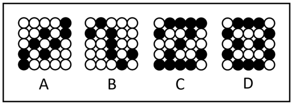

# 属性规律-对称性（仅中心对称与轴+中心对称的区分）

考点：[[20-考点/判断推理/图形推理/属性规律-对称性（仅中心对称与轴+中心对称的区分）|图形推理 / 属性规律-对称性（仅中心对称与轴+中心对称的区分）]]

**问法模型**：问'与其它三项不同的是'→三同一异型选非题：先归纳三个选项的共同属性规律，再挑出唯一不符合者

## 推理链
1. 第1步：四幅图均由5×5的黑球和白球组成，元素组成不同，且黑白球整体分布比较规整，提示优先考虑属性规律而非数量规律
2. 第2步：将每幅图的黑白球分布视为一个整体图形，判定其对称类型（仅中心对称/仅轴对称/轴+中心对称）
3. 第3步：把A、B、C整体旋转180°，黑白球分布均与原图重合，且沿任何方向都找不到使两侧镜像重合的对称轴，故A、B、C同为'仅中心对称图形'
4. 第4步：D项旋转180°后与原图重合（具中心对称性），同时存在一条对称轴，轴两侧黑白球分布镜像重合（具轴对称性）
5. 第5步：A、B、C为'仅中心对称'，D为'轴+中心对称'，D的对称属性与其余三项唯一不同，本题选非，故选D

**最快解法**：⚡ 对称性分类法：先对四图整体做'旋转180°是否与自身重合'的检验（四图均通过，皆中心对称）；再逐图找对称轴，发现只有D能找到对称轴，'三仅中心+一轴加中心'，不同者即D

## 易错点
- ⚠ 看到黑白球就先数黑球个数或找黑白交替的数量规律，忽略'黑白球整体分布规整'这一指向属性规律（对称性）的信号
- ⚠ 把白球当作'空格不存在'，只分析黑球局部，而对称性必须看黑白球整体分布；或找到中心对称后就停止，漏验是否存在对称轴，混淆'仅中心对称'与'轴+中心对称'
- ⚠ 忽略'与其它三项不同的是'为选非问法，误选三个相同属性的选项

## 母题抽象
> 🧩 当题干出现黑白球/黑白格规整排布且问'与其它三项不同'时，把黑白球当整体看对称性，用'仅中心对称 vs 轴+中心对称'分类，挑出对称类型唯一不同的选项

**同类特征**：黑白球规整分布、元素组成不同优先属性规律、问'与其它三项不同的是'（选非求异）、中心对称、轴对称+中心对称、整体对称类型分类

## 相关题
- [[10-真题/判断推理/图形推理/12561860 数量规律-面数量与属性规律-对称轴数量的复合对应规律|12561860]]（浙江 2024，相关度1）
- [[10-真题/判断推理/图形推理/1791814 属性规律-对称性（中心对称）|1791814]]（江苏 2016，相关度1）
- [[10-真题/判断推理/图形推理/18899567 属性规律-中心对称（四格拼合整体对称）|18899567]]（上海 2021，相关度1）
- [[10-真题/判断推理/图形推理/2028342 属性规律（曲直性上下交替）＋数量规律（面数量）|2028342]]（国考 2017，相关度1）
- [[10-真题/判断推理/图形推理/2387635 对称性-对称轴与图形内部线条的位置关系（重合-不重合交替）|2387635]]（浙江 2019，相关度1）

---

### 题干

下列选项中，与其它三项不同的是<u>        </u>。

### 选项
- A. A
- B. B
- C. C
- D. D　✅

### 官方解析
元素组成不同，优先考虑属性规律。观察发现，每幅图均由黑球和白球组成，且黑白球整体分布比较规整，考虑对称性。A、B、C三项均为仅中心对称图形，而D项为轴+中心对称图形，故只有D项与其它三项不同。
本题为选非题，故正确答案为D。

### 给定材料
（无）
