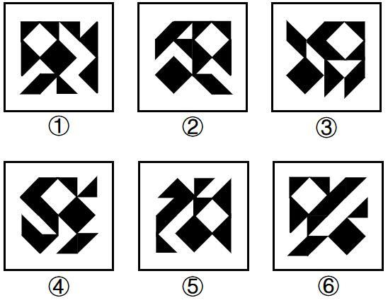

# 图形推理-元素相对位置关系（指定两元素相交于线-相离）

考点：[[20-考点/判断推理/图形推理/图形推理-元素相对位置关系（指定两元素相交于线-相离）|图形推理 / 图形推理-元素相对位置关系（指定两元素相交于线/相离）]]

**问法模型**：“把六个图形分为两类，使每一类都有各自共同特征”→ 分组分类题，先看整体规律，再比较每幅图共有元素间的相对位置关系

## 推理链
1. 第1步：六图元素组成相同（均为黑白七巧板式拼块），整体看无平移、旋转、翻转等明显位置规律，转而找局部元素关系
2. 第2步：逐图观察发现每幅图中均有一个黑菱形和一个白菱形，锁定'黑菱形+白菱形'这对共有元素作为分组依据
3. 第3步：比较两菱形的接触方式：图①④⑤中黑菱形与白菱形相交于一条公共边（相交于线）；图②③⑥中黑菱形与白菱形互不接触（相离）
4. 第4步：据此将①④⑤归为一组，②③⑥归为另一组
5. 第5步：对照选项，A项为①④⑤，②③⑥，与规律一致，故选A

**最快解法**：⚡ 找共有元素+位置比较法：先扫一遍确认每图都有'一黑一白两个菱形'，只盯这两个元素的相对位置——①④⑤两菱形共边相邻（相交于线），②③⑥两菱形分离不接触，直接锁定A

## 易错点
- ⚠ 整体无位置规律后误找黑白面积、图形个数等次要规律，漏掉'指定两元素相对位置'这一核心考点
- ⚠ 把'相交于线'误判为'点相交'或'部分重叠'，需区分点接触、线接触与完全相离三种接触方式
- ⚠ 图形为七巧板式复杂拼合，黑白菱形隐藏在拼块轮廓中，易被外框大轮廓干扰而漏认菱形元素

## 母题抽象
> 🧩 当分组分类题'元素组成相同但整体无位置规律'时，找每幅图共有的特定元素对，比较其相对位置关系（相交于线/相交于点/相离）作为分组标准

**同类特征**：元素组成相同、整体无位置规律、每图含一黑一白两个菱形、①④⑤黑白菱形相交于线、②③⑥黑白菱形相离、分组分类问法

## 相关题
- [[10-真题/判断推理/图形推理/19283870 图形推理-位置规律（两元素连线的平行-垂直关系）|19283870]]（国考 2025，相关度2）
- [[10-真题/判断推理/图形推理/2719404 图形推理-一笔画（黑球连线的奇点数与笔画数）|2719404]]（国考 2021，相关度2）
- [[10-真题/判断推理/图形推理/5893647 数量规律-元素分隔部分数及每部分元素个数（黑球分块计数）|5893647]]（国考 2024，相关度2）
- [[10-真题/判断推理/图形推理/2172768 位置规律（旋转-翻转）|2172768]]（海南 2021，相关度1）
- [[10-真题/判断推理/图形推理/10204458 位置规律-平移（特征交点沿内圈循环平移）|10204458]]（甘肃 2024，相关度1）

---

### 题干

把下面的六个图形分为两类，使每一类图形都有各自的共同特征或规律，分类正确的一项是：

### 选项
- A. ①④⑤，②③⑥　✅
- B. ①③⑤，②④⑥
- C. ①③④，②⑤⑥
- D. ①②④，③⑤⑥

### 官方解析
本题为分组分类题目。元素组成相同，但整体看没有明显的位置规律。观察发现，题干每幅图中均有一个黑菱形和一个白菱形，且图①④⑤中的黑菱形和白菱形相交于线，图②③⑥中的黑菱形和白菱形不相交。故图①④⑤为一组，图②③⑥为一组。
故正确答案为A。

### 给定材料
（无）
