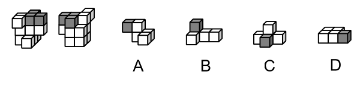
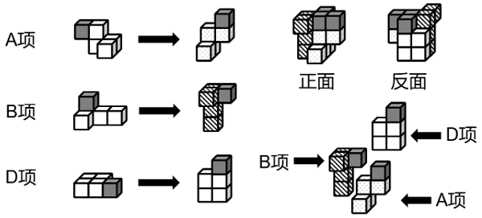

# 立体拼合（多块组合·选非型）

考点：[[20-考点/判断推理/图形推理/立体拼合（多块组合·选非型）|图形推理 / 立体拼合（多块组合·选非型）]]

**问法模型**：'可以由除哪项外的三个多面体组合而成'的选非问法 → 立体拼合模型：逐一旋转验证各选项能否与另外两块凹凸契合拼成题干多面体，唯一不能拼入的一项即答案

## 推理链
1. 第1步：题干多面体由12个白色正方体和3个灰色正方体组成（共15块），图中给出其前后两面直观图，需综合两图确定整体轮廓及3个灰色方块的空间位置
2. 第2步：问法'可以由除哪项外的三个多面体组合而成'为选非型立体拼合——从A、B、C、D中选出能拼成题干多面体的三块，唯一无法拼入的选项即为正确答案
3. 第3步：观察选项结构，A、B、C、D均恰含1个灰色正方体，与题干3个灰色方块一一对应，拼合时灰块可作为确定各块朝向与嵌入位置的定位锚点
4. 第4步：数块核对：D为2×3共6块的平板，故A、B两块应合计9块（A约5块、B约4块），候选组合须同时满足总块数为15且凹凸形状互补
5. 第5步：旋转嵌入验证：将A、B、D分别以灰块对准题干前、后两面直观图中灰色方块的位置旋入，三块的凸起与凹陷恰好互补，可拼出题干多面体（官方解析拼合图所示）
6. 第6步：C项为'白块居上、灰块居中、白块环绕'的结构，其灰块被白块包围的连接方式与题干中3个灰色方块的实际位置关系不符，无论怎样旋转均无法嵌入剩余空间
7. 第7步：本题为选非题，能拼入题干多面体的是A、B、D，不能拼入的C即为正确答案

**最快解法**：⚡ 灰块定位法＋旋转嵌入：以每块中唯一的灰色正方体为锚点，对照题干前、后两面直观图中灰色方块的位置逐一旋转试嵌，A、B、D凹凸互补可拼入（配合数块：D为6块，A、B合计9块，共15块），C怎么旋转都无法契合，选非故选C

## 易错点
- ⚠ 选非题审题失误：误把'除哪项外'理解成'选能拼合的一项'，错选A、B、D之一
- ⚠ 忽略'前后两面直观图'是同一多面体的两个视角，误当作两个不同多面体或重复计数灰色方块
- ⚠ 只凑小方块总数（15块）而忽略凹凸形状是否互补，误认为数量相等的组合即可拼合

## 母题抽象
> 🧩 当题干出现'某多面体可由除哪项外的几块拼合'的选非问法且各候选项含特征色（灰色）方块时，用特征色方块定位＋旋转嵌入法，验证各块与题干多面体的凹凸契合及总块数，无法嵌入者即答案

**同类特征**：选非问法：'可以由除哪项外的三个多面体组合而成'、立体拼合（多块组合）、12个白色＋3个灰色正方体，共15块、前后两面直观图（同一多面体两个视角）、四个选项各含1个灰色方块、需旋转嵌入验证凹凸契合

## 相关题
（暂无）

---

### 题干

左边为由12个白色正方体和3个灰色正方体组合而成的多面体前后两面直观图，问其可以由除哪项外的三个多面体组合而成？

### 选项
- A. A
- B. B
- C. C　✅
- D. D

### 官方解析

本题考查立体拼合。题干多面体可以由A、B、D三项中的立体图形拼合而成，具体拼合过程如下图所示：

本题为选非题，故正确答案为C。

### 给定材料
（无）
