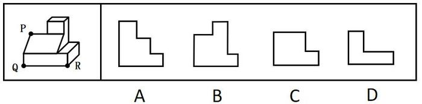
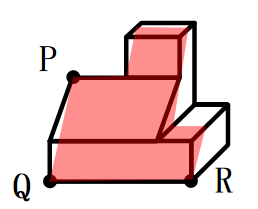

# 截面图（立体切割—三点定面）

考点：[[20-考点/判断推理/图形推理/截面图（立体切割—三点定面）|图形推理 / 截面图（立体切割—三点定面）]]

**问法模型**：'用经P、Q、R三点的平面对多面体进行切割，切面为？' → 先用'三点定面'公理确定唯一切割平面，再沿立体各表面依次描出交线得到截面轮廓

## 推理链
1. 第1步：从题干图形提取前提：Q、R两点位于多面体底部同一条棱（底面前沿）上，P位于上方斜面上，三点不在同一条直线上
2. 第2步：应用官方解析所依据的立体几何公理'过不在一条直线上的三点，有且只有一个平面'，故经P、Q、R的切割平面是唯一确定的
3. 第3步：确定切面走向：因Q、R同在底部棱上，切面与底面的交线为水平线段QR，即截面的底边；切面自QR向P所在的斜面方向倾斜升高
4. 第4步：切面在左侧先截左侧面得自Q上升的交线，随后与斜面相交于过P的直线，该交线沿斜面继续向右上方升高
5. 第5步：切面继续延伸穿过顶部小凸起，在截面上形成先升、再平、后降的'台阶'状交线，即截面右侧升高部分的来源；最后交线沿右侧表面下降回到R，与底边QR封闭成图
6. 第6步：逐项对照：A为左高右低的阶梯轮廓，与切面'过P后升高穿过顶部凸起'的实际走向相反，排除；C、D的台阶位置与轮廓走向和各表面交线不符，排除
7. 第7步：B项轮廓（左低、右侧因切过顶部凸起而升高、底边为QR）与上述交线围成的封闭图形一致，与官方答案B相符

**最快解法**：⚡ 三点定面＋表面描线法：先由Q、R同在底部棱上锁定截面底边QR，再由P点定切面倾斜方向，沿'左侧面→斜面（过P）→顶部小凸起→右侧面'依次描出交线并封闭，对照选项即为B

## 易错点
- ⚠ 把切面的倾斜方向看反，误选与实际'左低右高'相反的阶梯形A
- ⚠ 忽略切面同时穿过顶部小凸起，漏掉截面右侧升高台阶，误选C或D
- ⚠ 把截面图当成多面体的外部轮廓投影，而非切割平面与各表面交线围成的封闭平面图形

## 母题抽象
> 🧩 当题干出现'用经过三点的平面切割给定多面体求切面'时，先用'三点定面'锁定唯一切割平面（若两点共棱/共面则先定该底边），再沿多面体各表面依次描出交线并封闭成图，与选项比对验证

**同类特征**：经P、Q、R三点的平面切割、求切面（截面）图形、三点定面公理、Q、R同在底部棱上、P位于斜面上、斜面＋顶部小凸起结构

## 相关题
- [[10-真题/判断推理/图形推理/19283859 截面图（立体切割——三点定面）|19283859]]（国考 2025，相关度1）

---

### 题干

左边为给定的多面体，现用经P、Q、R三点的平面对其进行切割，切面为：

### 选项
- A. A
- B. B　✅
- C. C
- D. D

### 官方解析

本题考查截面图。根据平面公理“过不在一条直线上的三点，有且只有一个平面”可以得出，经过P、Q、R三点可以确定唯一的切面（即截面），即为B项，如下图所示：

故正确答案为B。

### 给定材料
（无）
