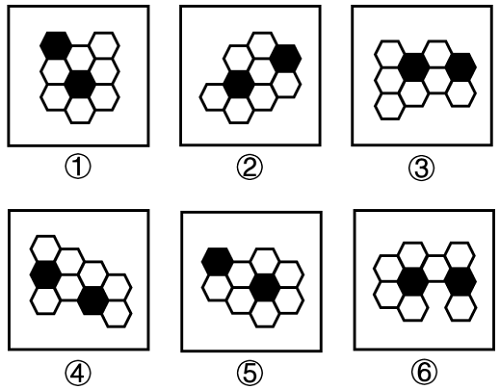

# 图形推理-特殊元素间最短路径形态（线连接-面连接）

考点：[[20-考点/判断推理/图形推理/图形推理-特殊元素间最短路径形态（线连接-面连接）|图形推理 / 图形推理-特殊元素间最短路径形态（线连接/面连接）]]

**问法模型**：六个图形分两类、每类各有共同规律 → 元素组成相同时排除数量类，转向两黑块间'最短路径'的形态（成线还是成面）分组

## 推理链
1. 第1步：六个图形均由蜂窝状六边形构成，元素组成相同，且每图都恰好含两个黑色六边形与若干白色六边形
2. 第2步：元素组成相同但各图外轮廓、黑块位置均无平移/旋转等位置规律，故不考位置，转向考查两个黑块之间的连接关系
3. 第3步：沿两个黑块之间找最短连通路径：图①③⑥中，两黑块沿路径首尾相接，路径呈宽为1的'一条线'（线连接）
4. 第4步：图②④⑤中，两黑块连同最短路径途经及两侧的白块充满一个有宽度的区域，路径呈'一个面'（面连接）
5. 第5步：按'线连接/面连接'二分：①③⑥为一组，②④⑤为一组
6. 第6步：对照选项，只有C项'①③⑥，②④⑤'与该分组一致，故选C

**最快解法**：⚡ 规律口诀法：锁定每图仅有的两个黑块，看其间最短路径——路径成一条单链'线'的①③⑥一组，路径撑成一个有宽度的'面'（区域）的②④⑤一组，直接选C

## 易错点
- ⚠ 只盯两黑块是否相邻共边，漏掉'最短路径形态'这一真正规律，导致⑥无法与①③正确归组
- ⚠ 被各图六边形总个数、外轮廓参差形状干扰，误从数量或对称性入手而找不到规律
- ⚠ 对'面'的判定不熟：②④⑤中路径区域沿线两侧有白块填充、有面积，易误看成'线'而错选

## 母题抽象
> 🧩 当分组分类题中各图元素组成相同且都含两个同类特殊元素（如两个黑块）时，常考两特殊元素间最短路径的形态——路径呈宽为1的'线'者一组，路径撑成有宽度的'面'者一组

**同类特征**：蜂窝六边形网格、每图恰含两个黑块、元素组成相同、位置无规律、考查两黑块间最短路径、线连接与面连接二分、分组分类问法

## 相关题
- [[10-真题/判断推理/图形推理/10297098 功能元素-黑点标记交点的发射线数|10297098]]（天津 2025，相关度1）
- [[10-真题/判断推理/图形推理/10297262 数量规律-面的形状种类（封闭面种类数分组）|10297262]]（浙江 2025，相关度1）
- [[10-真题/判断推理/图形推理/12019737 数量规律-相同元素的位置关系（相对-相邻）分组|12019737]]（浙江 2026，相关度1）
- [[10-真题/判断推理/图形推理/12536392 数量规律-黑色区域面积（宫格面积折算）|12536392]]（四川 2024，相关度1）
- [[10-真题/判断推理/图形推理/12882156 图形推理-对称性（仅轴对称 vs 既轴对称又中心对称）|12882156]]（黑龙江 2025，相关度1）

---

### 题干

把下面的六个图形分为两类，使每一类图形都有各自的共同特征或规律，分类正确的一项是：

### 选项
- A. ①②③，④⑤⑥
- B. ①③④，②⑤⑥
- C. ①③⑥，②④⑤　✅
- D. ①⑤⑥，②③④

### 官方解析
本题为分组分类题目。元素组成相同，但无明显位置规律。观察发现，题干图形均出现两个黑块，在连接两个黑块的最短路径中，且图①③⑥中两个黑块均通过一条线连接，图②④⑤中两个黑块均通过一个面连接，即图①③⑥为一组，图②④⑤为一组。
故正确答案为C。

### 给定材料
（无）
