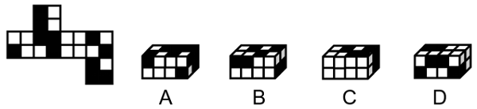
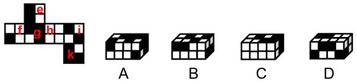
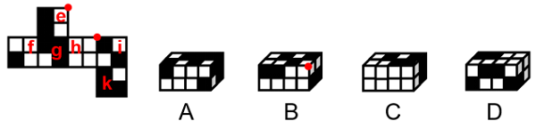

# 空间重构-六面体展开图折叠（相对面排除＋相邻面公共点细节判定）

考点：[[20-考点/判断推理/图形推理/空间重构-六面体展开图折叠（相对面排除＋相邻面公共点细节判定）|图形推理 / 空间重构-六面体展开图折叠（相对面排除＋相邻面公共点细节判定）]]

**问法模型**：题干给出正方体纸盒外表面展开图，问'由2个该正方体组合而成的长方体可能是哪个'→先在展开图上标注各面，再按'相对面不能同时出现＋相邻面公共点与图案细节'对选项逐项验证排除。

## 推理链
1. 第1步：在展开图上标序号为面e、f、g、h、i、k，各面图案含黑色块、白色格等特征，需判断折叠后各面的相邻与相对关系
2. 第2步：运用展开图基本规则——同一正方体中相对面不可能相邻同时出现；相邻三个面的公共点与其面上图案（如面i黑块顶点）的相对位置折叠后固定不变
3. 第3步：验证A项——左侧正方体由面f和面i构成，右侧正方体由面f、面g和面k构成，各面相邻关系与展开图一致，与题干相符
4. 第4步：验证B项——右侧正方体由面e、面h和面i构成；展开图中该三面的公共点与面i上黑块的顶点重合，而选项中三面公共点与面i黑块不相交，细节矛盾，排除
5. 第5步：验证C项——左侧正方体由面f和面h构成，而展开图中面f与面h为相对面，不能同时出现，排除
6. 第6步：验证D项——右侧正方体由面f、面h和面i构成，面f与面h为相对面不能同时出现，排除
7. 第7步：四项中仅A项与展开图的面构成及相邻关系完全一致，故选A

**最快解法**：⚡ 相对面排除法＋公共点检验：先在展开图中标出相对面（如f与h），凡选项中同一正方体同时出现相对面的直接排除（秒杀C、D）；再对剩余项用'相邻三面公共点是否与图案顶点（面i黑块顶点）重合'检验排除B，锁定A。

## 易错点
- ⚠ 相对面判定失误：把'Z'字形两端或隔行错列的f与h误判为相邻面，导致无法排除C、D
- ⚠ B项忽视公共点细节：只看三个面的图案相似就误判可行，漏查'三面公共点与面i黑块顶点重合'这一位置约束
- ⚠ 只核对单面图案、未逐一验证组合后每个可见面之间的相邻关系，遗漏组合体的面归属分析

## 母题抽象
> 🧩 当题干出现'正方体展开图＋折叠/组合后可能的立体图形'特征时，先用相对面法则排除同一立体中同时出现相对面的选项，再用相邻面公共点/公共边与图案细节（顶点重合、图案朝向）验证剩余选项。

**同类特征**：正方体纸盒外表面展开图、2个正方体组合成长方体、黑白图案面、相对面不能同时出现、公共点与黑块顶点重合、选项为双正方体立体图

## 相关题
- [[10-真题/判断推理/图形推理/12019707 空间折叠（六面体折纸盒）——相对面排除＋公共边画边法-公共点引线法|12019707]]（广东 2026，相关度1）
- [[10-真题/判断推理/图形推理/12561915 空间重构-六面体折叠（相对面排除+公共点法）|12561915]]（浙江 2024，相关度1）
- [[10-真题/判断推理/图形推理/16070182 空间重构-六面体展开图折叠（相对面排除＋相邻面数字方向验证）|16070182]]（湖北 2026，相关度1）
- [[10-真题/判断推理/图形推理/1746880 空间重构-六面体折叠（相对面排除+画边法）|1746880]]（国考 2016，相关度1）
- [[10-真题/判断推理/图形推理/1791826 空间重构-六面体折叠（公共点法+相对面排除）|1791826]]（江苏 2016，相关度1）

---

### 题干

左边为给定的正方体纸盒的外表面展开图，由2个该正方体纸盒组合而成的长方体可能是：

### 选项
- A. A　✅
- B. B
- C. C
- D. D

### 官方解析

将原展开图标上序号如下图，逐一进行分析。

A项：选项中左侧正方体纸盒由面f和面i构成，右侧正方体纸盒由面f、面g和面k构成，选项与题干展开图一致，当选；

B项：选项中右侧正方体纸盒由面e、面h和面i构成，题干展开图中三个面的公共点与面i上黑块的顶点重合，而选项中三个面的公共点与面i上的黑块不相交，选项与题干展开图不一致，排除；

C项：选项中左侧正方形纸盒由面f和面h构成，题干展开图中面f和面h为相对面，不能同时出现，选项与题干展开图不一致，排除；

D项：选项中右侧正方形纸盒由面f、面h和面i构成，题干展开图中面f和面h为相对面，不能同时出现，选项与题干展开图不一致，排除。

故正确答案为A。

### 给定材料
（无）
