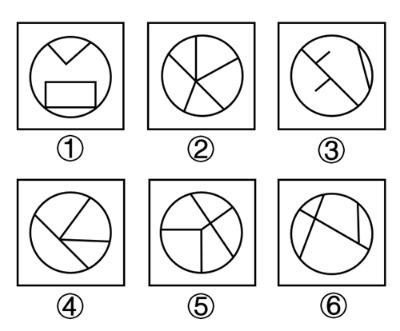

# 数量规律-交点数（内外框交点-框上交点）

考点：[[20-考点/判断推理/图形推理/数量规律-交点数（内外框交点-框上交点）|图形推理 / 数量规律-交点数（内外框交点/框上交点）]]

**问法模型**：六个图形分为两类且每类有共同规律 → 分组分类题：元素组成不同且无属性规律时，转向数量规律（本题锁定'内部线条与圆框的交点数'）

## 推理链
1. 第1步：题干六图元素组成不同，对称、曲直、封闭等属性规律不明显，但每幅图都有圆形外框，且内部线条与外框相交明显（如①中V形两端、矩形角均落在圆上，②呈放射状线条触及圆框）
2. 第2步：锁定计数对象为'框上交点'——只数内部线条与圆形外框的相交点，不数内部线条之间的交叉点
3. 第3步：逐图清点框上交点：图①中V形两端与矩形两角共4个，图③斜线两端与短线端点共4个，图④内部线与圆框相交共4个，故①③④框上交点均为4
4. 第4步：图②放射线条与圆框相交共5个，图⑤内部线与圆框相交共5个，图⑥内部线与圆框相交共5个，故②⑤⑥框上交点均为5
5. 第5步：按框上交点数4与5分成两组：①③④一组，②⑤⑥一组，与选项C完全对应

**最快解法**：⚡ 数量规律-数框上交点法：先确定圆形外框为计数边界，只数内部线条与圆框的接触点（每图1分钟内可数完），得①③④=4、②⑤⑥=5，直接锁定C

## 易错点
- ⚠ 误数内部线条之间的交叉点（内部交点）而非框上交点，导致计数混乱找不到规律
- ⚠ 图①外层还有正方形边框，易误把内含图形与正方形边框的关系纳入计数，忘记只以圆形外框为界
- ⚠ 漏数端点恰好落在圆框上的交点（如①中矩形角、③中短线端点），导致多数或少数一个交点而错分组

## 母题抽象
> 🧩 当题干所有图形均含同一外框（圆/多边形框）且内部线条与外框明显相交、属性规律缺失时，优先数'框上交点数'（内部线与外框的交点）进行分组验证

**同类特征**：圆形外框、内部线条与外框相交明显、元素组成不同、无明显属性规律、分组分类题干、框上交点数呈4/5两组

## 相关题
- [[10-真题/判断推理/图形推理/10204454 数量规律-部分数（黑白球连通区域数做和）|10204454]]（甘肃 2024，相关度2）
- [[10-真题/判断推理/图形推理/10297050 数量规律-特殊计数（线条穿过小白球的数量）|10297050]]（天津 2025，相关度2）
- [[10-真题/判断推理/图形推理/10297262 数量规律-面的形状种类（封闭面种类数分组）|10297262]]（浙江 2025，相关度2）
- [[10-真题/判断推理/图形推理/10297314 数量规律-交点数（曲直交点）|10297314]]（浙江 2025，相关度2）
- [[10-真题/判断推理/图形推理/11454020 数量规律-小元素按行排布（每行个数自上而下递增1）|11454020]]（选调 2024，相关度2）

---

### 题干

把下面的六个图形分为两类，使每一类图形都有各自的共同特征或规律，分类正确的一项是：

### 选项
- A. ①④⑥，②③⑤
- B. ①②③，④⑤⑥
- C. ①③④，②⑤⑥　✅
- D. ①③⑥，②④⑤

### 官方解析
本题为分组分类题目。元素组成不同，且无明显属性规律，考虑数量规律。观察发现，题干每幅图线条交叉明显，且都有圆形外框，内部线条与外框有明显相交，考虑数框上交点，图①③④框上交点数为4，图②⑤⑥框上交点数为5，即图①③④为一组，图②⑤⑥为一组。
故正确答案为C。

### 给定材料
（无）
