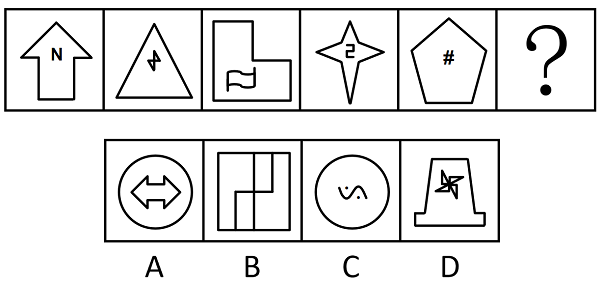

# 属性规律-对称性（内外分开看：外框仅轴对称+内部仅中心对称）

考点：[[20-考点/判断推理/图形推理/属性规律-对称性（内外分开看：外框仅轴对称+内部仅中心对称）|图形推理 / 属性规律-对称性（内外分开看：外框仅轴对称+内部仅中心对称）]]

**问法模型**：填入问号处使之呈现一定规律性 → 元素组成不同优先看属性规律，且图形均由内外两部分构成，采用'内外分开看'分别判定对称类型

## 推理链
1. 第1步：题干五图元素组成不同，且每幅图均由'外框+内部小元素'两部分构成（如箭头内含N、三角形内含闪电、五边形内含#），考虑内外分开看
2. 第2步：分析外框对称性——箭头、三角形、L形、四角星、五边形均只有对称轴、旋转180°不能与自身重合，即外框均为仅轴对称图形
3. 第3步：分析内部元素——N、闪电、旗帜、字符、#等旋转180°后与自身重合但无对称轴，即内部均为仅中心对称图形
4. 第4步：归纳规律：？处应选'外框仅轴对称+内部仅中心对称'的图形
5. 第5步：对照选项——A外框为圆（既轴对称又中心对称）、B外框为正方形（既轴对称又中心对称）、C外框为圆（既轴对称又中心对称），均不满足'外框仅轴对称'，排除
6. 第6步：D项外框为杯状图形仅轴对称，内部风车状元素仅中心对称，完全符合规律，故选D

**最快解法**：⚡ 内外分开看+排除法：先只看外框对称性，A/B/C的外框（圆、正方形、圆）都是'既轴对称又中心对称'，与题干'仅轴对称外框'不符，一步排除三项；再验证D外框仅轴对称、内部风车仅中心对称，锁定D

## 易错点
- ⚠ 只看图形整体对称性，发现每幅图整体既非纯轴对称也非纯中心对称，误判'无规律'而错看数量或位置规律
- ⚠ 忽略'仅'字：误认为外框只要轴对称即可，把外框为圆/正方形的A、C也当作符合，'仅轴对称'须排除既是轴对称又是中心对称的图形
- ⚠ 内部小字符对称性误判：如把N、#误认为有对称轴（它们只有中心对称），导致内部规律提炼错误

## 母题抽象
> 🧩 当题干每幅图都由'外框+内部小元素'构成且整体看不出统一规律时，用'内外分开看'，分别判定外框与内部的对称类型组合（本题规律为外框仅轴对称+内部仅中心对称），再逐项排除

**同类特征**：内外两部分结构、元素组成不同、外框均为仅轴对称图形、内部均为仅中心对称图形、N、#、字符等小元素、选项外框含圆和正方形等双重对称图形

## 相关题
- [[10-真题/判断推理/图形推理/10204454 数量规律-部分数（黑白球连通区域数做和）|10204454]]（甘肃 2024，相关度1）
- [[10-真题/判断推理/图形推理/10204604 数量规律-线数量（汉字横线数）|10204604]]（辽宁 2024，相关度1）
- [[10-真题/判断推理/图形推理/10297050 数量规律-特殊计数（线条穿过小白球的数量）|10297050]]（天津 2025，相关度1）
- [[10-真题/判断推理/图形推理/10297127 图形间关系-相交图形中不相交边数量（黑白图形相交）|10297127]]（天津 2025，相关度1）
- [[10-真题/判断推理/图形推理/10297148 数量规律-线的细化（端点连线穿过线条数；备选：平行线组数）|10297148]]（天津 2025，相关度1）

---

### 题干

从所给的四个选项中，选择最合适的一个填入问号处，使之呈现一定的规律性：

### 选项
- A. A
- B. B
- C. C
- D. D　✅

### 官方解析
元素组成不同，优先考虑属性规律。观察发现，题干图形均分为内外两部分，可以考虑内外分开看。题干图形的外框均为仅轴对称图形，内部均为仅中心对称图形，故？处也应选择一个外框为仅轴对称图形，内部为仅中心对称图形的选项，只有D项符合。
故正确答案为D。

### 给定材料
（无）
