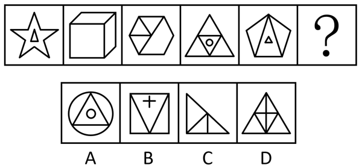

# 属性规律（轴对称）+数量规律（笔画数-两笔画）

考点：[[20-考点/判断推理/图形推理/属性规律（轴对称）+数量规律（笔画数-两笔画）|图形推理 / 属性规律（轴对称）+数量规律（笔画数-两笔画）]]

**问法模型**：问号处填入最合适图形使之呈现规律性 → 元素组成不同时，按'属性（对称性）初筛→数量（笔画数）二级辨析'的分层筛选模型

## 推理链
1. 第1步：题干五图元素组成不同（五角星、正方体、六边形'田'字变形、三角形嵌套、五边形嵌套），且均含明显等腰元素，优先考虑属性规律
2. 第2步：先看对称性——题干五图均为轴对称图形，故问号处也应为轴对称图形
3. 第3步：逐项对照对称性：A（圆+内接三角形+小圆）、B（正方形+V+十字）、D（三角形分割）均轴对称，C（直角三角形加内部线条）非轴对称，排除C
4. 第4步：属性筛后答案仍不唯一，进行二级辨析——数笔画（奇点数÷2）：图1五角星（0个奇点，1笔）+内部三角形（1笔）=2笔
5. 第5步：图2正方体（4个奇点）、图3'田'字变形六边形、图4大三角形与小三角形内接连通计1笔加独立小圆1笔、图5五边形与三角形连通计1笔加独立小三角形1笔，题干均为两笔画图形
6. 第6步：对照剩余选项数笔画：B外框1笔+十字2笔+V与外框连通1笔≥3笔，D内部线条交叉、奇点数超过4个为多笔画，排除B、D
7. 第7步：A项外圆与内接三角形各交点度数为偶数、连通计1笔，加内部独立小圆1笔共2笔，与题干'轴对称+两笔画'规律一致，故选A

**最快解法**：⚡ 两步排除法：先按'轴对称'排除C，再按'两笔画（奇点数÷2=笔画数）'排除含十字/交叉线条的B、D，唯一两笔画的A即答案

## 易错点
- ⚠ 只做对称性一级筛选就作答，忽略二级笔画数辨析，误选同为轴对称的B或D
- ⚠ 内接图形笔画数数错：把A项'圆+内接三角形+小圆'误数成3笔，忽略内接顶点处度数为偶、外圆与三角形连通合并只算1笔
- ⚠ 对图4、图5这类嵌套图形，把每个小图形机械累加成3笔，漏算'内接触点连通合并笔画'导致规律判断错误

## 母题抽象
> 🧩 当图形元素组成不同且出现五角星、等腰、嵌套结构时，先用对称性等属性规律初筛，再用'奇点数÷2=笔画数'做二级辨析，注意内接、相切会使两部分连通合并笔画

**同类特征**：元素组成不同、等腰/轴对称元素明显、五角星、田字变形/多面体轮廓、嵌套图形（大图套小图）、两笔画规律

## 相关题
- [[10-真题/判断推理/图形推理/2172360 数量规律-笔画数（奇点数法，两笔画规律）|2172360]]（江苏 2018，相关度2）
- [[10-真题/判断推理/图形推理/2262791 数量规律-笔画数（奇点法判定一笔画-两笔画）|2262791]]（天津 2016，相关度2）
- [[10-真题/判断推理/图形推理/2387642 数量规律-笔画数（一笔画-奇点数）|2387642]]（浙江 2019，相关度2）
- [[10-真题/判断推理/图形推理/2631957 图形推理-数量规律-笔画数（一笔画-奇点数）|2631957]]（天津 2017，相关度2）
- [[10-真题/判断推理/图形推理/2631962 属性规律-对称性（轴对称与中心对称隔项交替）|2631962]]（天津 2017，相关度2）

---

### 题干

从所给的四个选项中，选择最合适的一个填入问号处，使之呈现一定的规律性：

### 选项
- A. A　✅
- B. B
- C. C
- D. D

### 官方解析
元素组成不同，优先考虑属性规律。观察发现，题干出现多个等腰元素，考虑对称性。题干图形均为轴对称图形，故？处也应为轴对称图形，排除C项。继续观察发现，图1出现五角星，图2和图3为“田”字变形图，考虑笔画数。题干图形均为两笔画图形，故？处也应为两笔画图形，只有A项符合。
故正确答案为A。

### 给定材料
（无）
