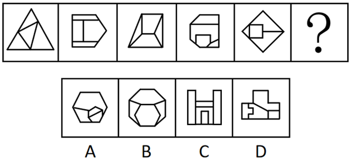

# 数量规律-面数量+细化规律（面的形状与外框轮廓相似）

考点：[[20-考点/判断推理/图形推理/数量规律-面数量+细化规律（面的形状与外框轮廓相似）|图形推理 / 数量规律-面数量+细化规律（面的形状与外框轮廓相似）]]

**问法模型**：问号处选最合适图形呈现规律 → 元素组成不同先看属性，属性无规律转数量（面数量），数量留多选时再找'面与外框相似'的二阶细化规律

## 推理链
1. 第1步：题干五幅图元素组成不同（三角形、多边形组合各不相同），且对称、曲直等属性规律不明显，而各图封闭区域特征突出
2. 第2步：优先数面数量：逐一计数，图1至图5的封闭面数量均为4个
3. 第3步：与选项对照面数量：C项（H形图）面数量为5，与题干不符，排除C项
4. 第4步：A、B、D面数量均符合4个，单一面数量规律无法唯一确定答案，需继续寻找二阶细化规律
5. 第5步：观察题干内外形状关系：每幅图中均存在一个面的形状与外框轮廓形状相似（如图1内部小三角形与外框三角形相似、图5内部方形与外框菱形轮廓相似）
6. 第6步：逐项验证细化规律：仅D项中存在一个面与外框轮廓形状相似，A、B项内部被分割后的各面均与外框轮廓不相似，故选D

**最快解法**：⚡ 数面法+相似验证两步走：第一遍快速数面排除C（5个面）；第二遍只看'内部是否有一个面与外框轮廓长得像'，扫一眼A、B、D，仅D内外形状相似，直接锁定

## 易错点
- ⚠ 只做到数面就停：A、B、D面数均为4，单靠面数量无法排除，必须继续找细化规律，否则会在剩余三项中乱选
- ⚠ 忽略'面与外框轮廓相似'这一细化考点，被B项'内外多层'的表象迷惑——B内部面被线条分割，并无单一面与外框相似
- ⚠ 面数量数错：把被内部线条分割后的复合区域当一整面漏数，或将非封闭线条误计为面

## 母题抽象
> 🧩 当题干图形元素组成不同、封闭面明显时，先数面数量做一级排除；若剩余多个选项面数相同，再验证'某面与外框轮廓相似/最大面/面的形状'等二阶细化规律锁定答案

**同类特征**：元素组成不同、封闭面明显、面数量相同（均为4）、内外图形形状相似、外框轮廓与内部面呼应、数量规律叠加细化考点

## 相关题
- [[10-真题/判断推理/图形推理/10297262 数量规律-面的形状种类（封闭面种类数分组）|10297262]]（浙江 2025，相关度2）
- [[10-真题/判断推理/图形推理/11367791 属性类-对称性（对称轴方向与条数、轴对称+中心对称）＋数量类-面数量（九宫格横行复合规律）|11367791]]（江苏 2025，相关度2）
- [[10-真题/判断推理/图形推理/2367935 数量规律-面数量（细分：三角形面个数递增）|2367935]]（江苏 2019，相关度2）
- [[10-真题/判断推理/图形推理/2376468 数量规律-面数量（封闭区域数等差递增）|2376468]]（重庆 2019，相关度2）
- [[10-真题/判断推理/图形推理/2402399 数量规律-面数量（封闭区域数等差递增）|2402399]]（重庆 2018，相关度2）

---

### 题干

从所给的四个选项中，选择最合适的一个填入问号处，使之呈现一定的规律性：

### 选项
- A. A
- B. B
- C. C
- D. D　✅

### 官方解析
元素组成不同，且无明显属性规律，考虑数量规律。观察发现，题干图形封闭面明显，优先考虑面数量。题干图形的面数量均为4，C项面数量为5，排除C项。继续观察发现，题干每幅图中均有一个面的形状与外框轮廓形状相似，只有D项符合。
故正确答案为D。

### 给定材料
（无）
