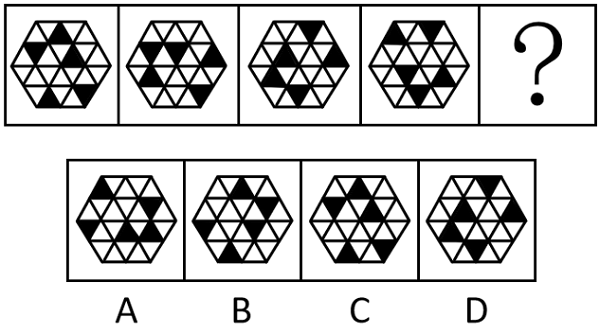
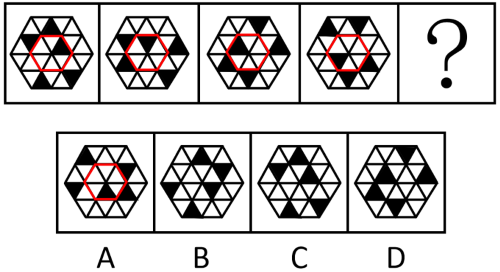

# 位置规律-平移（内外圈分组移动）

考点：[[20-考点/判断推理/图形推理/位置规律-平移（内外圈分组移动）|图形推理 / 位置规律-平移（内外圈分组移动）]]

**问法模型**：题干为'选最合适的一个填入问号使之呈现规律性'→ 元素组成相同时采用位置规律模型，内外分层结构则分圈追踪移动轨迹

## 推理链
1. 第1步：题干五幅图均为同一六边形三角网格，黑三角形数量逐图相同，元素组成相同，位置规律优先
2. 第2步：整体看黑三角形无统一移动规律，但内圈黑色三角形数量每幅图均相同，提示'内外圈分开看'
3. 第3步：追踪内圈——黑色三角形依次沿内圈逆时针移动一格，步长恒定
4. 第4步：追踪外圈——四个黑色三角形依次沿外圈逆时针移动三格，步长恒定
5. 第5步：按此规律推演问号处：内圈黑三角形再逆时针移一格，外圈四个黑三角形再逆时针移三格，得出目标位置
6. 第6步：逐项对照，仅A项内外圈黑三角形位置均与推演结果吻合，B、C、D均不符

**最快解法**：⚡ 分圈追踪法+排除法：黑三角形数量相同→内外圈分开数格；内圈逆时针1格、外圈逆时针3格，直接推演问号处位置并排除不符选项

## 易错点
- ⚠ 整体找不出统一规律时未想到'内外分开看'，误判为无规律或数量规律
- ⚠ 数格时方向搞反（逆时针/顺时针混淆）或步长数错（内圈1格、外圈3格），三角网格计数易乱
- ⚠ 忽略黑三角形数量恒定这一位置规律的前置信号，误入样式或数量规律误区

## 母题抽象
> 🧩 当题干图形元素组成相同、黑块分布在明显分层（内外圈/内外环）结构中且整体无统一轨迹时，用'分圈分别追踪移动方向与步长'的方法，验证各圈规律恒定后推演问号处

**同类特征**：元素组成相同、黑三角形数量恒定、内外圈分层网格、位置变化而非样式变化、问号处求下一状态、各圈移动步长不同

## 相关题
- [[10-真题/判断推理/图形推理/16593031 位置规律-平移（内外圈分组移动）|16593031]]（青海 2024，相关度3）
- [[10-真题/判断推理/图形推理/2295526 图形推理-位置规律（平移-内外圈分块追踪）|2295526]]（上海 2019，相关度2）
- [[10-真题/判断推理/图形推理/4651788 位置规律-平移（外圈顺时针循环移动，双元素同速同向）|4651788]]（江苏 2022，相关度2）
- [[10-真题/判断推理/图形推理/2172768 位置规律（旋转-翻转）|2172768]]（海南 2021，相关度1）
- [[10-真题/判断推理/图形推理/10204458 位置规律-平移（特征交点沿内圈循环平移）|10204458]]（甘肃 2024，相关度1）

---

### 题干

从所给的四个选项中，选择最合适的一个填入问号处，使之呈现一定的规律性：

### 选项
- A. A　✅
- B. B
- C. C
- D. D

### 官方解析

元素组成相同，优先考虑位置规律。观察发现，题干图形内圈的黑色三角形数量均相同，故考虑内外分开看。如下图所示，题干图形内圈的黑色三角形依次沿内圈逆时针移动一格，外圈四个黑色三角形依次沿外圈逆时针移动三格，只有A项符合。

故正确答案为A。

### 给定材料
（无）
