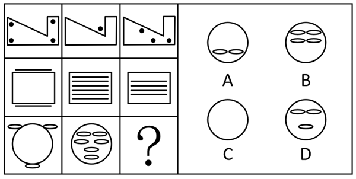

# 数量规律-小元素数量运算（框内外分布）

考点：[[20-考点/判断推理/图形推理/数量规律-小元素数量运算（框内外分布）|图形推理 / 数量规律-小元素数量运算（框内外分布）]]

**问法模型**：九宫格'填入问号处呈现规律性'→ 按行观察，对相同外框内外的同类小元素做数量差运算规律

## 推理链
1. 第1步：每行三图外框相同（第一行折角多边形、第二行矩形、第三行圆形），框内外散布同类小元素（黑点/横线/小椭圆），元素组成不同且无属性规律，考虑数量规律
2. 第2步：观察发现运算规律：每行中两图'内部'小元素数量之差=另一图'外部'小元素数量
3. 第3步：第一行验证：图1内部黑点4个、图3内部黑点3个，差值4-3=1=图2外部黑点1个
4. 第4步：第二行验证：图2内部横线6条、图3内部横线4条，差值6-4=2=图1外部横线2条（图1的横线均在框外上下）
5. 第5步：第三行套用：图1外部小椭圆3个（上方两侧各1个、下方1个），图2内部小椭圆6个，故'？'处内部小椭圆应为6-3=3个
6. 第6步：逐项对照：A内部仅1个、B内部4个、C内部0个、D内部3个（上2下1），只有D满足

**最快解法**：⚡ 数量运算排除法——先在第一、二行验证'两图内部数量差=第三图外部数量'，第三行直接用图2内部6个减图1外部3个得3个，秒选内部含3个小椭圆的D

## 易错点
- ⚠ 只数小元素总数、不区分框内外分布，发现不了'内部差=外部'的运算规律
- ⚠ 第三行图2内部小椭圆排列密集（呈三行分布），易数漏或数重，误算出其他数字
- ⚠ 误以为每行固定用'图1图2差=图3'的同一位置模式，实际'外部'所在图逐行变化，需先在验证行确定谁是外部图

## 母题抽象
> 🧩 当九宫格每行图形共享相同外框且框内外散布同类小元素时，按行数'框内'数量，验证'两图内部数量之差=另一图外部数量'，再反推问号处图形的内部数量选答案

**同类特征**：九宫格按行规律、每行外框相同、框内外均有同类小元素、小元素：黑点/横线/小椭圆、数量规律（差值运算）、元素组成不同无属性规律

## 相关题
- [[10-真题/判断推理/图形推理/2033320 数量规律-笔画数（奇点法）|2033320]]（河南 2016，相关度1）
- [[10-真题/判断推理/图形推理/2274542 数量规律-面数量及面的形状（全三角形面-全四边形面）|2274542]]（北京 2019，相关度1）
- [[10-真题/判断推理/图形推理/2376945 数量规律-笔画数（奇点计数）|2376945]]（选调 2019，相关度1）
- [[10-真题/判断推理/图形推理/2731714 数量规律-笔画数（多笔画按行递增）|2731714]]（深圳市考 2020，相关度1）
- [[10-真题/判断推理/图形推理/3523526 数量规律-面（封闭区域）个数|3523526]]（甘肃 2021，相关度1）

---

### 题干

从所给的四个选项中，选择最合适的一个填入问号处，使之呈现一定的规律性：

### 选项
- A. A
- B. B
- C. C
- D. D　✅

### 官方解析
元素组成不同，且无明显属性规律，考虑数量规律。题干图形每行都存在相同外框，且框的内外都存在数量不等的相同小元素，观察发现，相同小元素的数量存在规律，即每行中内部小元素的数量差=外部小元素的数量，第一行中，图1和图3内部黑点的数量差（4-3）=图2外部黑点的数量；第二行中，图2和图3内部横线的数量差（6-4）=图1外部横线的数量；为满足此规律，第三行“？”处图形内部小椭圆的数量应为3，只有D项满足。
故正确答案为D。

### 给定材料
（无）
